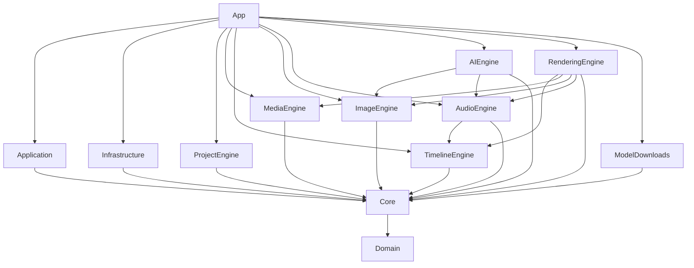

# Documentação técnica — Meu Editor de Vídeo

Documento para quem vai manter o projeto (entregáveis ENT016, RNF018 e CA023). Descreve o que o **código** faz hoje. Quando o plano ou a especificação previam outra tecnologia, a diferença está na seção [Diferenças em relação ao plano](#diferenças-em-relação-ao-plano).

Documentos complementares, que não são repetidos aqui:

- [DEPENDENCIAS.md](DEPENDENCIAS.md): pacotes NuGet, binários nativos e licenças.
- [MODELOS_IA.md](MODELOS_IA.md): catálogo, pacotes `.medmodel` e comportamento dos recursos de IA.
- [DESEMPENHO.md](DESEMPENHO.md): detecção de hardware, ajuste automático e tela de configurações.
- [INSTALADOR.md](INSTALADOR.md): MSI, Setup.exe, instalação silenciosa e assinatura de código.
- [MANUAL_DO_USUARIO.md](MANUAL_DO_USUARIO.md): uso do aplicativo (não é técnico).

---

## Visão geral

O **Meu Editor de Vídeo** é um editor de vídeo não linear para Windows, com interface em português do Brasil. Ele faz edição em múltiplas trilhas, pré-visualização, exportação, textos, composição 2,5D, áudio e recursos de IA.

Características fundamentais:

| Item | Valor no código |
|---|---|
| Runtime | .NET 10 (`net10.0` e `net10.0-windows`), `LangVersion latest`, `Nullable enable`, `TreatWarningsAsErrors` (`Directory.Build.props`) |
| Interface | WPF (`UseWPF`) com MVVM via CommunityToolkit.Mvvm 8.4.2 (`ObservableProperty`, `RelayCommand`) |
| Injeção de dependências | Microsoft.Extensions.Hosting 10.0.14 (`Host.CreateDefaultBuilder` em `src/MeuEditorDeVideo.App/App.xaml.cs`) |
| Mídia | FFmpeg 9.0.2 (build `full_build shared`, GPL) acessado por FFmpeg.AutoGen 9.0.1.1 |
| IA local | ONNX Runtime 1.24.4 com DirectML e CPU; Whisper.net 1.9.1 (whisper.cpp) |
| Áudio | NAudio.Wasapi 2.2.1 (saída) e DSP próprio em `src/MeuEditorDeVideo.AudioEngine/Dsp` |
| Visão computacional | OpenCvSharp4 4.13 |
| Logs | Serilog (arquivo rotativo local) |
| Licença | GPL-3.0-or-later (`LICENSE`; `Directory.Build.props`, `Copyright`) |
| Plataforma alvo | Windows 11 x64 (`RuntimeIdentifier win-x64` no App) |
| Processamento | 100% local. O único código com rede é o downloader de modelos (ver [Privacidade e segurança](#privacidade-e-segurança)) |

Versão atual: `1.0.0` (`<Version>` em `Directory.Build.props`).

---

## Arquitetura

### Camadas e projetos

A solução (`MeuEditorDeVideo.sln`) tem 13 projetos em `src/`, 3 projetos de teste em `tests/` e o instalador em `installer/`.

| Camada | Projeto | Responsabilidade |
|---|---|---|
| Núcleo do modelo | `Domain` | Entidades imutáveis (projeto, sequência, trilha, clipe), tempo racional, comandos de edição e histórico. Sem dependências de pacote. |
| Contratos | `Core` | Interfaces, enums, DTOs e erros (`MedError`) usados por todas as outras camadas. Depende só de `Domain`. |
| Aplicação | `Application` | Casos de uso: projeto (abrir, salvar, recuperar), importação de mídia, fila de renderização, salvamento automático e avaliação de desempenho. Não conhece motores nem UI. |
| Infraestrutura | `Infrastructure` | Caminhos, configurações JSON, logs (Serilog), manutenção de cache, detecção de hardware e biblioteca de modelos de exportação. |
| Motores | `ProjectEngine` | Formato `.med` (leitura, gravação atômica, migrações), autosave e localização de mídias. |
| Motores | `TimelineEngine` | Avaliação da timeline em um instante (quais camadas aparecem e com qual transformação) e encaixe (snap). |
| Motores | `MediaEngine` | FFmpeg: sondagem, decodificação, miniaturas, formas de onda, proxies, codificação e SVG. |
| Motores | `ImageEngine` | Efeitos por quadro, LUT, máscaras, texto, rastreamento e refino de bordas. |
| Motores | `AudioEngine` | Mixagem, DSP, análise de loudness e saída WASAPI. |
| Motores | `AIEngine` | Registro de modelos, pacotes `.medmodel`, sessões ONNX, segmentação, fala, cenas e melhoria de imagem. |
| Motores | `RenderingEngine` | Compositor, pré-visualização e exportação (motor de renderização). |
| Rede (isolado) | `ModelDownloads` | Único assembly com HTTP. Usado só pela ferramenta "Baixar modelos de IA". |
| Apresentação | `App` | WPF: janelas, view models, controles, atalhos, composição (DI) e tratamento global de exceções. |

### Grafo de dependências (referências de projeto)



Os testes referenciam `App` (`UnitTests`, `MediaTests`, `IntegrationTests`).

Observações sobre o grafo:

- `Domain` não tem nenhum `PackageReference`.
- `Application` não referencia nenhum motor. Ele só enxerga as interfaces de `Core`. A ligação com as implementações é feita apenas em `App`.
- `Infrastructure` não referencia `MediaEngine`. A detecção de hardware recebe como delegates o resumo dos codificadores e o teste de decodificação D3D11VA, que `App` passa na composição (ver `App.xaml.cs`, `IHardwareInfoService`).
- `ImageEngine` usa WPF (`UseWPF`) para rasterizar texto (`src/MeuEditorDeVideo.ImageEngine/Text/TextRasterizer.cs`). Motores podem usar WPF; `Core` e `Domain` não podem.

### Regras impostas por testes de arquitetura

Os testes em `tests/MeuEditorDeVideo.UnitTests/Architecture/` (NetArchTest.Rules) verificam as regras abaixo. Se uma regra precisar mudar, mude o teste junto e justifique no PR.

**`LayeringTests.cs`**

- `Domain` não depende de `Core`, `Application`, `Infrastructure`, `App`, `System.Windows` nem `Microsoft.Extensions`.
- `Core` não depende de `Application`, `Infrastructure`, `App` nem `System.Windows`.
- `Application` não depende de nenhum motor (`ProjectEngine`, `MediaEngine`, `TimelineEngine`, `ImageEngine`, `AudioEngine`, `AIEngine`, `RenderingEngine`), nem de `Infrastructure`, `App` ou `System.Windows`.
- Motores e `Infrastructure` não dependem de `App` nem de `Application`.

**`PrivacyTests.cs`** (RF169, RNF005, CA016)

- Nenhum assembly do produto usa `System.Net.Http`, `System.Net.Sockets`, `System.Net.WebSockets`, `System.Net.WebClient`, `System.Net.HttpWebRequest` ou `System.Net.Mail`.
- Nenhum assembly do produto referencia `System.Net.Http`, `System.Net.Sockets` ou `System.Net.WebSockets.Client`.
- `ModelDownloads` é a exceção documentada. Ele só pode referenciar `MeuEditorDeVideo.Core` entre os projetos do produto, e só pode usar HTTP (sem sockets, WebSockets, e-mail ou `WebClient`). O teste também garante que `ModelDownloads` não está na lista de assemblies "normais".

Para incluir um novo projeto de produto nas regras, adicione-o à lista `ProductAssemblies` e, se ele tiver regras de camada, a `LayeringTests`.

---

## Composição e ciclo de vida

A composição fica em `src/MeuEditorDeVideo.App/App.xaml.cs`. Não há contêiner fora dessa classe. Cada motor expõe um método de extensão `Add...` que `App.ConfigureServices` chama.

### Sequência de inicialização (`OnStartup`)

1. **Cultura pt-BR** (`ApplyPortugueseCulture`): define `CultureInfo` padrão das threads, `Thread.CurrentThread` e `FrameworkElement.LanguageProperty`.
2. **Caminhos** (`new AppPaths()`) e pasta de fontes do usuário em `ImageEngine.Text.FontCatalog.UserFontsFolder`.
3. **Host** (`Host.CreateDefaultBuilder`):
   - `UseMeuEditorInfrastructure(paths)` cria as pastas (`AppPaths.EnsureCreated`), configura o Serilog e registra `IAppPaths`, `ISettingsService` (`JsonSettingsService`) e `IExportTemplateStore`.
   - `ConfigureServices` registra os demais serviços (lista na próxima subseção).
   - Os argumentos da linha de comando não entram no host.
4. **Tratamento global de exceções** (`RegisterGlobalExceptionHandlers`, RNF010): ver a subseção própria.
5. `_host.StartAsync()`.
6. Log de início com `AppInfo.Version`.
7. `IThemeService.Apply(settings.Theme)`.
8. Cria e mostra `MainWindow`, navega para `HomeViewModel`.
9. `AutosaveScheduler.Start()`.
10. `IRenderQueueService.InitializeAsync()`: lê `render-queue\queue.json`. Trabalhos que estavam `Running` viram `Interrupted`, e a fila é salva de novo.
11. `StartBackgroundMaintenance`, em `Task.Run` (não bloqueia a UI):
    - `IHardwareInfoService.Get()` detecta CPU, memória, GPUs, discos e codificadores (`EncoderCatalog.HardwareSummary` testa cada codificador; pode levar alguns segundos).
    - `ICacheMaintenance.Trim(limite)` reduz o cache ao limite de `PreviewCacheGigabytes` (mínimo 1 GB).
12. Projeto inicial:
    - Se houver um argumento `.med` existente (associação de arquivo, `StartupArguments.ProjectPath`), esse projeto é aberto.
    - Caso contrário, se `OpenLastProjectOnStartup` estiver ligado e existir um projeto recente, abre o primeiro da lista.
    - Falhas na abertura são registradas em log e não impedem a interface.

### Encerramento (`OnExit`)

1. `AutosaveScheduler.DisposeAsync()` (cancela o loop).
2. `IProjectService.CloseAsync()`: encerra a sessão de autosave do projeto atual (apaga a pasta de autosave).
3. `_host.StopAsync(5 s)` e `Dispose`.

Ao fechar a janela, `MainWindow.OnClosing` pergunta sobre alterações não salvas (`ProjectWorkflow.ConfirmDiscardOrSaveAsync`). Se o usuário escolher "Não", as alterações não salvas são descartadas junto com o autosave.

### Registro de serviços

| Método de extensão | Registra (principais) |
|---|---|
| `UseMeuEditorInfrastructure` (Infrastructure) | `IAppPaths`, `ISettingsService` → `JsonSettingsService`, `IExportTemplateStore` → `JsonExportTemplateStore`, Serilog |
| `AddProjectEngine` (ProjectEngine) | `IProjectStore` → `MedProjectStore`, `IMediaLocator` → `MediaLocator`, `IAutosaveStore` → `AutosaveStore`, `IDomainJson` → `Format.DomainJson` |
| `AddMediaEngine` (MediaEngine) | `MediaCache`, `IMediaProbe`, `IThumbnailProvider`, `IWaveformProvider`, `IProxyService` → `ProxyService`, `IVideoFrameSourceFactory`, `IAudioSampleSourceFactory` |
| `AddPreviewEngine` (RenderingEngine) | `AddAudioEngine` (`IAudioAnalysisService`), `ICompositor` → `CpuCompositor`, `IAudioOutputFactory`, `PreviewEngine` (transient), `IRenderEngine` → `RenderEngine` |
| `AddMeuEditorApplication` (Application) | `IProjectService` → `ProjectService`, `AutosaveScheduler`, `IMediaImportService`, `IRenderQueueService` → `RenderQueueService` |
| `AddAiEngine` (AIEngine) | `IModelRegistry` → `ModelRegistry`, `OnnxSessionFactory`, `MatteCache`, `ISegmentationService`, `IAiFrameProcessor`, `ISceneDetectionService`, `IImageEnhancementService`, `IVoiceActivityService`, `IVoiceEnhancementService`, `ISpeechRecognitionService` → `WhisperTranscriber` |
| `AddModelDownloads` (ModelDownloads) | `IModelDownloader` → `HttpModelDownloader`, recebendo `ModelCatalog.AllowedHosts` |
| `App.ConfigureServices` | `CatalogModelInstaller`, `IThemeService`, `INavigationService`, `IDialogService`, `IProjectWorkflow`, view models, `MainWindow`, `ShortcutService`, `ICacheMaintenance`, `IHardwareInfoService` |

`ImageEngine` e `TimelineEngine` não têm método `Add...`. Os motores que os usam recebem as classes diretamente.

### Tratamento global de exceções (RNF010)

`RegisterGlobalExceptionHandlers` em `App.xaml.cs`:

- `DispatcherUnhandledException`: registra no log, mostra a mensagem pelo `IDialogService` e marca como tratada. Se a exceção for `MedException`, usa o `MedError` dela. Caso contrário, usa `MedError.Unexpected` (código `MED-0000`, mensagem genérica em pt-BR).
- `AppDomain.CurrentDomain.UnhandledException`: registra como crítica.
- `TaskScheduler.UnobservedTaskException`: registra e marca como observada.

Mensagens de erro são `MedError(Code, Message, Cause)` (`src/MeuEditorDeVideo.Core/Errors/MedError.cs`). Os códigos ficam em `src/MeuEditorDeVideo.Core/Errors/MedErrors.cs`, com faixas: `MED-0000` (inesperado), `MED-1001` a `MED-1011` (arquivo de projeto), `MED-1101` a `MED-1103` (operações do projeto), `MED-3xxx` (exportação e renderização). Mensagens nunca devem conter conteúdo audiovisual.

---

## Domínio e modelo de edição

Projeto: `src/MeuEditorDeVideo.Domain`.

### Tempo

- `MediaTime` (`Domain/Time/MediaTime.cs`) é um `long` em **flicks**: 1 segundo = 705.600.000 ticks. Essa base divide exatamente as taxas comuns (23,976 / 24 / 25 / 29,97 / 30 / 50 / 59,94 / 60 FPS) e as taxas de áudio 44,1 / 48 / 96 kHz. Tempos do modelo nunca são `double`. Conversões aproximadas (`FromSecondsApprox`) são só para entrada do usuário.
- `FrameRate` (`Domain/Time/FrameRate.cs`): numerador e denominador normalizados (30000/1001 para 29,97).
- `Rational` (`Domain/Time/Rational.cs`): velocidade do clipe (ex.: 1/2 = câmera lenta de 50%).
- `Timecode`: formatação e interpretação de tempo para a interface.

### Entidades principais

Todas são `record`s imutáveis:

- `Project` (`Domain/Model/Project.cs`): `Id`, `Name`, `Settings` (`ProjectSettings`: resolução, FPS, cor etc.), `StorageMode` (`Linked` ou `Packaged`), `Media` (lista de `MediaAsset`), `Sequences` (a primeira é a principal), datas de criação e alteração.
- `MediaAsset` (`Domain/Model/MediaAsset.cs`): tipo (`Video`, `Audio`, `Image`, `ImageSequence`, `AnimatedGif`), caminho original, caminho relativo, `PackagedEntry`, tamanho, data de escrita, impressão digital, duração, dimensões, FPS e metadados técnicos.
- `Sequence`, `Track`, `Clip`, `Marker` (`Domain/Model/Timeline.cs`). `Clip` tem `Transform` (posição, escala, rotação 2D e 3D, recorte, profundidade), `Effects` (`EffectInstance`), `Keyframes` (propriedade → lista de `Keyframe`), `Masks`, `Trackers`, `Stabilization` e `Transitions` (`Domain/Model/Visual.cs`, `Composition.cs`).
- `Text` (`Domain/Model/Text.cs`): estilo, formato e animação de texto.

### Comandos e histórico

- `IEditCommand` (`src/MeuEditorDeVideo.Domain/Editing/EditHistory.cs`): `Description` (pt-BR, aparece no histórico), `MergeKey` opcional e `Project Apply(Project)`. O comando devolve um estado novo e nunca altera o original.
- Operações de regra de negócio lançam `EditRejectedException` com mensagem para o usuário.
- Comandos ficam em `Domain/Editing/`: `TimelineCommands.cs` (mover, aparar, dividir, remover, colar, velocidade, agrupar), `VisualCommands.cs` (atualizar clipe, congelar quadro, repetir, transições), `ProjectCommands.cs` (mídia, trilhas, marcadores, relocalização), `TextCommands.cs`, `AudioCommands.cs`, `AiCommands.cs`. `CompositeCommand` agrupa vários comandos em uma só ação de desfazer.
- `EditHistory` guarda os estados completos (estrutura compartilhada, então o custo é pequeno). Capacidade padrão: 500. Comandos consecutivos com o mesmo `MergeKey` dentro de 1,5 s viram uma única entrada (por exemplo, arrastar um controle deslizante). Ele rastreia o estado salvo (`MarkSaved`) para saber se há alterações. Não é thread-safe; use só a thread da UI.

### Efeitos e catálogo

`src/MeuEditorDeVideo.Domain/Effects/EffectCatalog.cs` define as 25 constantes de tipo (`color.adjust`, `fx.blur`, `key.chroma`, `audio.eq`, `ai.background` etc.), agrupadas em `EffectCategory` (`Color`, `Stylize`, `Key`, `Audio`, `Ai`). Cada `EffectDefinition` lista `EffectParameter`s (tipo, faixa, padrão e unidade). A interface gera os painéis a partir desse catálogo.

O tipo do efeito é gravado no `.med`. **Nunca renomeie um tipo existente.**

### Validação

`ProjectValidator.Validate` (`Domain/Model/ProjectValidator.cs`) confere a consistência do projeto. Ela é chamada ao abrir e ao salvar (ver [Formato de projeto .med](#formato-de-projeto-med)).

---

## Formato de projeto .med

Implementação: `src/MeuEditorDeVideo.ProjectEngine`.

### Contêiner

O `.med` é um arquivo **ZIP** comum. Os arquivos internos são:

```text
projeto.med
├── manifest.json        metadados e lista de arquivos com tamanho e SHA-256
├── project.json         o modelo Project serializado (camelCase)
└── media/               só em projetos empacotados (StorageMode = Packaged)
    ├── videos/          {assetId:N}.{ext}
    ├── audios/
    ├── images/          imagens, GIFs animados
    └── graphics/        demais
```

Diferente do previsto na especificação (seção 9.1), o contêiner **não** tem `thumbnails/`, `proxies/`, `subtitles/`, `effects/`, `transitions/`, `lut/` nem `preview/`. Miniaturas e proxies ficam no cache local. Legendas, efeitos e transições ficam dentro de `project.json`.

### manifest.json

Classe `MedManifest` (`src/MeuEditorDeVideo.ProjectEngine/Format/MedManifest.cs`):

| Campo | Conteúdo |
|---|---|
| `format` | sempre `"MED"` (outro valor é recusado) |
| `formatVersion` | versão do formato, ex.: `"1.2"` |
| `projectId`, `name`, `createdAt`, `modifiedAt` | identificação |
| `storageMode` | `Linked` ou `Packaged` |
| `appVersion` | versão do aplicativo que gravou |
| `files` | `{ path, size, sha256 }` de cada entrada (inclusive `project.json`) |

### project.json

Serializado por `MedJson.Options` (`Format/MedJson.cs`):

- nomes em camelCase; enums como texto; campos nulos omitidos;
- `MediaTime` como inteiro (ticks de flick);
- `FrameRate` como `{ "numerator": n, "denominator": d }`;
- `Rational` (velocidade) como texto `"n/d"`.

### Compressão

- Mídias empacotadas são gravadas **sem compressão** (`CompressionLevel.NoCompression`), porque vídeo e áudio já são comprimidos e a leitura fica mais rápida.
- `project.json` e `manifest.json` usam `CompressionLevel.Optimal`.

### Abertura (`MedProjectStore.LoadAsync`)

1. Lê o manifesto e confere `format == "MED"`.
2. Interpreta `formatVersion`. Se a **versão maior** for superior à suportada (`MedMigrator.Current.Major`), recusa com `MED-1003`.
3. Confere integridade: para cada entrada do manifesto, o tamanho precisa bater. Entradas que não são mídia também precisam ter o SHA-256 igual (`MED-1004` caso contrário). Hashes de mídia são conferidos quando a mídia é extraída (ver [Linked e packaged](#linked-e-packaged)).
4. Lê `project.json` como JSON bruto e aplica as migrações (`MedMigrator.Migrate`) **antes** de desserializar para `Project`.
5. Valida o projeto com `ProjectValidator`.
6. Se o `projectId` do manifesto não bater com o do projeto, adiciona um aviso (não é erro).

Erros de formato viram `MED-1002` (não é projeto ou está danificado). Erros de permissão e de arquivo em uso viram `MED-1xxx` específicos.

### Versionamento e migrações

- Versão atual gravada: `MedMigrator.Current = 1.2` (`Format/MedMigrations.cs`).
- Migrações são `IMedMigration` (`From`, `To`, `Migrate(JsonObject)`), registradas em `MedMigrator.Default`. As existentes são `Migration1_0To1_1` e `Migration1_1To1_2`. Hoje as duas não alteram estrutura: campos novos têm valor neutro (volume 1, panorâmica 0 etc.).
- Regras de compatibilidade:
  - **Major maior que o suportado**: recusado (`MED-1003`).
  - **Minor maior que o suportado**: aberto, com aviso de que campos desconhecidos podem se perder ao salvar.
  - **Versão menor**: aplica a cadeia de migrações até `Current`. Se não houver migração registrada para uma versão intermediária, lança `InvalidOperationException`.
- Ao **salvar sobre o mesmo arquivo** um projeto que foi migrado, `ProjectService.SaveToAsync` cria antes uma cópia de segurança do original (`CreateBackupAsync`).

### Gravação atômica (`MedProjectStore.SaveAsync`)

1. `ProjectValidator.Validate`.
2. Cria um temporário na mesma pasta: `.{nome}.{guid}.tmp`.
3. Grava o ZIP no temporário (mídias primeiro, se empacotado; depois `project.json` e `manifest.json`) e faz `Flush(flushToDisk: true)`.
4. **Reabre o temporário** e confere manifesto e integridade (`VerifyWrittenAsync`).
5. Substitui o arquivo final com `File.Replace` (ou `File.Move`, se ele não existir).
6. No `finally`, apaga o temporário se ele ainda existir.

Erros são traduzidos (`MapSaveError`): disco cheio (HResult `0x70`/`0x27`) vira `MED-1005`; arquivo em uso (`0x20`/`0x21`) vira `MED-1xxx` de arquivo em uso; falta de permissão e outros erros têm códigos próprios.

`ProjectService.SaveToAsync` atualiza os caminhos relativos antes de gravar (`PreparePaths`).

### Cópias de segurança

- Pasta: `%LOCALAPPDATA%\MeuEditorDeVideo\backups\{projectId:N}\`.
- Nome: `{nome}_{yyyyMMdd-HHmmss-fff}.med`.
- Mantém no máximo **10** cópias por projeto (as mais antigas são apagadas).
- Criação manual: `IProjectService.CreateBackupAsync` (ação do editor, via `ProjectWorkflow.CreateBackupAsync`).
- Criação automática: ao salvar sobre um projeto migrado (ver acima).

### Salvamento automático e recuperação

Implementação: `ProjectEngine/AutosaveStore.cs` e `Application/Projects/AutosaveScheduler.cs`.

- Para cada projeto aberto, a pasta `%LOCALAPPDATA%\MeuEditorDeVideo\autosave\{projectId:N}\` contém:
  - `autosave.med`: gravado com `PreservePaths = true` e sem mídias (`IncludeMedia = false`);
  - `session.json`: id, nome, caminho original, PID do processo dono, horário de início do processo e horário do último autosave.
- `AutosaveScheduler` roda um loop com `PeriodicTimer` de 15 s. Quando o intervalo configurado passou (`AutosaveIntervalMinutes`, limitado a 1–60, padrão 5) e a sessão tem alterações, grava o **snapshot publicado** (imutável, seguro fora da UI). Se nada mudou desde o último snapshot, não grava. Falhas são registradas e tentadas no ciclo seguinte.
- `AutosaveEnabled` desliga o loop (padrão: ligado).
- Ao **salvar** o projeto, a sessão de autosave é reiniciada (a pasta antiga é apagada).
- Ao **fechar normalmente** (`CloseAsync` / `EndSession`), a pasta é apagada.
- **Recuperação**: `FindRecoverable` procura pastas cujo processo dono não existe mais. A checagem compara PID e horário de início (tolerância de 2 s), para evitar falsos positivos por reuso de PID. A tela inicial mostra o projeto recuperável e `OpenRecoveredAsync` carrega o `autosave.med`, resolvendo as mídias pelo caminho original do projeto.
- Sessões sem autosave válido são removidas.

### Linked e packaged

- **Linked** (vinculado, padrão): o `.med` guarda referências às mídias externas. `MediaAsset.OriginalPath` é o caminho absoluto no momento da importação ou da última localização; `RelativePath` é o caminho relativo à pasta do `.med`. Assim, mover o projeto junto com as mídias preserva as referências.
- **Packaged** (independente): `PackageMediaAsync` muda `StorageMode` para `Packaged`, exige que todas as mídias estejam disponíveis e copia cada uma para `media/{pasta}/{assetId:N}{ext}`. Sequências de imagens não podem ser empacotadas (`MedErrors.SequencePackagingUnsupported`).
- **Resolução** (`MediaLocator.ResolveAsync`), na ordem:
  1. mídia empacotada: usa o cache extraído se estiver válido; senão extrai do `.med` para `%LOCALAPPDATA%\MeuEditorDeVideo\cache\projects\{projectId:N}\media\`, conferindo SHA-256 e tamanho. A extração usa só `Path.GetFileName`, sem caminhos vindos do ZIP;
  2. caminho absoluto (`OriginalPath`);
  3. caminho relativo ao `.med`.
  Cada mídia recebe `MediaStatus`: `Available`, `Changed` (tamanho ou data diferentes do registrado) ou `Missing`.
- **Relocalização**: `RelinkAsync` (uma mídia) e `RelinkFromFolderAsync` (busca recursiva por nome e tamanho na pasta escolhida; a impressão digital confirma o candidato quando existe).
- **Impressão digital** (`ComputeFingerprintAsync`): SHA-256 do tamanho do arquivo mais os primeiros 1 MB e os últimos 1 MB (quando o arquivo tem mais de 2 MB). Calculada na importação.

---

## Engines e projetos

Cada subseção lista responsabilidades, tipos principais e decisões de projeto. Caminhos são relativos à raiz do repositório.

### Core

Contratos usados por todos os outros projetos, em `src/MeuEditorDeVideo.Core/`: `Abstractions/` (`IAppPaths`, `ISettingsService` com `AppSettings`, `IHardwareInfoService`, `ICacheMaintenance`), `AI/` (`ModelCapability`, `IModelRegistry`, serviços de IA, `IModelDownloader`), `Media/` (`IMediaProbe`, `IThumbnailProvider`, `IVideoFrameSource`, `IAudioSampleSource`, `IProxyService`), `Export/` (`ExportSettings`, `ExportTemplate`, `IRenderEngine`), `Projects/` (`IProjectStore`, `IMediaLocator`, `IAutosaveStore`) e `Errors/` (`MedError`, `MedErrors`).

Decisão: `AudioFormat` fixa **48 kHz, estéreo, float** em todo o pipeline de áudio.

### Domain

Ver [Domínio e modelo de edição](#domínio-e-modelo-de-edição).

### Application

Arquivos: `src/MeuEditorDeVideo.Application/`.

- `Projects/ProjectService.cs`: casos de uso do projeto (criar, abrir, abrir recuperado, salvar, salvar como, empacotar, cópia de segurança, relocalizar, fechar). Mantém `ProjectSession` (`Projects/ProjectSession.cs`: projeto atual, `EditHistory`, mídias resolvidas, caminho do arquivo). Mantém também a lista de projetos recentes (até 10) em `AppSettings.RecentProjects`.
- `Projects/AutosaveScheduler.cs`: ver [Salvamento automático e recuperação](#salvamento-automático-e-recuperação).
- `Media/MediaImportService.cs`: importação de arquivos e pastas (incluindo sequências numeradas). Itens inválidos vão para `MediaImportResult.Failed` sem interromper a importação. Duplicatas são puladas (`SkippedDuplicates`). Tudo entra em **uma** ação de desfazer.
- `Export/RenderQueueService.cs`: fila de renderização. Ver [Renderização e fila](#renderização-e-fila).
- `Performance/PerformanceAdvisor.cs`: classifica o computador (`Basic`, `Standard` e `High`, equivalentes a Básico, Intermediário e Alto em DESEMPENHO.md) pelos requisitos do §12 e recomenda qualidade de pré-visualização, memória e proxies. Ver [DESEMPENHO.md](DESEMPENHO.md).

### Infrastructure

Arquivos: `src/MeuEditorDeVideo.Infrastructure/`.

- `Paths/AppPaths.cs`: resolve as pastas (ver [Dados do usuário e pastas](#dados-do-usuário-e-pastas)). Há um construtor com raízes isoladas para testes.
- `Settings/JsonSettingsService.cs`: lê e grava `settings.json` com gravação atômica. Usa `File.Replace` com cópia `settings.json.bak`. Carrega na construção e publica `Changed` após cada gravação.
- `Export/JsonExportTemplateStore.cs`: modelos de exportação. Os embutidos vêm de `templates\export\` (ao lado do executável, somente leitura). Os do usuário ficam em `%APPDATA%`. Um modelo do usuário com o mesmo `Id` de um embutido substitui o embutido.
- `Cache/CacheMaintenance.cs`: mede e limpa o cache. Só mexe nas áreas `media` e `mattes`, ignora pontos de reanálise (junções e links simbólicos) e não remove entradas usadas nos últimos 2 minutos. Trim remove primeiro as entradas usadas há mais tempo.
- `Hardware/HardwareDetector.cs`: CPU pelo registro (`HARDWARE\DESCRIPTION\System\CentralProcessor\0`), memória por `GlobalMemoryStatusEx`, GPUs e memória de vídeo pelo registro da classe de display, discos por `DriveInfo`. Nunca lança exceção.
- `Hosting/InfrastructureServiceCollectionExtensions.cs`: Serilog (ver próxima subseção).

**Logs.** Arquivo `logs\meu-editor-{yyyyMMdd}.log`, rotação diária, limite de 20 MB por arquivo e 14 arquivos retidos. Nível `Information` (`Microsoft` em `Warning`). Logs são técnicos: não registram conteúdo audiovisual.

### ProjectEngine

Arquivos: `src/MeuEditorDeVideo.ProjectEngine/`.

- `MedProjectStore.cs`: abertura, gravação atômica, verificação, migrações e cópias de segurança (ver [Formato de projeto .med](#formato-de-projeto-med)).
- `Format/MedManifest.cs`, `Format/MedMigrations.cs`, `Format/MedJson.cs`, `Format/DomainJson.cs`.
- `AutosaveStore.cs`: autosave, sessões e recuperação.
- `MediaLocator.cs`: resolução, extração, relocalização e impressão digital de mídias.

`DomainJson` expõe o mesmo JSON do `.med` para a fila de renderização (guarda a foto do projeto).

### TimelineEngine

Arquivos: `src/MeuEditorDeVideo.TimelineEngine/`.

- `TimelineEvaluator.cs`: dado um instante, devolve as camadas visíveis de uma sequência, com a transformação já interpolada pelos keyframes, o instante da mídia de origem (considerando velocidade) e os efeitos ativos. Também devolve as máscaras de transição (`TransitionMask`) e o texto a desenhar (com progresso de créditos e máquina de escrever). É a única fonte de verdade sobre "o que aparece agora", usada pela pré-visualização e pela exportação.
- `SnapEngine.cs`: encaixe de clipes e marcadores.

Não tem DI próprio: os motores o instanciam diretamente.

### MediaEngine

Arquivos: `src/MeuEditorDeVideo.MediaEngine/`. É o único projeto que chama o FFmpeg diretamente (FFmpeg.AutoGen). Usa Svg.Skia para SVG.

- `Native/FFmpegRuntime.cs`: carrega as DLLs uma vez por processo. Busca em `MED_FFMPEG_DIR`, depois a pasta `ffmpeg` ao lado do executável e, em desenvolvimento, `deps\ffmpeg\bin` subindo a partir do executável. Marcador: `avcodec-63.dll`.
- `Native/StreamDecoder.cs`, `Native/VideoFrameReader.cs`: decodificação de uma faixa, com D3D11VA quando pedida e suportada. O leitor reaproveita o decodificador quando o próximo instante está até 3 s à frente (leitura sequencial) e faz busca caso contrário. `Native/HardwareProbe.cs` testa se D3D11VA pode ser criado.
- `MediaProbe.cs` (`IMediaProbe`): metadados (duração, dimensões, FPS, codecs, rotação); trata sequências numeradas.
- `ThumbnailProvider.cs`, `WaveformProvider.cs`, `MediaCache.cs`: miniaturas e formas de onda com cache binário em disco, chaveado pela impressão digital da mídia.
- `ProxyService.cs`: proxies de edição (ver [Pré-visualização e renderização](#pré-visualização-e-renderização)).
- `Playback/VideoFrameSource.cs`, `Playback/AudioSampleSource.cs`: fontes de quadros e de amostras para a pré-visualização. Se a GPU recusar um fluxo, o `VideoFrameSource` reabre a mídia por software.
- `Export/EncoderCatalog.cs` (sondagem de codificadores), `Export/VideoEncoder.cs`, `Export/AudioEncoder.cs`, `Export/ExportMuxer.cs`, `Export/SegmentFile.cs` (trechos `.medseg`).
- `MediaWorkers.cs`: limita o trabalho do FFmpeg a `clamp(núcleos / 2, 2, 8)` operações simultâneas.

Decisões: cada leitor é próprio (decodificadores não são compartilhados entre threads). O FFmpeg faz decodificação e codificação, **não** filtros de áudio ou vídeo.

### ImageEngine

Arquivos: `src/MeuEditorDeVideo.ImageEngine/`. Processamento de quadros na CPU. Não usa GPU.

- `Effects/EffectProcessor.cs`: aplica a pilha de efeitos de um clipe por tipo (`switch` sobre `e.Type`). Cobre ajustes de cor, balanço de branco, curvas, roda de cor, LUT, desfoque, nitidez, vinheta, tons de cinza, sépia, inversão, pixelização, ruído, posterização, brilho (glow), chroma key e refino de bordas (`edgeRefine`). Efeitos de IA (`ai.*`) não passam por aqui: são executados por `IAiFrameProcessor`.
- `Effects/CubeLut.cs` (LUT), `Effects/ToneCurve.cs` (curvas de tons), `Effects/EdgeRefiner.cs` (refino de bordas: contração, suavização e descontaminação de cor).
- `Composition/MotionAnalyzer.cs`: rastreamento de uma região com OpenCvSharp (CSRT ou correspondência de modelo) e estabilização (fluxo óptico).
- `Composition/MaskRenderer.cs`, `Composition/ShapeRasterizer.cs`: máscaras e formas vetoriais.
- `Text/TextRasterizer.cs`: rasterização de texto com `FormattedText` e `DrawingVisual` do WPF (`RenderTargetBitmap`). Sem interop direto com DirectWrite.
- `Text/FontCatalog.cs`: fontes do sistema e fontes do usuário (`%APPDATA%\MeuEditorDeVideo\fonts`, definidas pela `App`).

### AudioEngine

Arquivos: `src/MeuEditorDeVideo.AudioEngine/`.

- `AudioMixer.cs`: mixagem das trilhas de uma sequência (volume, panorâmica, mudo, solo). Gera também os níveis por trilha para os medidores.
- `Dsp/AudioProcessors.cs`, `Dsp/Biquad.cs`, `Dsp/Fft.cs`, `Dsp/TimeStretcher.cs`: equalizador, compressor, eco, reverb, telefone, distorção, redução de ruído e preservação de tom na velocidade variável.
- `Dsp/AudioAnalysis.cs`: medidor de loudness integrado conforme ITU-R BS.1770-4 / EBU R128 (ponderação K, blocos de 400 ms com 75% de sobreposição, comportas de −70 LUFS e −10 LU) e pico em dBFS. É implementação própria.
- `AudioAnalysisService.cs` (`IAudioAnalysisService`): loudness, silêncios e sincronização entre clipes. `AddAudioEngine` fica neste arquivo.
- `AudioOutput.cs`: `WasapiAudioOutput` usa NAudio `WasapiOut` em modo compartilhado, com latência de 60 ms e sincronização por evento. Informa quantas amostras já tocaram, e esse valor é o **relógio mestre** da reprodução. Sem dispositivo de áudio, a saída informa que é simulada (`IAudioOutput.HasDevice`) e o relógio é simulado.
- `AudioRingBuffer.cs`: buffer circular entre a produção (mixagem) e a saída.

### RenderingEngine

Arquivos: `src/MeuEditorDeVideo.RenderingEngine/`. Fluxo completo em [Pré-visualização e renderização](#pré-visualização-e-renderização).

- `FrameRenderer.cs`: monta um quadro. Compartilhado por pré-visualização e exportação, para que o exportado seja o que aparece na tela.
- `CpuCompositor.cs` (`ICompositor`), `TransitionMasks.cs` (máscaras de transição).
- `PreviewEngine.cs`: pré-visualização em tempo real (threads próprias, cache de quadros, reprodução).
- `RenderEngine.cs` (`IRenderEngine`): exportação em trechos, retomável.

### AIEngine

Arquivos: `src/MeuEditorDeVideo.AIEngine/`. Detalhes em [Inteligência artificial](#inteligência-artificial).

- `Models/`: `ModelRegistry.cs` (modelos instalados e incluídos), `ModelCatalog.cs` (catálogo oficial), `CatalogModelInstaller.cs` (instalação pelo catálogo), `ModelPackageBuilder.cs` e `ModelManifestJson.cs` (pacotes `.medmodel`).
- `Runtime/`: `OnnxSessionFactory.cs` (sessões ONNX em DirectML ou CPU), `ModelSessionHolder.cs` (reabre a sessão quando modelo ou dispositivo mudam).
- `Vision/`: `SegmentationService.cs` e `ModnetSegmenter.cs`, `MatteCache.cs`, `BackgroundCompositor.cs`, `SceneDetectionService.cs`, `ImageEnhancementService.cs`.
- `Speech/`: `WhisperTranscriber.cs` (Whisper.net), `SileroVad.cs`, `GtcrnEnhancer.cs`, `VoiceActivityService.cs`, `VoiceEnhancementService.cs`.

### ModelDownloads

Arquivos: `src/MeuEditorDeVideo.ModelDownloads/`. É o **único** assembly do produto com rede. Ver [Privacidade e segurança](#privacidade-e-segurança).

- `HttpModelDownloader.cs` (`IModelDownloader`): download com HTTPS, retomada de `.part` com `Range`, verificação de tamanho e SHA-256 antes de entregar o arquivo, e `User-Agent` genérico (`MeuEditorDeVideo/1.0`).
- `ModelDownloadsServiceCollectionExtensions.cs`: registro. A assinatura não expõe tipos de rede, para que `App` não passe a depender de `System.Net.Http`.

### App

Arquivos: `src/MeuEditorDeVideo.App/`.

- `App.xaml.cs`: composição, ciclo de vida, exceções globais.
- `Services/`: `ProjectWorkflow.cs` (fluxos de abrir, salvar, fechar, empacotar, cópia de segurança), `ShortcutService.cs` (`ShortcutCatalog` e `ShortcutService`), `StartupArguments.cs`, `ThemeService.cs` (tema escuro, claro ou do sistema), `DialogService.cs`, `NavigationService.cs`, `Help/` (manual, sobre e relatório do sistema).
- `ViewModels/`: `ShellViewModel`, `HomeViewModel`, `EditorViewModel`, `Preview/PreviewViewModel.cs` (exibe os quadros em `WriteableBitmap`), `Timeline/`, `Inspector/`, `Media/`, `Export/`, `SettingsViewModel`, `ModelCatalogViewModel`, `ModelManagerViewModel`.
- `Controls/`: `TimelineControl.cs` (trilhas e régua), `CompositionOverlay.cs`, `CurveEditor.cs`, `ColorWheel.cs`, `LevelMeter.cs`.
- `Views/`: `MainWindow`, `EditorView`, `HomeView`, `Panels/`, `Dialogs/`.

---

## Pré-visualização e renderização

### Quadro da pré-visualização

1. `TimelineEvaluator` calcula, para o instante `t`, as camadas visíveis (mídia ou texto), a transformação de cada uma, os efeitos ativos e as transições.
2. `FrameRenderer` monta cada camada:
   - lê o quadro com `IVideoFrameSource`, usando o **proxy** quando ele existe e `UseProxies` está ligado (`PreviewSnapshot.VideoPaths`), senão o original;
   - em câmera lenta, mistura dois quadros com `BlendWeight`;
   - aplica a pilha de efeitos na ordem: efeitos comuns (`EffectProcessor`) intercalados com efeitos de IA (`IAiFrameProcessor`), na posição em que estão na pilha;
   - rasteriza texto com `TextRasterizer` na escala de saída.
3. `CpuCompositor` ajusta cada camada ao quadro (contain), aplica transformação (escala, posição, rotação, espelhamento e, em 2,5D, perspectiva com distância focal da câmera virtual) e opacidade, e mistura por alfa. Camadas sem transformação são copiadas diretamente.
4. `PreviewEngine` guarda os quadros prontos num cache LRU limitado por memória (padrão 256 MB; ajustado pelo hardware, ou pelo valor `PreviewMemoryMegabytes` quando diferente de 0). A tela recebe o quadro e o exibe em `WriteableBitmap`.

**Qualidade.** Completa (1), 1/2 ou 1/4 da resolução do projeto. O modo "Automática" usa o divisor recomendado pelo `PerformanceAdvisor` e reduz mais se o quadro demorar a sair.

### Relógio de áudio e threads

`PreviewEngine` tem duas threads dedicadas:

- **Renderização de vídeo**: atende pedidos de quadro (cursor parado, arraste na régua). Pedidos antigos são descartados.
- **Produção de áudio**: alimenta o `AudioRingBuffer` com a mixagem.

Durante a reprodução, a saída WASAPI informa o instante que já foi ouvido, e esse valor é o relógio mestre. O vídeo segue o áudio. Sem dispositivo de áudio, o relógio é simulado. Quando pausado, o instante é o último pedido.

### Decodificação por hardware e recuos

- A pré-visualização só pede decodificação por GPU quando `UseGpuAcceleration` está ligado (`PreviewViewModel` chama `SetHardwareDecoding`).
- Se o D3D11VA falhar para um fluxo (`FFmpegException` com `UsesHardware`), `VideoFrameSource` reabre a mídia por software sem interromper a reprodução.
- `HardwareProbe.D3D11VideoDecoding()` é testada em segundo plano na inicialização, e o resultado aparece nas configurações e no relatório de sistema.

### Proxies

- Gerados por `ProxyService` / `ProxyGenerator` (`src/MeuEditorDeVideo.MediaEngine/ProxyService.cs`).
- Arquivo: `%LOCALAPPDATA%\MeuEditorDeVideo\cache\media\{chave}\proxy_540p_v1.mp4`.
- Formato: lado menor em **540 px** (sem ampliar), H.264 MP4 sem áudio, 2500 kbps, GOP de meio segundo, CFR com a taxa da mídia. O quadro `i` do proxy corresponde ao instante `i / fps` do original.
- Estados (`ProxyState`): `None`, `Queued`, `Generating`, `Ready`, `Failed`.
- Geração automática ao importar quando `AutoGenerateProxies` está ligado e o vídeo passa de 1080p (`ProxyPolicy.IsRecommended`). Também pode ser pedida manualmente.
- **Só a pré-visualização usa proxy.** A exportação sempre usa o original.
- Codificação do proxy tenta codificadores na ordem de `EncoderCatalog.Candidates(H264, Auto)` e cai para software se o de hardware falhar.

### Exportação (`RenderEngine`)

Fluxo (`src/MeuEditorDeVideo.RenderingEngine/RenderEngine.cs`):

1. `ExportFormats.Validate` confere as configurações contra o projeto.
2. Calcula as partes de saída (`MaxSecondsPerFile` ou tamanho alvo) e confere permissão de escrita e espaço em disco.
3. Escolhe a lista de codificadores (`EncoderCatalog.Candidates`):
   - **Automático**: GPU (NVENC, AMF, Quick Sync) e depois software;
   - **Hardware**: inclui Media Foundation antes do software;
   - **Software**: só software;
   - canal alfa exige software.
4. Renderiza o vídeo em **trechos de 10 s** (`SegmentLength`), gravados como `.medseg` na pasta de trabalho. Um trecho só vale se tiver o rodapé de conclusão.
5. **Retomada**: um arquivo de estado guarda a impressão digital do pedido e o codificador usado. Se o pedido for o mesmo, trechos completos são reaproveitados.
6. **Recuo de codificador**: se um codificador de hardware falhar (`FFmpegException`), os trechos são apagados, o próximo candidato é usado e um aviso é registrado no resultado. O último candidato é software.
7. Multiplexa vídeo com o áudio mixado (`AudioMixer` + `AudioEncoder`, 48 kHz estéreo) em um arquivo `.parcial`.
8. Valida o arquivo com o `IMediaProbe`: a duração precisa estar a até um quadro mais 2048 amostras do esperado. Só então renomeia para o nome final. Em caso de falha, o `.parcial` é apagado.
9. Legendas `.srt`/`.vtt` opcionais são escritas ao lado de cada parte, com tempos relativos ao início da parte.

Codificadores (`EncoderCatalog`): H.264 (NVENC, AMF, QSV, Media Foundation, x264), HEVC (NVENC, AMF, QSV, x265), AV1 (NVENC, AMF, QSV, SVT-AV1, libaom), VP9 (QSV, libvpx), MPEG-2, MJPEG, ProRes (`prores_ks`), FFV1, QuickTime Animation (`qtrle`) e GIF. Um codificador de hardware só é oferecido se **abrir de fato** nesta máquina (`Probe`). A lista é cacheada por processo.

Contêineres (`ExportContainer`): MP4, MOV, MKV, WebM, AVI, MPEG e GIF. Áudio: AAC, Opus, FLAC, MP3, MP2 e PCM.

### Renderização e fila

`RenderQueueService` (`src/MeuEditorDeVideo.Application/Export/RenderQueueService.cs`):

- Um trabalho por vez, em segundo plano.
- Estados (`RenderJobStatus`): `Queued`, `Running`, `Interrupted`, `Completed`, `Failed`, `Canceled`. Trabalhos `Interrupted`, `Failed` ou `Canceled` podem ser retomados (`CanResume`).
- Cada trabalho guarda uma **foto imutável** do projeto (`project.json`) e os caminhos das mídias (`media.json`), em `%LOCALAPPDATA%\MeuEditorDeVideo\render-queue\{jobId:N}\`. Edições posteriores não mudam o trabalho enfileirado.
- A lista fica em `render-queue\queue.json`, regravada a cada mudança.
- Trechos da exportação ficam em `render-queue\{jobId:N}\trechos\`, apagados ao concluir.
- Eventos: `Changed` (lista ou estado) e `ProgressChanged` (progresso por trabalho, com velocidade em quadros por segundo e tempo restante).

---

## Inteligência artificial

Projeto: `src/MeuEditorDeVideo.AIEngine`. Detalhes de uso para o usuário estão em [MODELOS_IA.md](MODELOS_IA.md).

### Capacidades

`ModelCapability` (`src/MeuEditorDeVideo.Core/AI/AiContracts.cs`), cada uma atendendo a um recurso do editor:

| Capacidade | Serviço | Modelo (catálogo) |
|---|---|---|
| `PersonSegmentation` | `SegmentationService` | MODNet (incluído no instalador) |
| `SpeechRecognition` | `WhisperTranscriber` | Whisper large-v3 turbo (GGML q5_0), com Silero VAD |
| `SpeechEnhancement` | `VoiceEnhancementService` | GTCRN |
| `VoiceActivity` | `VoiceActivityService` | Silero VAD |
| `SceneDetection` | `SceneDetectionService` | TransNetV2 (ou diferença de histogramas, sem modelo) |
| `ImageEnhancement` | `ImageEnhancementService` | Swin2SR leve 2× |

Há um efeito de IA no catálogo de efeitos: `ai.background` (`EffectCatalog.AiBackground`, categoria `Ai`). Ele é executado pelo `AiFrameProcessor`, dentro do `FrameRenderer`.

### Registro de modelos

`ModelRegistry` (`src/MeuEditorDeVideo.AIEngine/Models/ModelRegistry.cs`) lê dois locais:

- **Instalados pelo usuário**: `%LOCALAPPDATA%\MeuEditorDeVideo\ai-models\{id}\` (com `manifest.json`, o modelo, a licença e a documentação). Se houver mais de uma versão do mesmo `Capability`, a mais alta vence.
- **Incluídos no aplicativo**: `ai-models\` ao lado do executável, somente leitura. Não podem ser removidos. Um pacote instalado pelo usuário com o mesmo `Id` tem prioridade.

Métodos principais: `Installed`, `Find(capability)`, `IsAvailable`, `InstallAsync(package)`, `RemoveAsync(id)`, `VerifyAsync(id)` (recalcula o SHA-256) e `Refresh()`. `Changed` é disparado após cada operação.

### Formato do pacote `.medmodel`

Um ZIP com, na raiz:

- `manifest.json` (`ModelManifest`): `id`, `name`, `version`, `source`, `capability`, `purpose`, `format` (`ONNX` ou `GGML`), `file`, `sizeBytes`, `memoryMb`, `cpu`, `gpu`, `license`, `licenseFile`, `sha256`, `documentation`, `packageFormat` (atual: 1), `parameters`;
- o arquivo do modelo;
- a licença (`LICENSE.txt` ou o nome em `licenseFile`);
- `README.md`.

**Instalação** (`ModelRegistry.InstallAsync`):

1. Lê o manifesto. Recusa `packageFormat` maior que `IModelRegistry.SupportedPackageFormat` (1).
2. Valida nomes de entrada e caminhos (nenhuma entrada pode sair da pasta de destino).
3. Extrai a entrada do modelo calculando o SHA-256 durante a extração.
4. Confere o SHA-256 contra `manifest.sha256`. Se não bater, descarta e recusa.
5. Move para `ai-models\{id}\`.

`VerifyAsync` refaz a conferência de um modelo já instalado.

### Catálogo oficial e instalador de modelos

- Arquivo: `resources/ai-models/modelos.json`, copiado para `catalogo-ia\modelos.json` ao lado do executável, com as licenças em `catalogo-ia\licencas\`.
- `ModelCatalog.Load` valida cada entrada ao carregar:
  - `id` único;
  - `url` em **HTTPS** e com host em `ModelCatalog.AllowedHosts` (`huggingface.co`, `github.com`);
  - `sha256` com 64 caracteres hexadecimais;
  - `sizeBytes` positivo;
  - `file` e `licenseFile` sem separadores de caminho;
  - todas as dependências (`dependsOn`) existem e não há ciclos.
- Cada URL é fixada num **commit** (não em `main`).
- `CatalogModelInstaller.InstallAsync` instala o plano na ordem de dependências. Para cada modelo:
  1. se já existe um pacote `.medmodel` íntegro em `modelos-baixados\pacotes\`, pula o download;
  2. senão baixa com `IModelDownloader` para `modelos-baixados\downloads\`;
  3. gera o pacote com `ModelPackageBuilder` (manifesto, modelo, licença e README);
  4. apaga o arquivo baixado;
  5. instala com `IModelRegistry.InstallAsync` (com as mesmas validações de um pacote feito à mão).
- Um erro interrompe o plano. Os modelos já instalados continuam valendo.
- `tools/Build-ModelPackages.ps1` e `tools/New-MedModel.ps1` geram os mesmos pacotes pelo terminal, sem o downloader da aplicação.

### Sessões ONNX e escolha de dispositivo

`OnnxSessionFactory` (`src/MeuEditorDeVideo.AIEngine/Runtime/OnnxSessionFactory.cs`):

- O dispositivo pedido vem de `AppSettings.AiDevice` (padrão: `Gpu`).
- **GPU**: só se o manifesto tiver `gpu: true` e o dispositivo pedido for GPU. A sessão usa `AppendExecutionProvider_DML(0)` com `EnableMemoryPattern = false` (exigido pelo DirectML). Se a criação falhar com erro de runtime, DLL ausente, ponto de entrada ausente ou operação inválida, registra um aviso e **cai para CPU**.
- **CPU**: `GraphOptimizationLevel.ORT_ENABLE_ALL` e `IntraOpNumThreads = núcleos / 2` (mínimo 1).
- `ModelSessionHolder<T>` guarda a sessão e a reabre quando o modelo ou o dispositivo mudam.
- Nenhuma sessão acessa a rede.

Whisper (`WhisperTranscriber`) não usa ONNX: roda whisper.cpp pelo Whisper.net, na CPU.

### Cache de máscaras

- `MatteCache` (`src/MeuEditorDeVideo.AIEngine/Vision/MatteCache.cs`): memória (LRU) e disco em `%LOCALAPPDATA%\MeuEditorDeVideo\cache\mattes\{mídia:N}\{quadro}.png` (tons de cinza).
- A chave é o **quadro de origem** da mídia (`SegmentationService.FrameKey`). Pré-visualização, proxy e exportação compartilham o mesmo resultado.
- As máscaras são calculadas a partir do quadro de origem decodificado em até 960×540, com um decodificador próprio (leitura sequencial).
- `SegmentationService.PrecomputeAsync` calcula máscaras em segundo plano.
- `CacheMaintenance` limpa a área `mattes` junto com `media`.

### Fala, cenas e imagem

- **Legendas**: antes de transcrever, `WhisperTranscriber` localiza os trechos com fala (Silero VAD se instalado, senão detector de energia) e transcreve só esses trechos.
- **Isolamento de voz**: GTCRN quadro a quadro (STFT 512/256).
- **Cenas**: TransNetV2 com janelas de 100 quadros 48×27. Se o modelo não estiver instalado, `SceneDetectors` usa diferença de histogramas.
- **Melhoria de imagem**: Swin2SR em blocos de 192 px com sobreposição de 16 px.

### Segurança dos modelos

- SHA-256 é verificado em três momentos: no download (`HttpModelDownloader`), na geração do pacote e na instalação (`ModelRegistry`). Também pode ser refeito com `VerifyAsync`.
- O catálogo é validado ao carregar (HTTPS, host permitido, hash com formato correto).
- Nomes de arquivo são limitados a `Path.GetFileName`.

---

## Privacidade e segurança

### Sem telemetria

Não há coleta de dados de uso, relatório de falhas, analytics ou SDK de terceiros de telemetria. A busca no código por termos como `telemetry`, `sentry`, `analytics` ou `applicationinsights` não retorna resultados.

Logs (`%LOCALAPPDATA%\MeuEditorDeVideo\logs\`) ficam **somente no computador** e não contêm conteúdo audiovisual.

### Rede: só o downloader de modelos

O aplicativo não faz requisições de rede em nenhum fluxo normal de edição. A única exceção é `MeuEditorDeVideo.ModelDownloads`, usado **somente** quando o usuário clica em **Instalar** (ou **Instalar todos**) na ferramenta "Baixar modelos de IA". O download:

- usa HTTPS;
- aceita só os hosts de `ModelCatalog.AllowedHosts` (`huggingface.co`, `github.com`) **na URL inicial**, validada também ao carregar o catálogo;
- não envia cookies (`UseCookies = false`), não envia dados do usuário e usa `User-Agent` genérico;
- não segue redirecionamentos automaticamente (`AllowAutoRedirect = false`); cada salto é conferido, e um salto para `http` cancela o download;
- retoma um `.part` com `Range`, e confere tamanho e SHA-256 antes de entregar o arquivo; se a conferência falha, o arquivo é descartado.

**Ponto de atenção.** O código confere o **esquema** (HTTPS) de cada redirecionamento, mas **não confere o host** dos redirecionamentos: a lista de hosts vale só para a URL inicial. Isso é intencional no comentário do código (a origem pode usar uma CDN), mas significa que um redirecionamento pode levar o download a outro host HTTPS. A mitigação é o SHA-256 fixado no catálogo: um conteúdo diferente é descartado. Qualquer mudança nesse comportamento deve atualizar esta seção e `documentation/MODELOS_IA.md`.

### Como a regra é verificada

1. **Testes estáticos** (`tests/MeuEditorDeVideo.UnitTests/Architecture/PrivacyTests.cs`): nenhum assembly do produto usa APIs de rede, exceto `ModelDownloads`, que só pode usar HTTP e só pode referenciar `Core` entre os projetos do produto. Rodam em todo `dotnet test`.
2. **Testes de camada** (`LayeringTests.cs`): impedem que um motor ou a `Application` passe a depender de outra camada e, com isso, ganhe acesso a rede por caminho indireto.
3. **Testes de modelos e downloader** (`tests/MeuEditorDeVideo.UnitTests/AI/HttpModelDownloaderTests.cs`, `ModelCatalogTests.cs`): HTTPS, hosts, SHA-256, retomada e validação do catálogo.
4. **Bateria em tempo de execução** (`scripts/offline-check.ps1`, F12/CA015/CA016): inicia o executável, amostra as conexões TCP e os endpoints UDP do processo durante um tempo configurável e falha se houver conexão fora do loopback. Pode rodar um roteiro de automação de interface ao mesmo tempo (`-FlowScript`). Não exercita a ferramenta de download de modelos, o que é esperado: essa ferramenta é a única com rede por desenho.

### Integridade de arquivos

- Projetos `.med`: SHA-256 de cada entrada no manifesto; tamanho de cada entrada; gravação atômica com verificação do temporário (ver [Formato de projeto .med](#formato-de-projeto-med)).
- Mídias empacotadas: SHA-256 conferido na extração.
- Pacotes de modelo e modelos baixados: SHA-256 em todas as etapas.
- Configurações: gravação atômica, com `settings.json.bak`.
- Caminhos vindos de arquivos (`.med`, pacotes, catálogo) passam por `Path.GetFileName` ou por validação de destino antes de serem usados.

### Dados sensíveis

- Não há login, conta ou credencial.
- Caminhos de arquivos do usuário aparecem nos projetos (`.med`), nos projetos recentes (`settings.json`) e nos logs. Não saem do computador.

---

## Dados do usuário e pastas

Caminhos definidos em `src/MeuEditorDeVideo.Infrastructure/Paths/AppPaths.cs`. `%APPDATA%` e `%LOCALAPPDATA%` vêm de `Environment.SpecialFolder`.

### %APPDATA%\MeuEditorDeVideo (`RoamingData`)

| Caminho | Conteúdo |
|---|---|
| `settings.json` | `AppSettings` (ver [Configurações, desempenho e atalhos](#configurações-desempenho-e-atalhos)). Gravado de forma atômica; cópia anterior em `settings.json.bak`. |
| `templates\` | Modelos de exportação do usuário (JSON). Os embutidos ficam no aplicativo. |
| `fonts\` | Fontes adicionadas pelo usuário para textos, sem instalar no Windows. |

### %LOCALAPPDATA%\MeuEditorDeVideo (`LocalData`)

| Caminho | Conteúdo | Limpeza |
|---|---|---|
| `logs\` | `meu-editor-{data}.log`, até 14 arquivos, 20 MB cada. | Rotação automática. |
| `cache\media\` | Miniaturas (`thumb_*.bgra`), formas de onda (`waveform.peaks`) e proxies (`proxy_540p_v1.mp4`), por chave de impressão digital. | `CacheMaintenance` (LRU). |
| `cache\mattes\` | Máscaras de IA por mídia e quadro. | `CacheMaintenance` (LRU). |
| `cache\projects\{id}\media\` | Mídias extraídas de projetos empacotados. | Não é limitado pelo cache. |
| `autosave\{id}\` | `autosave.med` e `session.json` de cada projeto aberto. | Apagado ao salvar e ao fechar normalmente. Sobras de sessões encerradas são recuperáveis. |
| `backups\{id}\` | Cópias `.med` (até 10 por projeto). | Automática (até 10 por projeto). |
| `ai-models\{id}\` | Modelos instalados (pacotes `.medmodel` já extraídos). | Pela ferramenta de modelos. |
| `modelos-baixados\downloads\` | Arquivos baixados pelo instalador de modelos, enquanto o pacote é gerado. Restos de downloads interrompidos (`.part`) ficam aqui para retomada. | Apagado após gerar o pacote. |
| `modelos-baixados\pacotes\` | Pacotes `.medmodel` gerados pelo catálogo (reinstaláveis em outro computador). | Manual. |
| `render-queue\` | `queue.json` e uma pasta por trabalho (`project.json`, `media.json`, `trechos\`). | Remoção pela fila; `ClearFinished` remove trabalhos concluídos. |

Além disso, ao lado do projeto `.med`, a geração de legendas por IA cria a pasta `Mídias geradas (IA)` com os WAVs gerados (ver `documentation/MODELOS_IA.md`).

### Ao lado do executável

| Caminho | Conteúdo |
|---|---|
| `ffmpeg\` | DLLs do FFmpeg (copiadas de `deps\ffmpeg\bin` no build). |
| `ai-models\` | Modelos incluídos (MODNet), somente leitura. |
| `catalogo-ia\` | `modelos.json` e `licencas\`. |
| `templates\export\` | Modelos de exportação embutidos (`EXP001.json` a `EXP012.json`). |
| `ajuda\MANUAL_DO_USUARIO.md` | Manual, aberto pela Ajuda (F1). |
| `LICENSE.txt`, `THIRD-PARTY-NOTICES.txt` | Licença e avisos de terceiros. |

---

## Configurações, desempenho e atalhos

### Configurações (`AppSettings`)

Definidas em `src/MeuEditorDeVideo.Core/Abstractions/ISettingsService.cs`. Cada campo tem valor padrão, então um `settings.json` antigo continua válido. **Ao adicionar campo, dê valor padrão.**

| Campo | Padrão | Uso |
|---|---|---|
| `Language` | `pt-BR` | Idioma (somente pt-BR no momento). |
| `Theme` | `Dark` | `Dark`, `Light` ou `System`. |
| `OpenLastProjectOnStartup` | `false` | Abre o projeto mais recente ao iniciar. |
| `UseGpuAcceleration` | `true` | Decodificação D3D11VA na pré-visualização e codificação por GPU na exportação. |
| `PreviewQuality` | `Auto` | Completa, 1/2, 1/4 ou automática. |
| `PreviewMemoryMegabytes` | `0` | Memória de quadros prontos; `0` = automática. |
| `PreviewCacheGigabytes` | `4` | Limite do cache em disco (mínimo efetivo: 1 GB). |
| `UseProxies` | `true` | Usa proxies na pré-visualização. |
| `AutoGenerateProxies` | `true` | Gera proxies de vídeos acima de 1080p ao importar. |
| `BackgroundRendering` | `true` | Renderização em segundo plano (fila). |
| `AiDevice` | `Gpu` | `Cpu` ou `Gpu` (DirectML, com recuo para CPU). |
| `AutosaveEnabled` | `true` | Salvamento automático. |
| `AutosaveIntervalMinutes` | `5` | Entre 1 e 60 minutos. |
| `DefaultProjectsDirectory` | `null` | Pasta padrão de projetos (padrão do sistema: Vídeos\Meu Editor de Vídeo). |
| `DefaultExportDirectory` | `null` | Pasta padrão de exportação. |
| `Shortcuts` | vazio | Atalhos alterados pelo usuário (ação → combinação). |
| `RecentProjects` | vazio | Até 10 projetos recentes. |

### Desempenho

- Detecção de hardware e ajuste automático: [DESEMPENHO.md](DESEMPENHO.md).
- A detecção roda em segundo plano na inicialização. O resultado fica em `IHardwareInfoService` e aparece nas configurações e no relatório de sistema (Ajuda › Sobre).
- A tela de configurações fica em Ferramentas › Configurações (Ctrl+,).

### Atalhos

- Catálogo: `src/MeuEditorDeVideo.App/Services/ShortcutService.cs`, classe `ShortcutCatalog`.
- Cada ação tem um id estável (`area.acao`, ex.: `reproducao.reproduzir`), rótulo, categoria e combinações padrão (a primeira é a principal).
- Combinações são guardadas como texto nos nomes do WPF (`Ctrl+Shift+S`, `Space`, `Ctrl+OemPlus`) em `AppSettings.Shortcuts`.
- `ShortcutService.Find(key, modifiers)` resolve a ação. Ações alteradas pelo usuário têm prioridade sobre o padrão.
- Ações sem combinação ficam com texto vazio.

---

## Testes

### Projetos

| Projeto | Escopo | Dependências externas |
|---|---|---|
| `tests/MeuEditorDeVideo.UnitTests` | Lógica sem FFmpeg real: domínio (tempo, comandos, histórico, validação), áudio (DSP, mixagem, loudness com referência), visual (efeitos, composição, animação, compositor), texto, linha do tempo, exportação (formatos, modelos, fila, timecode), projeto (`.med`, autosave, localização de mídias), infraestrutura (configurações, caches, hardware, proxies), aplicação (view models, atalhos, ajuda, desempenho), IA (catálogo, registro, downloader, fala, visão) e arquitetura. | Nenhuma. Testes de IA são ignorados (Skip) sem os modelos. |
| `tests/MeuEditorDeVideo.MediaTests` | Mídia real com FFmpeg: sondagem, miniaturas, formas de onda, proxies, SVG, reprodução de vídeo e áudio, renderização visual e de áudio, matriz audiovisual, importação e um teste de desempenho (categoria `Desempenho`). | `deps\ffmpeg` (DLLs e `ffmpeg.exe`). Gera mídias de teste com `ffmpeg.exe`. |
| `tests/MeuEditorDeVideo.IntegrationTests` | Fluxos completos com os serviços reais (`Support/AppContainer.cs`, mesma composição do `App`, sem janela): projeto `.med`, recuperação após queda, exportação com FFmpeg, IA com ONNX, timeline com mídias, interface e linha do tempo e argumentos de linha de comando. Testes são executados em sequência (`DisableTestParallelization`). | `deps\ffmpeg`. Modelos de IA opcionais (`ModeloFact`). |

### Como rodar

Pré-requisitos: .NET SDK 10 e, para os testes de mídia e integração, as dependências nativas.

```powershell
pwsh scripts/fetch-deps.ps1                 # FFmpeg, MODNet e VC++ (verificados por SHA-256)
dotnet restore MeuEditorDeVideo.sln
dotnet build MeuEditorDeVideo.sln -c Release
dotnet test MeuEditorDeVideo.sln
```

Para rodar só uma categoria:

```powershell
dotnet test MeuEditorDeVideo.sln --filter "FullyQualifiedName~Architecture"
dotnet test tests/MeuEditorDeVideo.MediaTests --filter "Categoria=Desempenho"
```

- **Modelos de IA**: testes marcados com `ModelFact`/`ModeloFact` procuram o arquivo em `%MED_MODELS_DIR%`, em `deps\ai-models` (onde o MODNet entra após `fetch-deps`) e nos modelos instalados. Se o arquivo não existir, o teste é **ignorado** (Skip) com mensagem. Para rodar todos, defina `MED_MODELS_DIR` com os modelos do catálogo.
- **Mídias de teste**: `SampleMedia` e `IntegrationMedia` criam arquivos com o `ffmpeg.exe` de `deps\ffmpeg\bin` em uma pasta temporária com acentos (para validar caminhos UTF-8). Sem `fetch-deps`, os testes falham com "ffmpeg.exe não encontrado".
- **Testes de arquitetura e privacidade** (`UnitTests\Architecture`) não precisam de nada externo e devem passar sempre.

### CI

`.github/workflows/build.yml` roda em `windows-latest` a cada push na `main` e em todo pull request:

1. cache de `deps/` indexado pelo hash de `scripts/deps.lock.json`;
2. `scripts/fetch-deps.ps1 -Strict` (recusa hash ausente no lock);
3. `dotnet restore`, `dotnet build -c Release --no-restore`;
4. `dotnet test -c Release --no-build --logger trx`;
5. upload dos resultados `.trx`.

O CI não baixa modelos de IA, então os testes de IA que dependem de modelo são ignorados nele.

---

## Compilação, dependências e instalador

### Compilação

1. `pwsh scripts/fetch-deps.ps1`: baixa e verifica as dependências nativas listadas em `scripts/deps.lock.json` (FFmpeg `9.0.2` `full_build shared`, MODNet e `VC_redist.x64.exe`). Cada arquivo é conferido por SHA-256. Downloads ficam em `deps/.downloads`. Ao primeiro uso de uma entrada sem hash, o script calcula o hash e **grava no lock**; esse hash deve ser conferido e commitado. `-Strict` recusa hashes ausentes (usado no CI). `-Force` refaz tudo.
2. `dotnet build MeuEditorDeVideo.sln -c Release`.
3. Durante o build do `App` (`src/MeuEditorDeVideo.App/MeuEditorDeVideo.App.csproj`):
   - copia `deps\ffmpeg\bin\*.dll` para `ffmpeg\` (se a pasta existir);
   - copia `deps\ai-models\` (MODNet) para `ai-models\`, além de `resources\ai-models\incluidos\`;
   - copia `resources\ai-models\modelos.json` e `licencas\*.txt` para `catalogo-ia\`;
   - copia `resources\templates\export\*.json` para `templates\export\`;
   - copia `THIRD-PARTY-NOTICES.txt`, `LICENSE` e o manual (`ajuda\`).

### Versionamento

- Versão única em `Directory.Build.props` (`<Version>1.0.0</Version>`). Ela vira `AssemblyInformationalVersion` (`AppInfo.Version`, tela Sobre, cabeçalho do `.med` em `appVersion`) e a versão do MSI (`build-installer.ps1` lê o valor e passa para o WiX).
- Versões de pacotes NuGet ficam centralizadas em `Directory.Packages.props` (`ManagePackageVersionsCentrally`). Mudanças de versão devem ser registradas em [DEPENDENCIAS.md](DEPENDENCIAS.md).
- Versão do formato `.med`: `MedMigrator.Current` (independente da versão do aplicativo).
- O `User-Agent` do downloader de modelos é fixo (`MeuEditorDeVideo/1.0`) e não acompanha a versão do aplicativo.

### Avisos de terceiros

`scripts/generate-notices.ps1` gera `THIRD-PARTY-NOTICES.txt` a partir dos pacotes NuGet efetivamente distribuídos (lidos de `~/.nuget/packages`) e das licenças em `resources/licenses/`. Regere sempre que mudar uma dependência.

### Instalador

`pwsh scripts/build-installer.ps1` (detalhes em [INSTALADOR.md](INSTALADOR.md)):

1. `dotnet publish` do `App` (Release, `win-x64`, self-contained) em `artifacts\publish`.
2. Converte `LICENSE` para RTF (`artifacts\License.rtf`).
3. Compila o MSI (`installer\Msi\MeuEditorDeVideo.Installer.wixproj`, WiX 6) em `artifacts\installer\MeuEditorDeVideo-{versão}-x64.msi`.
4. Compila o `Setup.exe` (`installer\Bundle\MeuEditorDeVideo.Setup.wixproj`, Burn), que encadeia o Visual C++ Redistributable.
5. Assinatura opcional (`-CertificateThumbprint` ou `-CertificatePath`), aplicada ao executável, ao MSI e ao bundle (com `wix burn detach/reattach`).
6. Gera `SHA256SUMS.txt`.

Pré-requisitos: .NET SDK 10 e `fetch-deps.ps1` executado. O SDK do WiX vem do NuGet.

A orientação de assinatura está em [INSTALADOR.md](INSTALADOR.md).

---

## Como estender

### Novo efeito ou nova transição

**Efeito de imagem** (ex.: "Sépia suave"):

1. Adicione a constante e a definição em `src/MeuEditorDeVideo.Domain/Effects/EffectCatalog.cs`: tipo estável (ex.: `fx.sepiaSoft`), nome, descrição, categoria e parâmetros (`EffectParameter` com faixa e padrão). O tipo é gravado no `.med`, então não o mude depois de publicado.
2. Adicione o `case` em `src/MeuEditorDeVideo.ImageEngine/Effects/EffectProcessor.cs` (`switch (e.Type)`). Use `Value(e, "chave")` para ler os parâmetros. Se o efeito for neutro com os valores padrão, `IsNeutral` pula o processamento.
3. Se o efeito afetar o canal alfa, marque `alpha = true` no `case`.
4. Testes: acrescente casos em `tests/MeuEditorDeVideo.UnitTests/Visual/EffectCatalogTests.cs` e `EffectProcessorTests.cs`.
5. A interface monta o painel a partir do catálogo. Confira em `ViewModels/Inspector/ClipInspectorViewModel.cs` se a categoria precisa de algum ajuste.

**Efeito de áudio**: constante `audio.*` no catálogo e processamento em `src/MeuEditorDeVideo.AudioEngine/Dsp/AudioProcessors.cs`.

**Efeito de IA**: use `ai.*` e a categoria `Ai`. Ele é executado pelo `IAiFrameProcessor` (`AIEngine/Vision/AiFrameProcessor.cs`). Veja [Inteligência artificial](#inteligência-artificial).

**Transição**:

1. Adicione o valor em `TransitionKind` (`src/MeuEditorDeVideo.Domain/Model/Visual.cs`). Valores não devem ser removidos nem renumerados se já foram gravados em projetos.
2. Implemente a máscara em `src/MeuEditorDeVideo.RenderingEngine/TransitionMasks.cs` (`switch` sobre o tipo, com progresso `p` e coordenadas `u`, `v`).
3. Se a transição mudar a aparência de texto ou a ordem de composição, confira `TimelineEvaluator`.
4. Teste em `tests/MeuEditorDeVideo.UnitTests/Visual/` e no motor de render.

### Novo modelo de exportação (template JSON)

1. Crie `resources/templates/export/EXPnnn.json` com um `id` **único** (os embutidos usam `EXP001` a `EXP012`).
2. Campos: `id`, `name`, `description` e `settings` (um `ExportSettings` em camelCase, com enums como texto: `"container": "Mp4"`, `"videoCodec": "H264"`, `"encoder": "Auto"`, `"rateControl": "Vbr"`, `"audioCodec": "Aac"`...). Campos não informados assumem o padrão do `ExportSettings`.
3. Ao compilar, o arquivo é copiado para `templates\export\`. Um modelo do usuário com o mesmo `id` substitui o embutido (`JsonExportTemplateStore`).
4. Testes: `tests/MeuEditorDeVideo.UnitTests/Export/ExportTemplateStoreTests.cs` e `ExportFormatsTests.cs` (valida as configurações contra as regras de `ExportFormats.Validate`).

### Novo modelo de IA no catálogo

1. Obtenha o arquivo de uma origem permitida (`huggingface.co` ou `github.com`), **em HTTPS**, em uma URL fixada num commit.
2. Calcule o SHA-256 e o tamanho em bytes do arquivo.
3. Adicione a entrada em `resources/ai-models/modelos.json`: `id`, `file`, `name`, `version`, `source`, `capability`, `purpose`, `features`, `license`, `licenseFile`, `memoryMb`, `gpu`, `parameters`, `dependsOn`, `url`, `sha256`, `sizeBytes`.
4. Coloque o texto da licença em `resources/ai-models/licencas/{licenseFile}`.
5. Se a capacidade for nova: adicione o valor em `ModelCapability` (`Core/AI/AiContracts.cs`), implemente o serviço em `AIEngine` (com `ModelSessionHolder<T>` para sessão ONNX, se for ONNX), registre-o em `AiEngineServiceCollectionExtensions.AddAiEngine` e ligue-o ao recurso na UI.
6. `ModelCatalogTests.Catalogo_do_repositorio_e_valido_e_tem_licencas` valida o catálogo do repositório.
7. Atualize [DEPENDENCIAS.md](DEPENDENCIAS.md) (modelos) e [MODELOS_IA.md](MODELOS_IA.md) (tabela e recursos), e regere `THIRD-PARTY-NOTICES.txt` com `scripts/generate-notices.ps1` se a licença exigir.

### Novo atalho

1. Adicione a constante do id em `ShortcutCatalog` (`src/MeuEditorDeVideo.App/Services/ShortcutService.cs`), no padrão `área.ação` (ex.: `linha.dividir`).
2. Adicione um `ShortcutAction(id, "Rótulo", "Categoria", "Combinação padrão")` em `ShortcutCatalog.All`.
3. Trate a ação onde ela é disparada: `Views/EditorView.xaml.cs` (`switch` sobre `Shortcuts?.Find(...)`) ou `Controls/TimelineControl.cs`, se for de linha do tempo.
4. Não renomeie ids existentes: eles são gravados em `settings.json`.
5. Testes: `tests/MeuEditorDeVideo.UnitTests/Application/ShortcutServiceTests.cs`.

### Nova migração do formato .med

Use quando uma mudança no modelo **não** puder ser absorvida por campos opcionais com valor neutro.

1. Em `src/MeuEditorDeVideo.ProjectEngine/Format/MedMigrations.cs`, crie `Migration{X}_{Y}To{X}_{Z}` implementando `IMedMigration` (`From`, `To`, `Migrate(JsonObject project)`). A migração recebe o JSON **bruto**, antes da desserialização, então pode renomear e reestruturar campos sem depender das classes atuais.
2. Adicione a migração em `MedMigrator.Default` e atualize `MedMigrator.Current` para a nova versão.
   - Mudança incompatível (campo removido ou com significado diferente): aumente o **major**. Versões antigas recusam o arquivo com `MED-1003`.
   - Mudança compatível (campo novo com padrão neutro): aumente o **minor**. Versões antigas abrem com aviso.
3. A cadeia precisa ser contínua: `Migrate` exige uma migração com `From` igual à versão de cada passo até `Current`.
4. Os testes de formato estão em `tests/MeuEditorDeVideo.UnitTests/ProjectEngine/MedProjectStoreTests.cs`. Acrescente um `.med` de versão antiga (gerado antes da mudança) e confira abertura, migração e aviso.
5. Lembre que `ProjectService` cria uma cópia de segurança antes de sobrescrever um projeto migrado.

Regra geral para o modelo: campos novos em `Domain` precisam de valor padrão. Sem isso, arquivos antigos não carregam.

---

## Diferenças em relação ao plano

Comparação com `ESPECIFICACAO_TECNICA_E_FUNCIONAL.md` e `documentation/PLANO_DE_IMPLANTACAO.md`. A implementação atual segue o código, não o plano.

| Tema | Plano / especificação | Implementado | Observação |
|---|---|---|---|
| Composição | Compositor em Direct3D 11 com shaders HLSL (Vortice.Windows). Pipeline duplo GPU/CPU (plano, risco L9). | Compositor **só em CPU** (`RenderingEngine/CpuCompositor.cs`). O plano já previa o CPU como fallback. | Vortice.Windows não está em nenhum `.csproj` nem em `Directory.Packages.props`. |
| Exibição | Superfície D3D11 compartilhada exibida por `D3DImage` (D3D9Ex); `WriteableBitmap` como fallback. | `WriteableBitmap` (`App/ViewModels/Preview/PreviewViewModel.cs`). | Nenhum uso de `D3DImage`. |
| Texto | DirectWrite/Direct2D via Vortice, renderizado na GPU. | Texto rasterizado na CPU com `FormattedText` e `DrawingVisual` do WPF (`ImageEngine/Text/TextRasterizer.cs`). | Sem interop com DirectWrite. |
| Uso de D3D11 | Composição, texto e exibição. | Só **decodificação** por D3D11VA no FFmpeg (`MediaEngine/Native/StreamDecoder.cs`, `HardwareProbe.cs`). Efeitos de IA usam DirectML (ONNX). | |
| FFmpeg | 7.x, build GPL v3, shared. | FFmpeg **9.0.2** `full_build shared` (GPL), via FFmpeg.AutoGen 9.0.1.1. Versão fixada em `scripts/deps.lock.json`. | DEPENDENCIAS.md está consistente com o lock. |
| Filtros de áudio | Filtros do FFmpeg: `loudnorm`, `acompressor`, `equalizer`, `silencedetect`, `afftdn`. | **Não usados.** DSP próprio em `AudioEngine/Dsp/`. Loudness BS.1770-4 próprio (`Dsp/AudioAnalysis.cs`). | FFmpeg é usado só para decodificar e codificar. |
| Visão computacional | OpenCV 4.x para estabilização, rastreamento, detecção de cenas e refino de bordas. | OpenCvSharp4 usado em rastreamento (CSRT/correspondência de modelo), estabilização e refino de bordas. Detecção de cenas com TransNetV2 ou histogramas. | Rastreamento "Tracker Nano/ViT" do plano não aparece no código. |
| Modelos de IA | Segmentação: MediaPipe ou BiRefNet. Ruído: DeepFilterNet. Isolamento de voz: Demucs. Imagem: Real-ESRGAN. Silêncio: Silero VAD. Cenas: TransNetV2. | Catálogo: **MODNet** (segmentação, incluído), **GTCRN** (voz), **Silero VAD**, **TransNetV2**, **Swin2SR** (imagem) e **Whisper large-v3 turbo** (fala). | Não há DeepFilterNet, Demucs, Real-ESRGAN, MediaPipe nem BiRefNet. |
| Fala | Whisper como "local", e a especificação diz que ONNX Runtime deve ser usado sempre que houver modelo compatível. | Whisper via **whisper.cpp** (GGML, Whisper.net), na CPU. Demais modelos em ONNX. | Diferença em relação à regra de ONNX da especificação. |
| Rede | Especificação e plano: aplicativo sem rede (RNF003, RF169). | Há um downloader de modelos **explícito**, isolado em `ModelDownloads`, só ativo por ação do usuário. | Exceção documentada em `PrivacyTests.cs`. |
| Formato .med | Contêiner com `thumbnails/`, `proxies/`, `subtitles/`, `effects/`, `transitions/`, `lut/`, `preview/` (spec. 9.1). | Só `manifest.json`, `project.json` e `media/` (com subpastas `videos`, `audios`, `images`, `graphics`). Miniaturas e proxies são cache local. | Manifesto e integridade seguem a especificação (9.2). |
| Mídia de sequência | Não especificado no trecho de 9.1. | Sequências de imagens não podem ser empacotadas (`MedErrors.SequencePackagingUnsupported`). | Decisão de implementação. |
| Layout 2,5D | Plano (F9): "camadas 2,5D" com perspectiva e câmera virtual. | Implementado no `CpuCompositor` (rotação X/Y, profundidade, câmera virtual em larguras do quadro). | Conforme o plano. |
| CI | Plano: integração com FFmpeg real e Direct3D WARP no CI. | CI roda build e testes em `windows-latest`, com FFmpeg real, sem WARP e sem modelos de IA. | Testes de IA são ignorados no CI. |

---
