# Benutzerhandbuch — Meu Editor de Vídeo

Dieses Handbuch erklärt, wie Sie Meu Editor de Vídeo installieren, verwenden und einrichten. Es richtet sich an Menschen, die noch nie ein Video geschnitten haben. Die Namen von Menüs und Schaltflächen sind dieselben wie auf dem Bildschirm.

**Fett** gedruckte Texte sind Namen von Menüs, Schaltflächen und Optionen. Das Zeichen › trennt die Ebenen eines Menüs: **Datei › Exportieren…** bedeutet, das Menü Datei zu öffnen und Exportieren zu wählen.

## Erste Schritte

Meu Editor de Vídeo läuft unter Windows 11 (64 Bit). Verwenden Sie zur Installation eine der beiden Installationsdateien:

- **MeuEditorDeVideo-…-Setup.exe**: vollständiges Installationsprogramm. Für die meisten Personen empfohlen.
- **MeuEditorDeVideo-…-x64.msi**: Windows-Installer-Paket für alle, die die Standardinstallation von Windows bevorzugen.

Führen Sie die Datei aus, folgen Sie den Bildschirmen und öffnen Sie das Programm zum Schluss über das Startmenü. Es muss nichts weiter separat installiert werden.

> Wenn Windows die Warnung „Der Computer wurde durch Windows geschützt“ anzeigt, klicken Sie auf „Weitere Informationen“ und dann auf „Trotzdem ausführen“. Diese Warnung erscheint bei Programmen ohne digitales Signaturzertifikat.

### Systemanforderungen

Dies sind die in der Produktspezifikation vorgesehenen Anforderungen:

- **Minimum:** Windows 11 (64 Bit), Prozessor Intel Core i5 oder AMD Ryzen 5, 16 GB RAM, Direct3D-kompatible Grafikkarte und SSD mit mindestens 512 GB.
- **Empfohlen:** Windows 11 (64 Bit), Prozessor Intel Core i7 oder AMD Ryzen 7, 32 GB RAM oder mehr, Grafikkarte NVIDIA RTX oder AMD Radeon mit 8 GB Grafikspeicher oder mehr und NVMe-SSD mit 1 TB oder mehr.

Eine dedizierte Grafikkarte ist nicht zwingend erforderlich, macht aber Vorschau, Export und die Funktionen der künstlichen Intelligenz deutlich schneller.

### Beim Öffnen des Programms

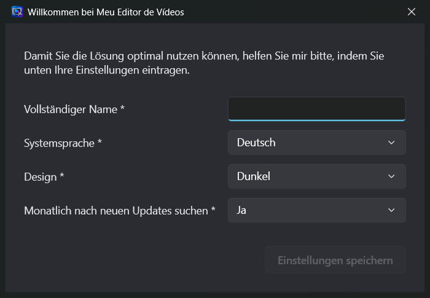

Beim ersten Start (oder wenn eine Einstellung in der Windows-Registrierung fehlt oder leer ist) erscheint das Fenster **Willkommen bei Meu Editor de Vídeos**. Füllen Sie **Vollständiger Name**, **Systemsprache**, **Design** (Hell, Dunkel oder Wie das Betriebssystem) und **Monatlich nach neuen Updates suchen** (Ja oder Nein) aus und klicken Sie auf **Einstellungen speichern**. Alle Felder sind Pflichtfelder, und das Fenster schließt sich erst nach dem Speichern. Wenn Sie eine andere Sprache wählen, startet das Programm darin neu. Später können Sie die Einstellungen unter **Werkzeuge › Einstellungen… › Allgemein** ändern.

Das Programm öffnet sich direkt im Bearbeitungsbildschirm, mit einem neuen, leeren Projekt namens „Unbenannt“. Wenn es eine Kopie eines Projekts gibt, das nicht ordnungsgemäß geschlossen wurde, fragt das Programm, ob Sie sie wiederherstellen möchten (siehe Abschnitt Speichern, automatisches Speichern und Wiederherstellung).

Die fünf zuletzt geöffneten Projekte erscheinen im Menü **Datei** zwischen Trennlinien. Klicken Sie auf eines, um es zu öffnen. Wenn die Datei verschoben oder gelöscht wurde, weist das Programm darauf hin und entfernt sie aus der Liste.

### Ein Projekt erstellen

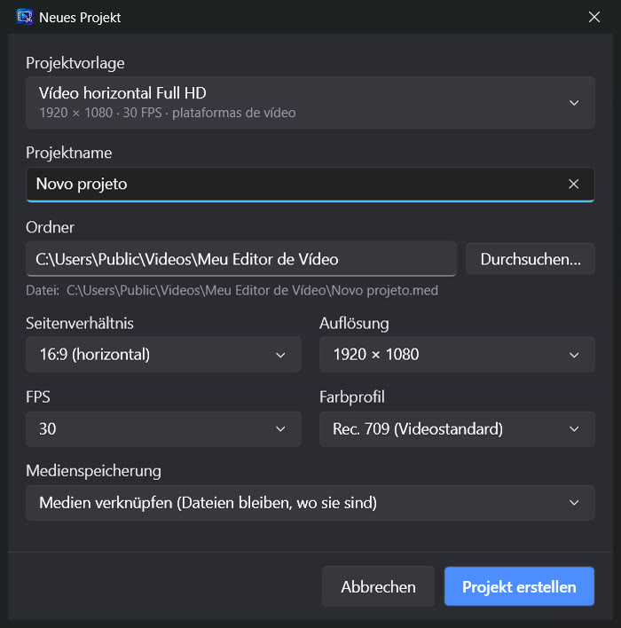

1. Wählen Sie **Datei › Neues Projekt…**.
2. Geben Sie unter „Projektname“ einen Namen ein.
3. Wählen Sie unter „Projektordner“ den Ordner, in dem das Projekt gespeichert wird (verwenden Sie bei Bedarf **Durchsuchen…**).
4. Wählen Sie eine „Projektvorlage“. Die Vorlagen bringen bereits die empfohlene Auflösung, das Seitenverhältnis und die Bildrate mit. Es gibt Vorlagen für horizontale Videos (Full HD, 4K und Kino), vertikale und quadratische Videos sowie Vorlagen für Plattformen wie YouTube, Instagram, TikTok, WhatsApp und Facebook.
5. Wenn Sie möchten, passen Sie Auflösung, Seitenverhältnis, Bildrate (FPS) und Farbprofil manuell an.
6. Wählen Sie unter „Speicherung der Medien“ eine Option:
   - **Medien verknüpfen (Dateien bleiben, wo sie sind)**: Das Projekt speichert nur den Pfad der Dateien. Das ist am leichtesten, aber die Dateien müssen am selben Ort bleiben.
   - **Medien ins Projekt einpacken (eigenständige .med)**: Die Medien werden in das Projekt kopiert. Verwenden Sie dies, wenn Sie das Projekt auf einen anderen Computer mitnehmen möchten.
7. Klicken Sie auf **Projekt erstellen**.

### Ein vorhandenes Projekt öffnen

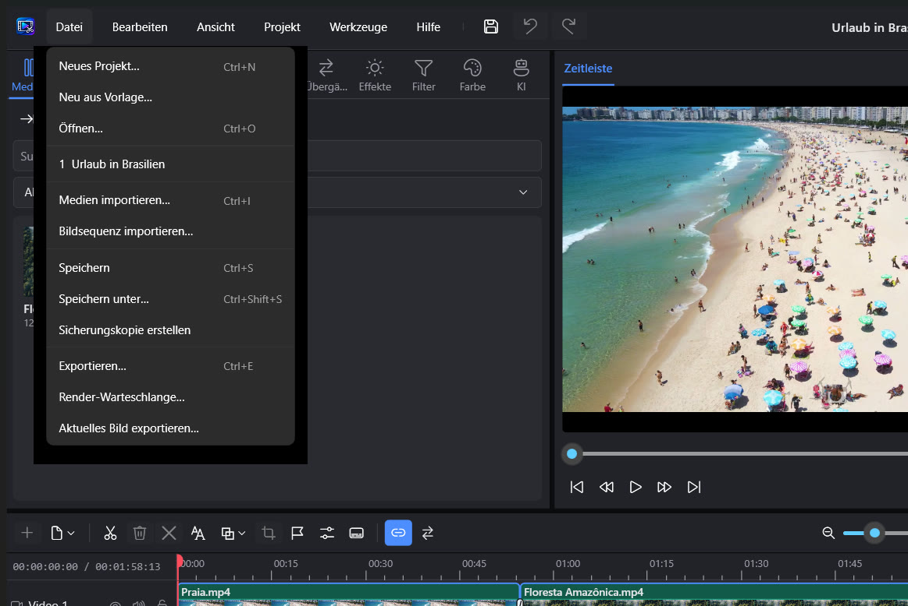

Es gibt drei Möglichkeiten:

- Wählen Sie **Datei › Öffnen…** und wählen Sie die .med-Datei aus.
- Klicken Sie auf eines der zuletzt verwendeten Projekte im Menü **Datei**.
- Doppelklicken Sie im Datei-Explorer auf die .med-Datei. Das Programm öffnet das Projekt automatisch.

## Der Bearbeitungsbildschirm

Nachdem Sie ein Projekt erstellt oder geöffnet haben, erscheint der Bearbeitungsbildschirm. Er ist in Bereiche aufgeteilt:

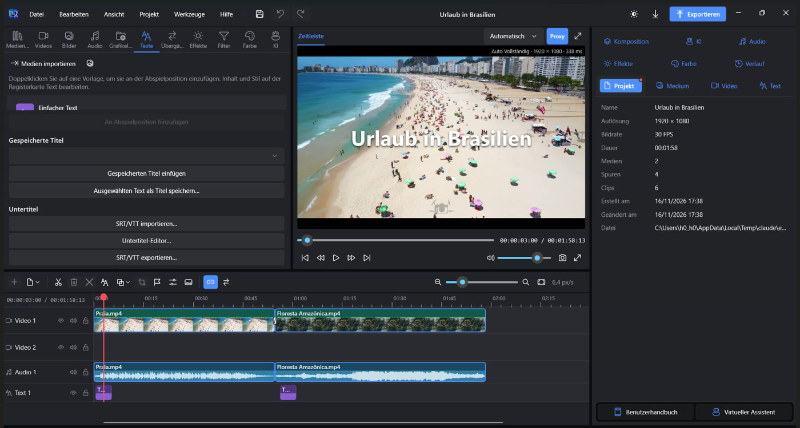

- **Obere Leiste** (oben im Fenster): links die Menüs **Datei**, **Bearbeiten**, **Ansicht**, **Projekt**, **Werkzeuge** und **Hilfe** sowie die Schaltflächen **Speichern**, **Rückgängig** und **Wiederholen**; in der Mitte der Projektname; rechts **Design**, **Render-Warteschlange**, **Exportieren** und die Schaltflächen zum Minimieren, Maximieren und Schließen des Fensters. Ziehen Sie die Leiste, um das Fenster zu verschieben, und doppelklicken Sie darauf, um es zu maximieren oder wiederherzustellen.
- **Medienbibliothek** (links): Oben befinden sich die Registerkarten Medienbibliothek, Videos, Bilder, Audio, Grafikelemente, Texte, Übergänge, Effekte, Farbe und KI. Bewegen Sie die Maus über eine Registerkarte, um den vollständigen Namen zu sehen. Importierte Medien erscheinen in einem Raster mit Miniaturbild und Dauer.
- **Vorschau** (Mitte oben): zeigt das Ergebnis des Videos. Oben befinden sich die Vorschauauflösung, die Schaltfläche Proxy und die Schaltfläche **Monitor maximieren**, mit der die Vorschau Bibliothek und Zeitleiste überdeckt (das Eigenschaftenfeld bleibt sichtbar; klicken Sie erneut, um wiederherzustellen); unten die Positionsleiste (ziehen, um zu einer beliebigen Stelle zu springen), die Schaltflächen für Wiedergabe, Pause und Einzelbild, die Lautstärke, die Bildaufnahme (speichert das aktuelle Bild als PNG oder JPEG in Projektauflösung; auch unter **Datei › Aktuelles Bild exportieren…**) und der Vollbildmodus.
- **Eigenschaften** (rechts): zeigt die Informationen und Einstellungen des ausgewählten Elements. Sie sind in Registerkarten aufgeteilt: **Projekt** (Auflösung, Bildrate, Dauer, Anzahl der Medien und Clips, Datei), **Medium**, **Video**, **Text**, **Komposition**, **KI**, **Audio**, **Effekte**, **Farbe** und **Verlauf**. Unten rechts öffnen die Verknüpfungen **Benutzerhandbuch** und **Virtueller Assistent** die Hilfe mit einem Klick.
- **Zeitleiste** (unten): Hier setzen Sie das Video zusammen. Jede horizontale Zeile ist eine Spur. Direkt darüber befindet sich eine Symbolleiste.

> Wenn der Projektname die Markierung „● nicht gespeichert“ trägt, gibt es Änderungen, die noch nicht gespeichert wurden. Verwenden Sie **Datei › Speichern** oder Strg+S.

### Menüs

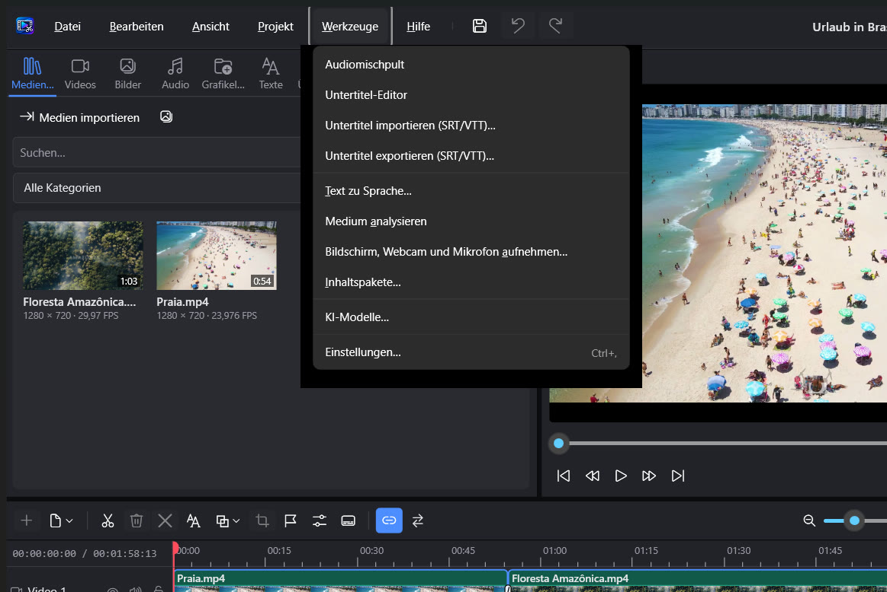

- **Datei**: neues Projekt, **neu aus Vorlage**, öffnen, Medien importieren, Bildsequenz importieren, speichern, speichern unter, Sicherungskopie erstellen, exportieren, Render-Warteschlange, aktuelles Bild exportieren (PNG oder JPEG) und die fünf zuletzt verwendeten Projekte.
- **Bearbeiten**: Rückgängig und Wiederholen; alles auswählen; teilen; **Schnitte zusammenfügen** (macht eine Teilung rückgängig: Klicken Sie auf das Lineal über der Schnittstelle; nur verfügbar, wenn beide Seiten die Fortsetzung desselben Mediums ohne unterschiedliche Einstellungen sind); ausschneiden, kopieren, an der Abspielposition einfügen und duplizieren; löschen, löschen und Lücke schließen (nur auf der Spur des Clips) und **löschen und zusammenfügen** (schließt die Lücke auf allen Spuren und hält sie synchron; gesperrte Spuren bewegen sich nicht, und der Vorgang wird abgelehnt, wenn ein Clip einer anderen Spur einen Teil des entfernten Abschnitts belegt).
- **Ansicht**:
  - **Layoutmodus**: **Standard**; **Zeitleiste** (die Zeitleiste nimmt die volle Breite ein); **Video** (der Monitor nimmt die rechte Hälfte in voller Höhe ein).
  - **Wiedergabequalität**: Automatisch, Voll, 1/2 oder 1/4.
  - **Zoomstufe des Videos**: Anpassen (passt in den Monitor) oder 10 % bis 400 %; oberhalb der Monitorgröße erscheinen Bildlaufleisten.
  - **Wiedergabe/Pause**, **Stopp** (springt zu der Stelle zurück, an der die Wiedergabe begann) und **Bereich für Schleifenwiedergabe** (wiederholt die Auswahl der Zeitleiste oder, ohne Auswahl, das ganze Projekt).
  - **Lineal**: Lineale in Videopixeln oben und links vom Bild.
- **Projekt**: Medien ins Projekt einpacken, **automatisch neu ausrichten**, **als Vorlage speichern**, **Einstellungsebene**, **verschachtelter Clip**, **geteilter Bildschirm**, **Multikamera** und fehlende Medien suchen (siehe [Einstellungsebenen, verschachtelte Clips, geteilter Bildschirm und Multikamera](#einstellungsebenen-verschachtelte-clips-geteilter-bildschirm-und-multikamera)).
  - **Als Vorlage speichern…** legt eine Kopie des gespeicherten Projekts in Ihren Vorlagen ab. **Datei › Neu aus Vorlage…** wählt eine Vorlage (Ihre eigene oder aus einem Paket), fragt, wo das neue Projekt gespeichert werden soll, und öffnet die Kopie; die Vorlage bleibt unverändert.
  - **Automatisch neu ausrichten…** ändert das Format des Projekts (9:16 für Reels, TikTok und Shorts; 1:1; 4:5; 16:9) und positioniert jeden Video- und Bildclip neu, sodass er das neue Bild ausfüllt. Wählen Sie unter **Verfolgen** **Gesicht**, **Ganzer Körper** oder **Bildmitte**. Um die Person zu verfolgen, verwendet das Programm das Modell zur Hintergrundentfernung und erstellt Positions-Keyframes, die Sie später auf der Registerkarte Video anpassen können. Texte bleiben unverändert. Der Fortschritt erscheint auf der Registerkarte **KI**, und alles lässt sich mit einem einzigen Strg+Z rückgängig machen.
- **Werkzeuge**: Audiomixer, Untertitel-Editor, Untertitel importieren und exportieren, **Text zu Sprache**, **Medien analysieren**, **Bildschirm, Webcam und Mikrofon aufnehmen**, **Inhaltspakete**, KI-Modelle und Einstellungen.
  - **Bildschirm, Webcam und Mikrofon aufnehmen…** nimmt den Desktop, eine Webcam in einer Bildschirmecke und den Ton eines Mikrofons gleichzeitig in eine MP4-Datei auf. Bei mehreren Monitoren wählen Sie unter **Aufzunehmender Bildschirm**, welcher Bildschirm aufgenommen wird (oder alle). Wählen Sie dann unter **Was aufnehmen** entweder **Ganzer Bildschirm** oder **Nur ein Fenster**; im zweiten Fall wählen Sie unter **Aufzunehmendes Fenster** eines der auf dem gewählten Bildschirm geöffneten Fenster (minimierte Fenster werden nicht angezeigt; lassen Sie es während der Aufnahme geöffnet und sichtbar). Die Webcam nimmt ein Zehntel der Breite des aufgenommenen Bildschirms ein. Wenn Sie auf **Aufnehmen** klicken, wird das Programm minimiert, und vor dem Start der Aufnahme erscheint in der Bildschirmmitte ein Countdown 5, 4, 3, 2, 1. Zum Beenden drücken Sie **F10** (funktioniert mit jedem Programm im Vordergrund); das Programm erscheint wieder. Die Aufnahme landet im Ordner **Aufnahmen** (neben dem Projekt oder unter Videos › Meu Editor de Vídeo), in der Bibliothek (Kategorie Aufnahmen) und, wenn die Option aktiviert ist, an der Abspielposition in der Zeitleiste. Ohne Bildschirm wird nur die Webcam aufgenommen.
  - **Inhaltspakete…** installiert, exportiert und entfernt Pakete mit Stickern, Titeln und Projektvorlagen (.medpack-Dateien). Ein Paket ist ein ZIP mit den Ordnern `figurinhas` (PNG, GIF, WebP, JPEG oder SVG), `titulos` (.medtitle) und `modelos` (.med) und optional einer `pacote.json` mit dem Namen (zum Beispiel `{"nome": "Sommerfest"}`). Elemente, die Sie selbst speichern, landen im Paket **Meine Elemente**; verwenden Sie **Exportieren…**, um es zu teilen.
  - **Text zu Sprache…** verwandelt einen Text mit den unter Windows installierten Stimmen in eine Sprachaufnahme, ohne Internet. Geben Sie den Text ein, wählen Sie **Stimme** und **Geschwindigkeit** und klicken Sie auf **Erzeugen und einfügen**: Das Audio kommt in die Bibliothek (Kategorie Sprecher) und wird an der Abspielposition eingefügt, auf der ersten freien Audiospur oder auf einer neuen Spur namens Sprecher. Für weitere Stimmen installieren Sie diese unter **Windows-Einstellungen › Zeit und Sprache › Spracherkennung**.
  - **Medien analysieren** versieht alle Medien der Bibliothek mit Schlagwörtern: Typ, Ausrichtung (horizontal, vertikal, quadratisch), Auflösung (HD, Full HD, 4K), Dauer (kurz, lang) und Ton. Mit installierten Modellen außerdem **Sprache** oder **ohne Sprache**, die Anzahl der **Szenen** und **Person** oder **ohne Personen**. Die Schlagwörter erscheinen, wenn Sie die Maus über das Medium bewegen, und das Feld **Suchen…** der Bibliothek durchsucht sie ebenfalls.
- **Hilfe**: **Benutzerhandbuch** (F1), **Virtueller Assistent** (Umschalt+F1), **Tastenkombinationen…**, **Systeminformationen…**, **Protokollordner öffnen**, **Lizenzen von Drittanbietern**, **Über Meu Editor de Vídeo**, **Technischer Support** (öffnet die Support-Seite im Browser, in der Sprache des Programms), **Nach Updates suchen** (fragt über das Internet ab, ob es eine neue Version gibt: zeigt „Sie haben die neueste Version!“ oder das Fenster **Neue Version verfügbar** mit Version, Sprachen, unterstützten Systemen, Autor und den Download-Links im Microsoft Store und auf der Website AplicativosIA.Online; ein Klick auf **Dieses Fenster schließen** speichert das Datum der Prüfung). In **Über Meu Editor de Vídeo** öffnet das LinkedIn-Symbol das Profil des Autors im Browser. Dort finden Sie auch die Links **Besuchen Sie unsere Website** (die Website des Programms in der Sprache der Oberfläche) und **Meu Editor de Vídeo auf GitHub besuchen** (der Quellcode).

Das **Benutzerhandbuch** öffnet dieses Handbuch im Programm, ohne Internet. Die Liste links führt zu jedem Thema, und Strg+F sucht nach einem Wort. Das Fenster kann während der Bearbeitung geöffnet bleiben.

**Tastenkombinationen…** zeigt die verwendeten Tastenkombinationen, auch die von Ihnen geänderten. **Systeminformationen…** zeigt Version, Windows, Prozessor, Arbeitsspeicher, Grafikkarte, KI-Modelle und die Programmordner; die Schaltfläche **Kopieren** legt alles in die Zwischenablage, nützlich, wenn Sie um Hilfe bitten.

## Medien importieren

Importieren heißt, die Dateien ins Projekt zu holen, die Sie verwenden möchten, etwa Videos, Fotos, Musik und Aufnahmen. Die Originaldateien werden nicht verändert.

### Unterstützte Formate

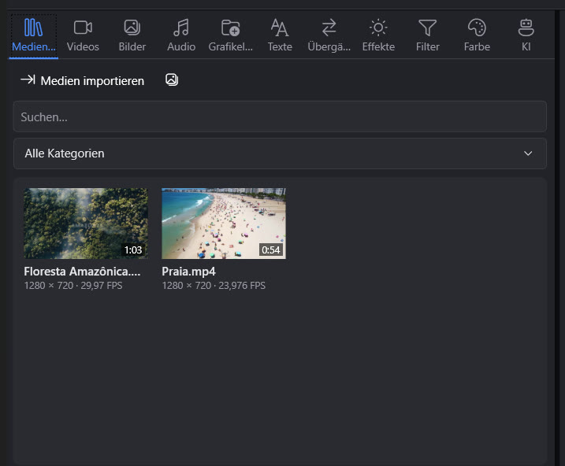

- **Video**: MP4, M4V, MOV, MKV, WebM, AVI, WMV, FLV, MPG und MPEG, M2TS, MTS, TS, 3GP, OGV, MXF und VOB.
- **Audio**: MP3, WAV, AAC, M4A, FLAC, OGG, OGA, Opus, WMA, AIFF, AIF, AC3 und AMR.
- **Bild**: JPG und JPEG, PNG, BMP, TIF und TIFF, WebP, TGA, JFIF und SVG.
- **Animiertes GIF**: GIF.
- **Bildsequenz**: eine Reihe nummerierter Fotos, etwa foto_0001.png, foto_0002.png und so weiter.

Dateien in anderen Formaten werden mit der Meldung „Nicht unterstütztes Dateiformat.“ abgelehnt.

### So importieren Sie

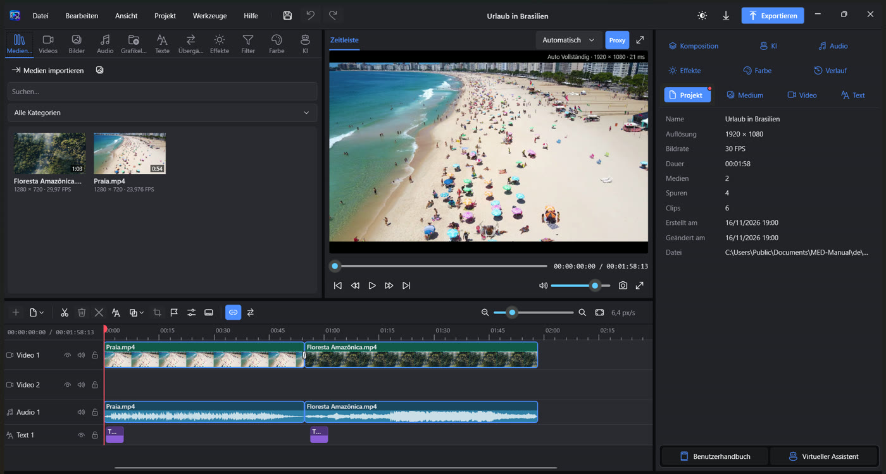

1. Klicken Sie im Bibliotheksbereich auf **Medien importieren** oder verwenden Sie **Datei › Medien importieren…** (Tastenkombination Strg+I).
2. Wählen Sie eine oder mehrere Dateien aus und bestätigen Sie.
3. Verfolgen Sie den Fortschritt. Die Meldung „3 von 10 werden importiert“ zeigt, wie viele Dateien bereits gelesen wurden.

Sie können auch Dateien oder Ordner aus dem Datei-Explorer ziehen und auf der Medienbibliothek ablegen. Wenn sich die Datei über dem richtigen Bereich befindet, erscheint der Hinweis „Zum Importieren ablegen“.

Für eine Bildsequenz verwenden Sie **Datei › Bildsequenz importieren…**. Das Programm erkennt die Nummerierung automatisch.

Jedes importierte Medium erhält ein Miniaturbild. Wenn Sie ein Medium auswählen, zeigt die Registerkarte **Medium** der Eigenschaften Dauer, Auflösung, Bildrate und weitere Daten der Datei.

### Die Bibliothek organisieren

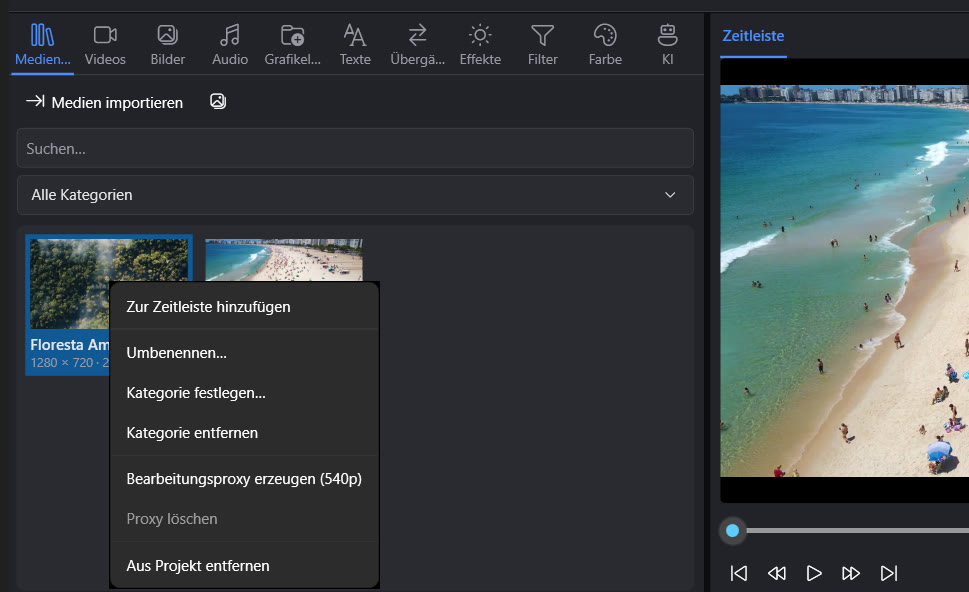

- Verwenden Sie das Feld **Suchen…**, um ein Medium nach Name, Kategorie oder den unter **Werkzeuge › Medien analysieren** erstellten Schlagwörtern zu finden (zum Beispiel „Sprache“, „Person“ oder „vertikal“).
- Klicken Sie mit der rechten Maustaste auf ein Medium, um **Umbenennen…**, **Kategorie festlegen…**, **Kategorie entfernen**, **Zur Zeitleiste hinzufügen** oder **Aus dem Projekt entfernen** auszuwählen.
- Das Entfernen eines Mediums aus dem Projekt löscht die Datei nicht vom Computer.

### Fehlende Medien

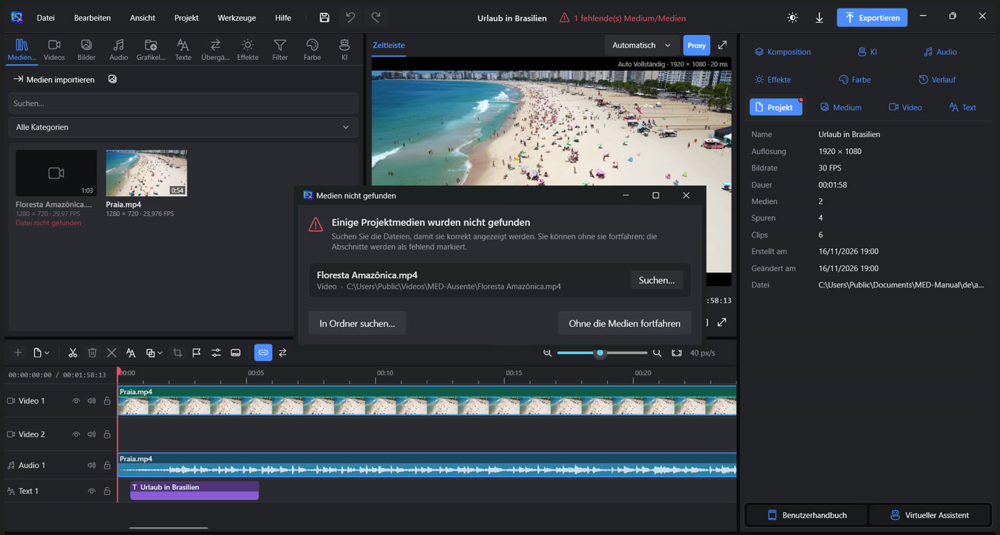

Wenn eine Datei verschoben, umbenannt oder gelöscht wurde, zeigt das Projekt beim Öffnen die Warnung „Einige Medien des Projekts wurden nicht gefunden“. Die Warnung erscheint auch in der Statusleiste als „Fehlende Medien“, mit der Anzahl der betroffenen Medien. So beheben Sie das:

1. Klicken Sie auf **Suchen…**, um die Datei anzugeben, oder auf **In Ordner suchen…**, damit das Programm in den von Ihnen gewählten Ordnern und Unterordnern sucht.
2. Wenn Sie sie jetzt nicht suchen möchten, klicken Sie auf **Ohne die Medien fortfahren**. Die Abschnitte werden als fehlend markiert und können später gesucht werden.

Sie können dieses Fenster jederzeit über **Projekt › Fehlende Medien suchen…** öffnen. In einem aus dem Internet heruntergeladenen Projekt sucht das Programm keine Medien und LUTs auf einem anderen Computer im Netzwerk, denn schon die Anfrage an diesen Computer würde ihm Ihre Windows-Anmeldedaten senden: Solche Medien erscheinen als fehlend, und solche LUTs werden deaktiviert. Wenn Sie der Herkunft des Projekts vertrauen, suchen Sie die Medien in diesem Fenster und aktivieren Sie die LUTs im Bereich **Eigenschaften** wieder.

Um dieses Problem beim Mitnehmen des Projekts auf einen anderen Computer zu vermeiden, verwenden Sie **Projekt › Medien ins Projekt einpacken…**. Damit werden die Medien in die Projektdatei kopiert.

### Proxys (leichte Versionen zum Bearbeiten)

Ein Proxy ist eine leichte Kopie eines großen Videos in 540p, die nur dazu dient, die Vorschau flüssiger zu machen. Der Export verwendet immer die Originaldatei.

- Um einen Proxy zu erstellen, klicken Sie mit der rechten Maustaste auf das Video in der Bibliothek und wählen **Bearbeitungsproxy erzeugen (540p)**.
- Um einen Proxy zu löschen, wählen Sie **Proxy löschen**.
- Im Monitor schaltet die Option **Proxys in der Vorschau verwenden** die Verwendung der Proxys ein oder aus.
- Unter **Werkzeuge › Einstellungen…** können Sie festlegen, dass Proxys für Videos über 1080p automatisch erzeugt werden.

## Bearbeiten in der Zeitleiste

In der Zeitleiste wird das Video von links nach rechts zusammengesetzt. Die **Abspielposition** (eine senkrechte Linie) zeigt den Zeitpunkt, der in der Vorschau zu sehen ist. Die Medienstücke auf den Spuren heißen Clips.

### Medien in die Zeitleiste einfügen

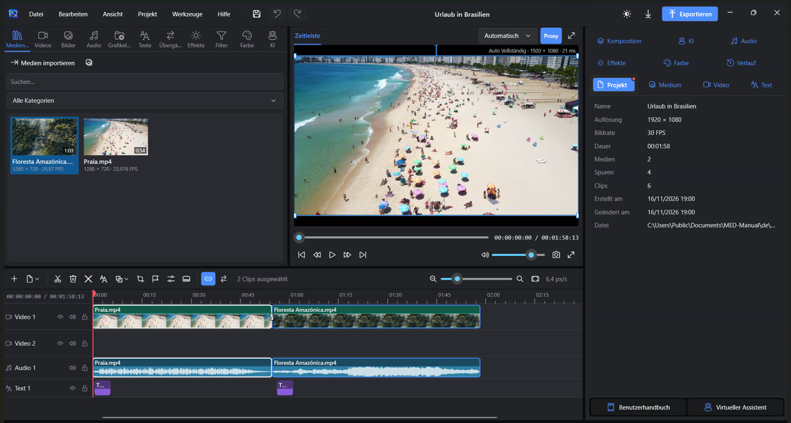

- Ziehen Sie ein Medium aus der Bibliothek auf eine Spur.
- Oder wählen Sie das Medium in der Bibliothek aus und klicken Sie in der Symbolleiste auf **Zur Zeitleiste hinzufügen**. Bilder und Audio werden an der Abspielposition eingefügt: Ein Bild kommt auf eine freie Bildspur, sonst auf eine leere Videospur; Audio kommt auf eine an dieser Stelle freie Audiospur. Passt keine, legt das Programm eine neue Spur an.

### Verschieben, trimmen und teilen

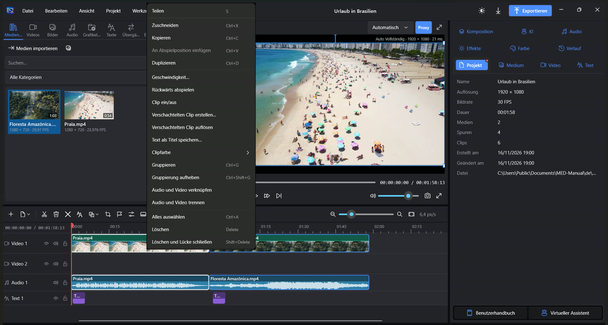

- **Verschieben**: Ziehen Sie den Clip an eine andere Stelle der Spur oder auf eine andere Spur desselben Typs.
- **Anfang oder Ende trimmen**: Ziehen Sie den Rand des Clips, um den verwendeten Abschnitt zu kürzen oder zu verlängern.
- **Teilen**: Setzen Sie die Abspielposition an die gewünschte Stelle und klicken Sie in der Symbolleiste auf **Teilen** oder drücken Sie S. Der Clip wird an dieser Stelle in zwei Teile geschnitten.
- **Schnitte zusammenfügen** (Menü Bearbeiten): fügt die beiden Teile eines geteilten Clips wieder zusammen. Setzen Sie die Abspielposition auf die Schnittstelle; das funktioniert nur, wenn beide Teile die Fortsetzung desselben Mediums ohne unterschiedliche Einstellungen sind.
- **Löschen**: Wählen Sie den Clip aus und drücken Sie Entf. Sie können auch die Schaltfläche **Auswahl löschen** verwenden.
- **Löschen und Lücke schließen**: löscht den Clip und zieht die folgenden Clips nach, um die Lücke zu füllen. Verwenden Sie Umschalt+Entf.
- **Zuschneiden und vergrößern**: Wählen Sie einen Video- oder Bildclip aus und klicken Sie auf die Zuschneiden-Schaltfläche in der Schaltflächenleiste der Zeitleiste. Ziehen Sie im sich öffnenden Fenster im Bild, um den Bereich zu markieren, der im Video bleiben soll: Ziehen Sie innerhalb des Bereichs, um ihn zu verschieben, nutzen Sie die Griffe an Ecken und Kanten, um die Größe zu ändern, oder ziehen Sie außerhalb, um einen neuen zu zeichnen. Mit der Zeitleiste im Fenster wählen Sie ein Referenzbild im Clip. Unter **Seitenverhältnis** wählen Sie **Frei**, das Verhältnis des Projekts, das ursprüngliche oder ein festes (16:9, 9:16, 1:1, 4:3, 3:4, 4:5); bei festem Verhältnis ändern nur die Ecken die Größe. **Größe** zeigt den Bereich in Videopixeln. Wenn Sie auf **Anwenden** klicken, wird der markierte Bereich vergrößert, bis er das Bild füllt, zentriert; weicht sein Verhältnis vom Projekt ab, bleiben Balken. Drehung sowie Positions- und Skalierungs-Keyframes des Clips werden entfernt, die Projektgröße ändert sich nicht. **Zurücksetzen** kehrt zum ganzen Bild zurück. Strg+Z macht es rückgängig.
- **Einfachen Text hinzufügen**: Die Schaltfläche **T** in der Schaltflächenleiste der Zeitleiste erstellt an der Abspielposition einen einfachen Text und öffnet den Eigenschaften-Reiter **Text**, damit Sie ihn eingeben und formatieren können.
- **Zeichenwerkzeuge**: Die Formen-Schaltfläche öffnet ein Menü mit **Rechteck**, **Pfeil**, **Ellipse**, **Dreieck**, **Linie** und **Polygon**. Die gewählte Form wird an der Abspielposition für 5 Sekunden auf einer freien Grafikspur eingefügt, und der Eigenschaften-Reiter **Video** öffnet sich, um Größe, Farbe und Kontur anzupassen.
- **Kopieren, ausschneiden, einfügen und duplizieren**: Verwenden Sie Strg+C, Strg+X, Strg+V und Strg+D. Beim Einfügen landet der Clip an der Abspielposition.

### Magnet und Ripple-Bearbeitung

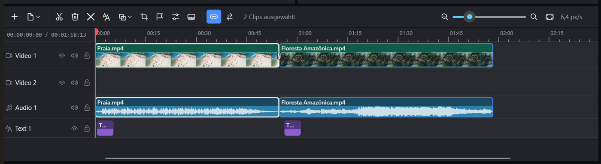

- **Ausrichtungsmagnet** (Taste N): Wenn er aktiviert ist, „rastet“ der Clip an den Rändern anderer Clips und an der Abspielposition ein, sodass sich Teile leicht ohne Lücken aneinanderfügen lassen. Die Schaltfläche befindet sich in der Symbolleiste.
- **Ripple-Bearbeitung**: Wenn sie aktiviert ist, schiebt das Verschieben oder Trimmen eines Clips die folgenden Clips mit, ohne Lücken zu hinterlassen.

### Spuren

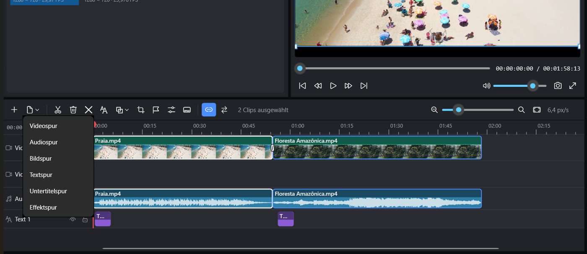

Spuren sind die horizontalen Zeilen der Zeitleiste. Um eine Spur hinzuzufügen, klicken Sie auf die Schaltfläche **Spur hinzufügen** und wählen den Typ (jede neue Spur, ob von Ihnen oder vom Programm angelegt, wird ganz oben über allen anderen Spuren eingefügt):

- **Videospur**
- **Audiospur**
- **Bildspur**
- **Textspur**
- **Untertitelspur**
- **Effektspur**

Jede Spur hat im Kopf links drei Schaltflächen:

- **Ausblenden**: blendet die Spur in der Vorschau aus.
- **Stumm**: schaltet die Audiospur stumm.
- **Sperren**: verhindert Änderungen an der Spur, damit Fertiges nicht verändert wird.

Klicken Sie mit der rechten Maustaste auf den Spurnamen, um **Spur umbenennen…** oder **Spur entfernen** zu wählen. Um die Reihenfolge der Spuren zu ändern, ziehen Sie den Namen einer Spur nach oben oder unten (oder verwenden Sie **Spur nach oben verschieben** und **Spur nach unten verschieben** im selben Menü). Die oberste Spur erscheint vorne.

### Gruppieren und verknüpfen

- **Gruppieren** (Strg+G): fasst mehrere Clips zusammen, damit sie sich gemeinsam bewegen. Verwenden Sie **Gruppierung aufheben** (Strg+Umschalt+G), um sie zu trennen.
- **Audio und Video verknüpfen**: lässt den Ton eines Videos dem Video folgen. Verwenden Sie **Verknüpfung von Audio und Video aufheben**, um sie zu trennen.

### Clipgeschwindigkeit

Klicken Sie mit der rechten Maustaste auf den Clip und wählen Sie **Geschwindigkeit…**, um ihn schneller oder langsamer zu machen. Auf der Registerkarte **Video** der Eigenschaften reicht die Liste der Geschwindigkeiten von 0,25× (Zeitlupe) bis 8× (Zeitraffer).

### Clips aktivieren und deaktivieren

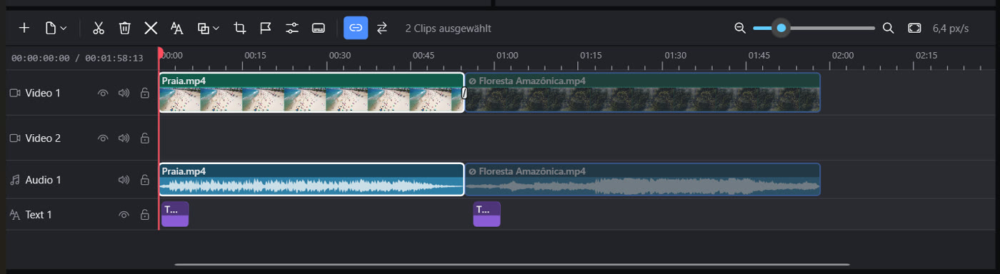

Klicken Sie mit der rechten Maustaste auf den Clip und wählen Sie **Clip aktivieren/deaktivieren**. Ein deaktivierter Clip bleibt in der Zeitleiste (abgeblendet und mit dem Symbol ⊘), ist aber bei Wiedergabe und Export weder zu sehen noch zu hören.

### Einstellungsebenen, verschachtelte Clips, geteilter Bildschirm und Multikamera

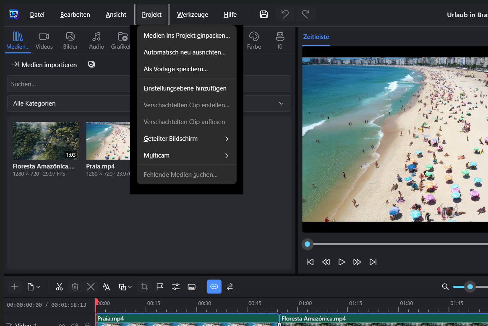

- **Einstellungsebene** (**Projekt › Einstellungsebene hinzufügen**): erstellt an der Abspielposition einen 5-Sekunden-Clip auf einer Effektspur. Die darauf angewendeten Effekte und Farbkorrekturen gelten für **alle darunterliegenden Spuren**, solange der Clip dauert. Wählen Sie die Ebene aus und fügen Sie auf den Registerkarten **Effekte** und **Farbe** Effekte hinzu. Die Deckkraft der Ebene dosiert den Effekt, und Masken begrenzen den Bereich. Dehnen oder verschieben Sie die Ebene wie jeden Clip.
- **Verschachtelter Clip** (**Projekt › Verschachtelten Clip erstellen…** oder Kontextmenü): fasst die ausgewählten Clips (mit ihrem verknüpften Audio) zu einem einzigen Clip zusammen, der sich als Ganzes verschieben, schneiden und mit Effekten versehen lässt. Die ursprünglichen Spuren und Positionen bleiben darin erhalten. **Verschachtelten Clip auflösen** bringt die Clips zurück in die Zeitleiste, auf neue Spuren, nur mit dem Abschnitt, den der verschachtelte Clip zeigte. Der Ton des verschachtelten Clips wird nur bei normaler Geschwindigkeit wiedergegeben.
- **Geteilter Bildschirm** (**Projekt › Geteilter Bildschirm**): Wählen Sie 2 bis 4 Video- oder Bildclips aus, jeden auf einer anderen Spur, und wählen Sie ein Layout: **2 nebeneinander**, **2 übereinander**, **3 Spalten**, **3 Streifen**, **1 groß und 2 klein** oder **4 im Raster**. Jeder Clip (in der Reihenfolge der Spuren, von oben nach unten) wird vergrößert, um seinen Teil des Bildes auszufüllen, und der Überstand wird beschnitten. Passen Sie Position und Zuschnitt anschließend auf der Registerkarte Video an.
- **Multikamera** (**Projekt › Multikamera**): Legen Sie jede Kamera auf eine Videospur, synchronisiert (zum Beispiel mit **Über Audio synchronisieren**). Während der Wiedergabe oder im Stillstand wählen Sie **Kamera 1** bis **Kamera 4** (Alt+1 bis Alt+4, mit dem Fokus auf der Zeitleiste), um diese Kamera **ab der Abspielposition** zu zeigen: Das Programm schneidet alle Kameras an der Abspielposition und deaktiviert die anderen. Kamera 1 ist die oberste Videospur mit einem Clip an der Abspielposition. Der Ton ändert sich nicht.

### Clipfarbe

Um Clips optisch zu kennzeichnen, wählen Sie einen oder mehrere Clips aus, klicken mit der rechten Maustaste und wählen **Clipfarbe**. Die Farbe wird im Projekt gespeichert und kann mit Strg+Z rückgängig gemacht werden. Wählen Sie **Automatisch (nach Typ)**, um zur Standardfarbe zurückzukehren (Video, Bild, Audio oder Text).

Projekte mit Clipfarben verwenden das Format 1.3. Frühere Versionen des Programms öffnen diese Projekte mit einer Warnung und ignorieren die Farben.

### Marker

Marker sind Merkzeichen im Zeitlineal, nützlich, um wichtige Stellen zu notieren, etwa den Beginn eines Redebeitrags.

- Setzen Sie die Abspielposition und klicken Sie auf **Marker hinzufügen** oder drücken Sie M.
- Klicken Sie mit der rechten Maustaste auf den Marker, um **Marker umbenennen…** oder **Marker entfernen** zu wählen.

### Zeitleisten-Zoom

Verwenden Sie die Zoom-Schaltflächen in der Symbolleiste oder die Tastenkombinationen:

- Vergrößern: Strg + Plustaste (oder + auf dem Ziffernblock)
- Verkleinern: Strg + Minustaste (oder - auf dem Ziffernblock)
- An Fenster anpassen: Umschalt+Z

### Rückgängig und Wiederholen

- **Rückgängig** (Strg+Z) und **Wiederholen** (Strg+Y oder Strg+Umschalt+Z) gehen durch die letzten Aktionen zurück und vor.
- Die Registerkarte **Verlauf** in den Eigenschaften zeigt die Liste der ausgeführten Aktionen. Klicken Sie auf eine, um das Projekt auf diesen Stand zurückzusetzen.

### Im Video navigieren

- Leertaste: Wiedergabe oder Pause.
- Pfeiltasten links und rechts: ein Bild zurück oder vor.
- Umschalt mit den Pfeiltasten: eine Sekunde zurück oder vor.
- Auf und ab: zum vorherigen und zum nächsten Schnitt.
- Pos1 und Ende: zum Anfang und zum Ende.

## Visuelle Effekte, Text und Übergänge

Um einen Effekt anzuwenden, wählen Sie den Clip in der Zeitleiste aus und verwenden die Registerkarten der Eigenschaften. Sie können auch die Bereiche der Bibliothek wie **Effekte**, **Farbe** und **Übergänge** verwenden: Doppelklicken Sie auf ein Element, um es an der Abspielposition oder auf den ausgewählten Clip anzuwenden, oder verwenden Sie die Schaltfläche **Auf ausgewählten Clip anwenden**. Effekte und Übergänge gelten auch für Bilder, Sticker und Texte, und die Registerkarte **Farbe** passt die Farben von Bildern und Stickern an. Wenn Sie einen Clip einfügen, öffnet sich der Eigenschaftenbereich von selbst auf der passenden Registerkarte: **Text** für Texte, **Video** für Videos, Bilder und Sticker und **Audio** für Audio.

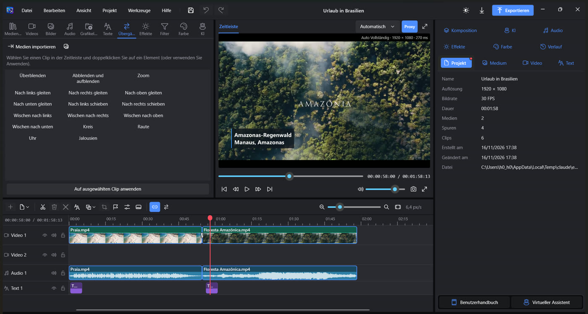

Der Bereich **Effekte** der Bibliothek zeigt fertige Videoeffekte als Miniaturen, nach Kategorien geordnet (wählen Sie die Kategorie in der Liste über den Miniaturen): **Trends**, **Intros**, **Outros**, **Liebe**, **Party**, **Rahmen**, **Hervorheben**, **Verzerrung**, **Glitch**, **Flackern**, **Grunge**, **Lupe**, **Licht**, **Retro**, **Wackeln**, **Dias**, **Geteilter Bildschirm**, **Timer**, **Sucher** und **Werkzeuge** (Weichzeichnen, Schärfen, Vignette, Chroma Key und die übrigen Grundeffekte). Jede Miniatur zeigt den Effekt in einer Strandszene mit einer Person; bei Bewegungseffekten wie **Wackeln** überlagert die Miniatur benachbarte Zeitpunkte, um die Bewegung anzudeuten. Die Effekte werden über die Zeit des Clips animiert: **Intros** blenden das Video am Clipanfang ein, **Outros** blenden es am Ende aus und der **Timer** folgt der Cliplänge. Nach dem Anwenden erscheint der Effekt auf der Registerkarte **Effekte** der Eigenschaften, wo Sie Stil, Intensität, Geschwindigkeit, Farbe und weitere Einstellungen wählen.

Der Bereich **Filter** der Bibliothek (neben **Effekte**) bietet fertige Looks, die Farbe, Stimmung und Stil eines Videos oder Bildes auf einmal ändern, ohne jede Einstellung einzeln anzupassen. Wählen Sie die Kategorie in der Liste über den Miniaturen: **Einfach**, **Empfohlen**, **Monochrom**, **Lifestyle**, **Filmisch**, **Retro**, **Frühling**, **Innenräume**, **Nacht** und **Kreativ**. Jede Miniatur zeigt den Filter auf einer farbigen Strandszene mit Leuchtturm, Segelboot und Palme. Wählen Sie den Clip aus und doppelklicken Sie auf den Filter (oder verwenden Sie **Auf ausgewählten Clip anwenden**). Ein Filter besteht aus normalen Effekten (Farbanpassungen, Kurven, Farbräder, Vignette, Körnung, weiches Leuchten), die auf der Registerkarte **Effekte** der Eigenschaften erscheinen, wo Sie jeden einzeln anpassen oder entfernen können.

### Registerkarte Video

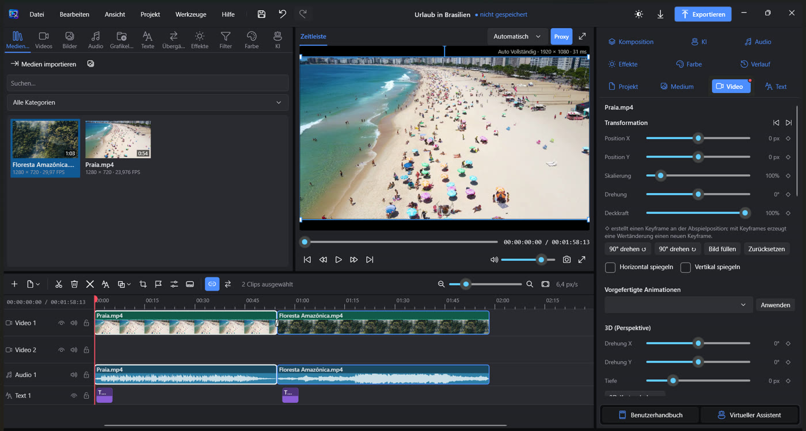

Diese Registerkarte bündelt die Bewegungs- und Zeiteinstellungen des Clips:

- **Transformation**: Position X und Y, Skalierung, Drehung und Deckkraft. Neben jedem Wert gibt es eine Schaltfläche ◇, die einen Keyframe erstellt. Das geht auch direkt im Monitor: Wählen Sie den Clip in der Zeitleiste aus, ziehen Sie ihn im Video, um ihn zu verschieben, ziehen Sie den runden Griff über dem Rahmen, um ihn zu drehen (mit Umschalt in 15°-Schritten), und ziehen Sie bei Bildern, Stickern, Videos und Formen eine Ecke, um die Größe zu ändern. Texte lassen sich nur verschieben und drehen.
- **Keyframes**: Ein Keyframe speichert einen Wert zu einem bestimmten Zeitpunkt. Wenn es Keyframes gibt, ändert das Programm den Wert zwischen ihnen allmählich. Verwenden Sie **Vorheriger Keyframe** und **Nächster Keyframe**, um zwischen ihnen zu wechseln, und **Interpolation**, um die Kurve zu wählen: Weich (Ein- und Auslauf), Linear, Beschleunigen, Abbremsen oder Halten (Sprung).
- **3D (Perspektive)**: Drehung X, Drehung Y und Tiefe, um dem Clip Tiefe zu verleihen. Die Schaltfläche **3D-Kartendrehung** lässt den Clip wie eine Karte umdrehen. Es ist kein vollständiges 3D-Modell.
- **Fertige Animationen**: sofort anwendbare Bewegungseffekte wie von links hereinkommen, mit Zoom erscheinen, Ken Burns (langsamer Zoom), pulsieren, drehen, schwanken, hüpfen sowie ein- und ausblenden.
- **Zuschnitt**: schneidet die Ränder des Videos links, oben, rechts und unten ab. Die Regler blenden die Ränder nur aus; die Projektgröße bleibt gleich. Damit das Video tatsächlich die zugeschnittene Größe erhält, klicken Sie auf **Zuschnitt auf das Video anwenden**: Das Projekt erhält die Größe des zugeschnittenen Bereichs in Pixeln des Originalvideos (eine 1920×1080-Aufnahme ohne 25 % links wird zu 1440×1080), der zugeschnittene Bereich füllt das Bild, und der Export erfolgt in diesen Abmessungen. Texte und andere Clips passen sich an. Der Clip darf nicht gedreht sein und keine Positions- oder Skalierungs-Keyframes haben. Strg+Z macht es rückgängig.
- **Mischen**: Mischmodus mit anderen Ebenen, etwa Multiplizieren, Negativ multiplizieren, Ineinanderkopieren, Weiches Licht, Addieren, Abdunkeln, Aufhellen und Differenz.
- **Blenden**: **Einblenden** und **Ausblenden**, von 0 bis 10 Sekunden, damit der Clip sanft erscheint und verschwindet.
- **Geschwindigkeit**: vordefinierte Geschwindigkeiten oder eine andere Geschwindigkeit. Unter 1× mischt die Option **Geglättete Zeitlupe** benachbarte Bilder, um Sprünge zu verringern. **Rückwärts abspielen** zeigt den Clip vom Ende zum Anfang, auch mit umgekehrtem verknüpftem Ton (auch im Kontextmenü des Clips; der Clip erhält in der Zeitleiste das Symbol ◀). Gilt nicht für Standbilder. Verwenden Sie bei langen Videos Proxys, damit die Rückwärtswiedergabe flüssig bleibt.
  - **Zeitlupe durch Interpolation (optischer Fluss)**: erzeugt unter 1× die Zwischenbilder entlang der Bewegung, was flüssiger ist als das einfache Mischen. Es wird kein Modell benötigt, aber Wiedergabe und Export werden langsamer.
  - **Kurve**: Geschwindigkeitskurve (Speed Ramping). Wählen Sie **Montage**, **Held**, **Bullet Time**, **Sprung**, **Beschleunigen** oder **Abbremsen**, damit der Clip in sich beschleunigt und abbremst, ohne Dauer oder verwendeten Videoabschnitt zu ändern. **Konstant (ohne Kurve)** stellt den Normalzustand wieder her. Mit Kurve ist der Ton des Clips stumm. Trimmen oder Teilen des Clips kehrt ebenfalls zur konstanten Geschwindigkeit zurück.
  - **Bewegungsunschärfe**: Bewegungsspur, wenn Position, Skalierung oder Drehung mit Keyframes animiert sind. Bei 100 % deckt die Spur die Dauer eines ganzen Bildes ab.
- **Standbild**, **Abschnitt wiederholen**, **Bild füllen**, **Um 90° drehen** und **Spiegeln** horizontal und vertikal.
- **Eingangsübergang**: wendet einen Übergang zwischen diesem Clip und dem vorherigen Clip auf derselben Spur an. Dazu müssen die beiden Clips aneinanderstoßen. Sie wählen den Übergang und die **Übergangsdauer**. Liegt davor kein angrenzender Clip (ein einzelnes Bild, ein Sticker oder ein Text), ist der Übergang ein Einstieg: Er beginnt am Anfang des Clips und blendet ihn über den Spuren darunter ein.

- **Kameraverfolgung**: Wählen Sie **Kopf** oder **Körper**, und eine virtuelle Kamera folgt diesem Teil der Person. Einstellungen:
  - **Automatischer Schnitt (Zoom)**: rückt das Bild näher an das Ziel.
  - **Bewegung folgen**: wie stark die Kamera dem Ziel folgt (bei 0 % bleibt sie in der Mitte).
  - **Wackeln**: Kamerawackeln um das Ziel herum.
  - **Unscharfer Hintergrund**: macht alles unscharf, was nicht die Person ist.

  Die Verfolgung verwendet dasselbe Personen-Freistellungsmodell wie die Registerkarte **KI** (installieren Sie es unter **KI-Modelle**, falls noch nicht vorhanden). Ohne das Modell oder ohne Person im Bild bleibt die Kamera in der Mitte und der Hintergrund wird nicht unscharf. Der Effekt erscheint auch in der Liste der angewendeten Effekte auf der Registerkarte **Effekte**.
- **Retuschieren**: Retusche des Gesichts der Person, Bild für Bild. Klicken Sie auf **Schönheit**, **Make-up** oder **Gesichter unkenntlich machen**, um den Effekt zum Clip hinzuzufügen; die Einstellungen erscheinen direkt darunter.
  - **Gesichter unkenntlich machen**: findet das Gesicht in jedem Bild und verdeckt es mit **Weichzeichnen**, **Verpixeln** oder **Schwarzer Balken**. Stellen Sie **Intensität** und **Bereichsgröße** ein. Funktioniert mit einem Gesicht pro Bild.
  - **Schönheit**: **Haut · glätten** und **Haut · aufhellen**, **Mimikfalten** und **Tränensäcke** (glätten diese Bereiche) sowie Formanpassungen: **Gesicht · schmaler**, **Augen · vergrößern**, **Nase · schmaler**, **Mund · Größe** und **Augenbrauen · anheben** (negative Werte bewirken das Gegenteil).
  - **Make-up**: Wählen Sie einen fertigen **Look** (Natürlich, Glamour, Abend oder Rosé) oder **Keiner**, und stellen Sie jedes Element ein: **Wimpern**, **Lidschatten**, **Eyeliner**, **Augenbrauen**, **Lippenstift**, **Rouge**, **Kontur**, **Highlights**, **Augenfarbe** und **Sommersprossen**. Lidschatten, Augenbrauen, Lippenstift, Rouge und Iris haben eine eigene Farbe. Ein Element mit einem Wert über 0 % verwendet seinen eigenen Wert und seine Farbe; bei 0 % gilt die Einstellung des Looks.

  Die Retusche verwendet das Modell **Face Mesh V2**, das 478 Punkte des Gesichts erkennt. Installieren Sie es unter **Werkzeuge › KI-Modelle › Modelle herunterladen…** (etwa 5 MB). Ist das Personen-Freistellungsmodell installiert, hilft es, den Kopf im Bild zu finden. Ohne das Face-Mesh-Modell oder ohne sichtbares Gesicht bleibt das Bild unverändert. Die Retusche funktioniert am besten mit frontalem Gesicht, das einen guten Teil des Bildes einnimmt.

Die verfügbaren Übergänge sind: Harter Schnitt, Überblenden, Abblenden und Aufblenden, Zoom, Schieben (nach links, rechts, oben und unten), Drücken (nach links und rechts), Wischen (nach links, rechts, oben und unten), Kreis, Raute, Uhr und Jalousien.

### Effekte

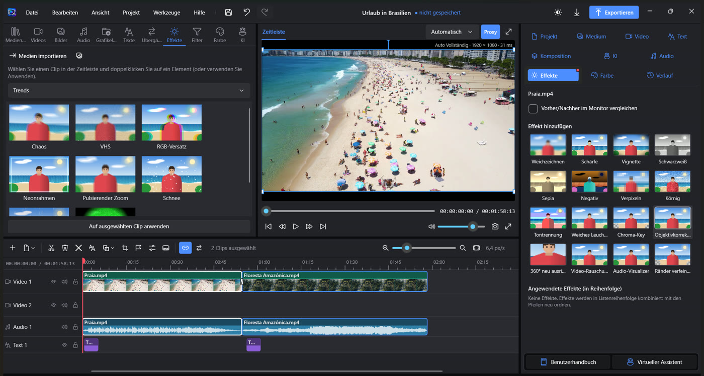

Die Registerkarte **Effekte** hat zwei Teile. Oben ein Raster mit einem Miniaturbild jedes Effekts, das das Ergebnis an einer Beispielszene zeigt: Klicken Sie auf eines, um den Effekt zum Clip hinzuzufügen. Unten die Liste **Angewendete Effekte**, in der Reihenfolge, in der die Effekte verarbeitet werden. Jeder Effekt der Liste hat Schieberegler für seine Einstellungen sowie die Schaltflächen **Nach oben**, **Nach unten** und **Effekt entfernen**. Der Pfeil links neben dem Namen blendet die Einstellungen ein oder aus. Doppelklicken Sie auf einen Schieberegler, um zum Standardwert zurückzukehren. Bei Farbeinstellungen zeigt ein farbiger Streifen unter dem Regler die Wirkung des Werts (zum Beispiel Blau bis Orange bei der Temperatur).

Verfügbare visuelle Effekte:

- **Weichzeichnen**, **Schärfen**, **Vignette**, **Schwarzweiß**, **Sepia**, **Negativ**, **Verpixeln**, **Körnung**, **Tontrennung** und **Weiches Leuchten**.
- **Chroma-Key**: entfernt einen grünen, blauen oder anders gewählten Hintergrund. Mit Toleranz, Weichheit des Übergangs, Kantenglättung, Entfernung des Farbüberstrahlens und der Option, den Hintergrund transparent oder einfarbig zu machen.
- **Kanten verfeinern**: zieht den Rand der Transparenz zusammen oder dehnt ihn aus, glättet ihn und bereinigt die Kantenfarbe. Verwenden Sie dies nach dem Chroma-Key oder einer Maske.
- **360°-Neuausrichtung**: verwandelt ein 360°-Video (equirektangular, Breite gleich der doppelten Höhe) in eine normale Ansicht. Stellen Sie **Richtung**, **Neigung**, **Rollen** und **Sichtfeld** ein und wählen Sie das **Seitenverhältnis der Ansicht** (16:9, 9:16, 1:1, 4:3 oder 4:5). Erstellen Sie Keyframes auf diesen Werten, damit sich die virtuelle Kamera durch das Video bewegt.
- **Objektivkorrektur**: korrigiert die Krümmung gerader Linien durch Weitwinkelobjektive und Actionkameras (negative Werte) oder durch Teleobjektive (positive). **Zoom zum Ausblenden der Ränder** vergrößert das Bild, um die leeren Ecken zu entfernen.
- **Video-Rauschunterdrückung**: glättet das Rauschen von Aufnahmen bei wenig Licht. **Details erhalten** bewahrt mehr Struktur.
- **Audio-Visualizer**: Balken (normal oder gespiegelt) oder eine Welle, die zum Klang eines Musikstücks tanzen. Wählen Sie beim Hinzufügen das Musikstück aus der Bibliothek; es muss in der Zeitleiste liegen. Stellen Sie Anzahl der Balken, Höhe, Farbe und Deckkraft ein. Verwenden Sie ihn auf einem Video- oder Bildclip (zum Beispiel einem Hintergrund).

Auf den Registerkarten **Effekte** und **Farbe** zeigt die Option **Vorher/Nachher im Monitor vergleichen** links einer Linie im Monitor das Video ohne Effekte und ohne Farbkorrektur zum Vergleich. Ziehen Sie den Griff der Linie nach rechts oder links, um die Teilung zu verändern.

Die Karten der bereits auf den Clip angewendeten Optionen haben einen hervorgehobenen Rand. Ein Doppelklick auf eine angewendete Karte nimmt die Option zurück: Er entfernt den Effekt oder, bei einer Farbvoreinstellung, die von ihr erstellten Anpassungen (sofern Sie sie nicht geändert haben).

### Farbe

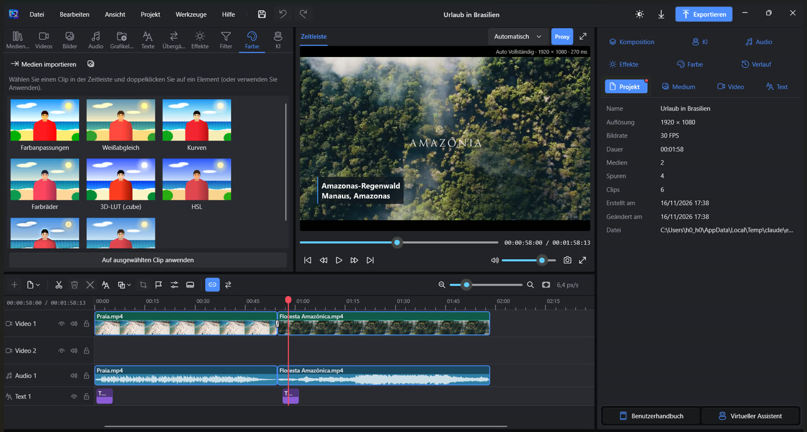

Die Registerkarte **Farbe** beginnt mit den **Voreinstellungen**: Schwarzweiß, Noir, Kino, Lebendig, Warm, Kühl, Verblasst, Retro und Hell und luftig. Klicken Sie auf ein Miniaturbild, um den Stil auf den Clip anzuwenden. Die Voreinstellung erscheint in der Liste der angewendeten Korrekturen als normale Anpassungen, die Sie ändern oder entfernen können; **Rückgängig** (Strg+Z) macht alles auf einmal rückgängig.

Darunter, unter **Farbwerkzeuge** (und im Bereich **Farbe** der Bibliothek), befinden sich die Werkzeuge zur Farbkorrektur:

- **Farbanpassungen**: Belichtung, Helligkeit, Kontrast, Sättigung, Temperatur, Tönung (Grün oder Magenta), Farbton, Tiefen und Lichter.
- **Weißabgleich**: Geben Sie die Farbe an, die neutralgrau sein sollte, und das Programm korrigiert den Farbstich.
- **Kurven**: Tonwertkurven des ganzen Videos und pro Kanal (Rot, Grün und Blau).
- **Farbräder**: getrennte Anpassung von Tiefen, Mitteltönen und Lichtern.
- **3D-LUT (.cube)**: wendet eine Farbtabelle im .cube-Format an, die oft verwendet wird, um einem Video einen Stil zu geben. Wählen Sie die Intensität mit dem Schieberegler.
- **HSL**: passt Farbton, Sättigung und Luminanz jedes Farbbereichs (Rot, Orange, Gelb, Grün, Cyan, Blau, Violett und Magenta) an, ohne die anderen zu verändern, zum Beispiel nur das Blau des Himmels. Grautöne, Schwarz und Weiß ändern sich nicht.
- **HDR**: HDR-Look, der Tiefen und Lichter zurückholt und Details verstärkt. Mit Intensität, Tiefen, Lichtern, Details und Dynamik.
- **Farbe angleichen**: gleicht Farbe und Kontrast eines Clips an die eines anderen an. Wählen Sie den Clip aus und verwenden Sie auf der Registerkarte **KI** die Option **Farbe an vorherigen Clip angleichen**: Das Programm vergleicht drei Bilder jedes Clips und erstellt den Effekt mit Verstärkung und Versatz pro Kanal. Stellen Sie die **Intensität** für einen Mittelweg ein.

### Masken, Verfolgung und Stabilisierung

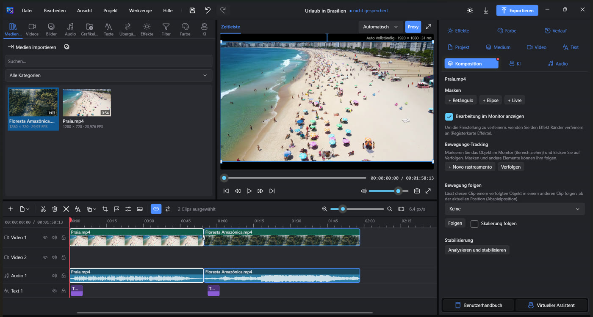

Diese Funktionen befinden sich auf der Registerkarte **Komposition**. Sie funktionieren für Videos, Bilder, Texte und Grafikelemente.

- **Masken**: Erstellen Sie eine Form mit **+ Rechteck**, **+ Ellipse** oder **+ Frei** (Punkte, mit Strg+Klick im Monitor). Die Maske beschneidet, was vom Clip sichtbar ist. Sie können Masken addieren, subtrahieren oder schneiden, die Maske umkehren und die Kontur weichzeichnen.
- **Farbmaske (nur Effekte)**: Wenn aktiviert, beschneidet die Maske den Clip nicht; sie begrenzt Farbkorrektur und Effekte auf ihren Bereich (zum Beispiel nur das Gesicht aufhellen oder nur ein Nummernschild unscharf machen). Der weiche Rand der Maske bildet den Übergang.
- **Formschlüssel**: Mit der Schaltfläche **◇ Formschlüssel** ändert die Maske im Lauf der Zeit ihre Form.
- **Bewegungsverfolgung**: Markieren Sie ein Objekt im Monitor, klicken Sie auf **Verfolgen**, und das Programm folgt diesem Objekt. Ein anderer Clip kann dann mit der Option **Folgen** der Bewegung **folgen**. Verwenden Sie **Lösen**, um es auszuschalten.
- **Stabilisierung**: **Analysieren und stabilisieren** misst die Kamerabewegung und gleicht Wackeln aus. Stellen Sie **Glättung** und **Vergrößerung** des Bildes ein. Verwenden Sie **Stabilisierung entfernen**, um es rückgängig zu machen.

### Grafikelemente und Formen

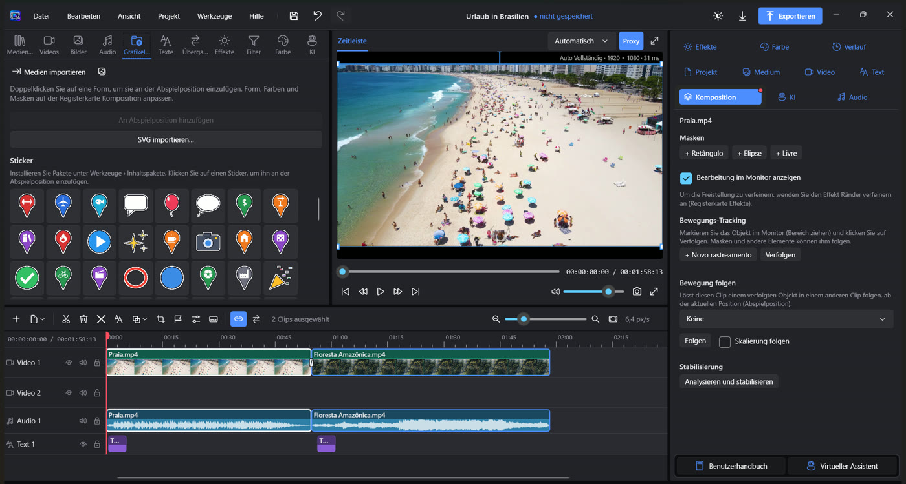

Doppelklicken Sie im Bereich **Grafikelemente** der Bibliothek auf eine Form, um sie an der Abspielposition einzufügen. Verfügbare Formen sind: Rechteck, Abgerundetes Rechteck, Kreis, Linie, Pfeil, Stern, Sechseck, Sprechblase und Herz. Füllung und Konturfarbe stellen Sie auf der Registerkarte **Komposition** ein.

Sie können auch über die Schaltfläche **SVG importieren…** eine Vektorgrafik importieren.

Unter **Sticker** erscheinen die Sticker der installierten Pakete. Das Programm wird mit dem Paket **Basis** mit 96 Stickern ausgeliefert: häufig verwendete (Pfeile, Hervorhebungskreis, richtig und falsch, Sprechblasen, Herz, Stern, Emojis, Schaltflächen Abonnieren und Gefällt mir, Siegel wie Neu und Angebot und andere), geometrische Formen (Kreis, Quadrat, Rechteck, Dreieck, Raute, Fünfeck und Sechseck), Kartenpins mit quadratischem, rundem, sechseckigem, rautenförmigem, Stern-, Herz- oder Dreieckskopf sowie Pins für Orte in der Stadt (Flughafen, Bus-, Bahn- und U-Bahn-Station, Krankenhaus, Polizei, Feuerwehr, Schule, Museum, Park, Restaurant, Hotel und andere). Es kann nicht entfernt, aber exportiert werden. Klicken Sie auf einen, um ihn 3 Sekunden lang mit 40 % Größe (auf der Registerkarte Video anpassbar) an der Abspielposition auf einer freien Bildspur (oder einer neuen Spur namens Sticker) einzufügen. Das Bild kommt auch in die Bibliothek, in die Kategorie Sticker.

### Texte und Untertitel

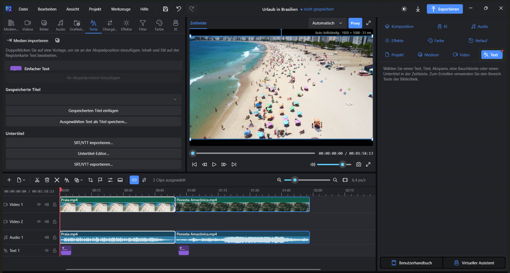

### Texte einfügen

Doppelklicken Sie im Bereich **Texte** der Bibliothek auf eine Vorlage, um sie an der Abspielposition einzufügen:

- **Einfacher Text**: fetter Text mit weichem Schatten.
- **Titel**: großer Titel in der Mitte mit Zoom-Einstieg.
- **Bauchbinde (Lower Third)**: Name und Funktion unten links, mit Kasten und Akzentbalken.
- **Abspann**: Liste von Mitwirkenden, die während des Clips über den Bildschirm nach oben läuft.
- **Untertitel**: Untertitel auf der Untertitelspur, mit dunklem Kasten am unteren Bildrand.

Wählen Sie den Text in der Zeitleiste aus, um ihn zu bearbeiten. Die Registerkarte **Text** der Eigenschaften enthält:

- **Inhalt**: der Text. Drücken Sie die Eingabetaste für einen Zeilenumbruch.
- **Schriftart**: Windows-Schriftarten oder mit **+ Schriftart** zum Programm hinzugefügte Schriftarten (.ttf- oder .otf-Dateien).
- **Fett**, **Kursiv** und **Unterstrichen**.
- **Farben** von Text, Kontur, Hintergrundkasten und Schatten. Verwenden Sie das Format #RRGGBB oder #AARRGGBB, um die Farbe festzulegen.
- **Ausrichtung** und **Ankerpunkt**.
- **Eingangsanimation** und **Ausgangsanimation**: zum Beispiel Blende, Schieben oder Zoom.

Position, Skalierung, Drehung und Deckkraft des Texts befinden sich auf der Registerkarte **Video**.

Um einen fertigen Text (Stil, Animationen und Dauer) wiederzuverwenden, wählen Sie ihn aus und verwenden Sie im Bereich Texte (oder im Kontextmenü des Clips) **Ausgewählten Text als Titel speichern…**. Er erscheint unter **Gespeicherte Titel**; wählen Sie ihn aus und klicken Sie auf **Gespeicherten Titel einfügen**, um ihn an der Abspielposition einzufügen. Titel aus installierten Paketen erscheinen in derselben Liste.

### Untertitel

Untertitel sind Texte mit Zeitangaben, die auf der Untertitelspur angeordnet sind. So arbeiten Sie mit ihnen:

- **Werkzeuge › Untertitel importieren (SRT/VTT)…**: holt eine fertige Untertiteldatei herein.
- **Werkzeuge › Untertitel exportieren (SRT/VTT)…**: speichert die Untertitel des Projekts als SRT- oder VTT-Datei.
- **Werkzeuge › Untertitel-Editor**: öffnet ein Fenster, um alle Untertitel zu sehen und zu bearbeiten. Sie können Text und Zeiten hinzufügen, entfernen und bearbeiten, zu einem bestimmten Untertitel springen und alle auf einmal um Sekunden verschieben.
- **Untertitel erzeugen**: erstellt Untertitel automatisch aus der Sprache. Siehe Abschnitt Künstliche Intelligenz.

Beim Exportieren des Videos können Sie wählen, ob eine Untertiteldatei neben dem Video gespeichert oder die Untertitel direkt ins Video gezeichnet werden (eingebrannte Untertitel).

## Audio

### Audiomixer

Öffnen Sie den Mixer unter **Werkzeuge › Audiomixer** oder über die Schaltfläche in der Symbolleiste. Er zeigt für jede Audiospur eine Spalte mit:

- **Lautstärke** (Fader) und **Panorama** (links und rechts). Doppelklicken Sie auf den Fader oder das Panorama, um zum Standard zurückzukehren.
- **M** (stumm): schaltet die Spur stumm.
- **S** (Solo): lässt nur die Solo-Spuren spielen.
- Pegelanzeigen, die sich während der Wiedergabe bewegen.

### Registerkarte Audio des Clips

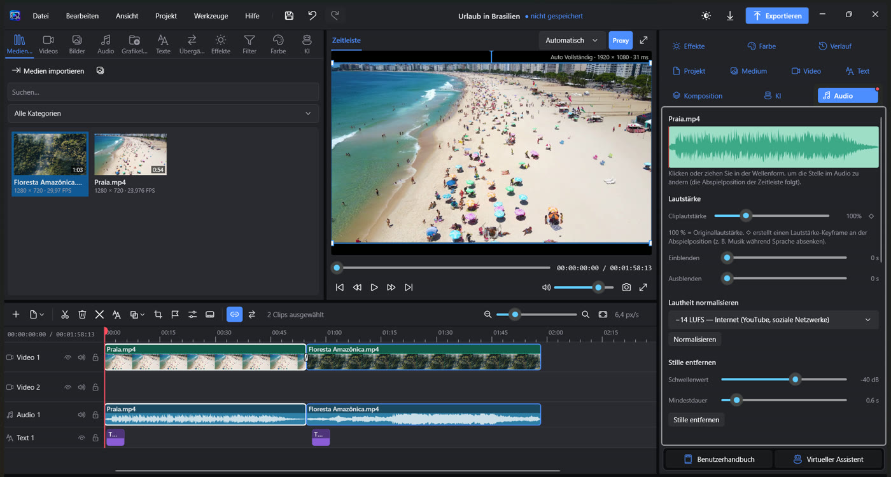

Wählen Sie einen Audioclip oder ein Video mit Ton aus und verwenden Sie die Registerkarte **Audio**:

- **Wellenform**: Oben im Reiter wird das Audio des Clips angezeigt, mit der Abspielposition der Zeitleiste in Rot. Klicken oder ziehen Sie darauf, um zu einer anderen Stelle im Audio zu springen; Abspielposition und Monitor folgen.
- **Lautstärke**: 100 % ist die Originallautstärke. Mit der Schaltfläche ◇ erstellen Sie einen Lautstärke-Keyframe. So können Sie zum Beispiel die Musik während eines Redebeitrags absenken.
- **Einblenden** und **Ausblenden**: Blenden von 0 bis 10 Sekunden, damit der Ton sanft beginnt und endet.
- **Lautheit normalisieren**: passt die Lautstärke an ein Lautheitsziel an (Norm EBU R128), ohne einen sicheren Spitzenpegel zu überschreiten. Wählen Sie das **Lautheitsziel** vor dem Anwenden.
- **Stille entfernen**: schneidet die stillen Abschnitte des Clips heraus. Stellen Sie den **Schwellenwert** ein, unterhalb dessen Ton als Stille gilt, sowie die **Mindestdauer** der Stille.
- **Beats**: Wenn die Musik ausgewählt ist, erstellt **Beats markieren** einen Marker auf jedem Beat, und **Videos an Beats schneiden** teilt die Video- und Bildclips, die gleichzeitig laufen, an jedem Beat (für rhythmische Montagen). Stellen Sie die **Empfindlichkeit** ein: höher findet mehr Beats.
- **Unter Sprache absenken**: Wenn die Musik ausgewählt ist, klicken Sie auf **Unter Sprache absenken**, und das Programm senkt ihre Lautstärke an Stellen, an denen auf den anderen Spuren gesprochen wird (Sprecher, Interview). Wählen Sie die **Absenkung** (Standard −12 dB) und den **Übergang** (Dauer des Absenkens und Anhebens). Das Ergebnis sind Lautstärke-Keyframes, die Sie anpassen können; **Absenkung entfernen** löscht diese Animation. Mit installiertem Spracherkennungsmodell ist die Erkennung genauer; ohne es verwendet das Programm den Tonpegel.
- **Über Audio synchronisieren**: Wenn Sie denselben Moment mit zwei Kameras oder einem Tonrekorder aufgenommen haben, wählen Sie beide Clips aus und klicken auf **Synchronisieren**. Das Programm richtet die beiden Töne aneinander aus. Der Clip auf der höheren Spur bleibt stehen, der andere wird verschoben.
- **Tonhöhe bei Geschwindigkeit beibehalten**: Wenn der Clip beschleunigt oder verlangsamt wird, behält die Stimme eine natürliche Tonhöhe.

### Audioeffekte

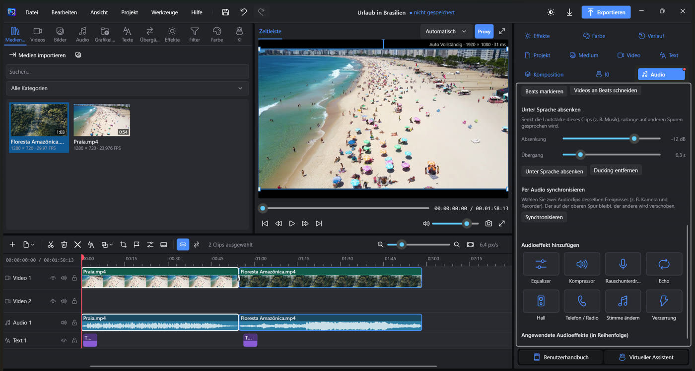

Auf derselben Registerkarte finden Sie unter **Audioeffekt hinzufügen** die Effekte:

- **Equalizer**: Bässe, Mitten und Höhen, mit Tiefenfilter.
- **Kompressor**: gleicht laute und leise Passagen an, mit Schwellenwert, Verhältnis, Attack, Release und Ausgleichsverstärkung.
- **Rauschunterdrückung**: verringert Rauschen und gleichmäßige Geräusche wie Lüfter oder Klimaanlage. Mit Intensität und Empfindlichkeit.
- **Echo**: verzögerte Wiederholungen des Tons.
- **Hall**: simuliert den Klang eines Raums.
- **Telefon / Radio**: Klang eines Telefons oder alten Radios.
- **Verzerrung**: Sättigung des Tons.
- **Stimme ändern**: fertige Stimmen (**Tief**, **Hoch**, **Streifenhörnchen**, **Monster** und **Roboter**) oder unter **Benutzerdefiniert** die **Tonhöhe** in Halbtönen und die Intensität des **Roboters**. Die Geschwindigkeit ändert sich nicht.

Die Effekte werden in der Reihenfolge angewendet, in der sie in der Liste **Angewendete Audioeffekte** erscheinen.

## Künstliche Intelligenz

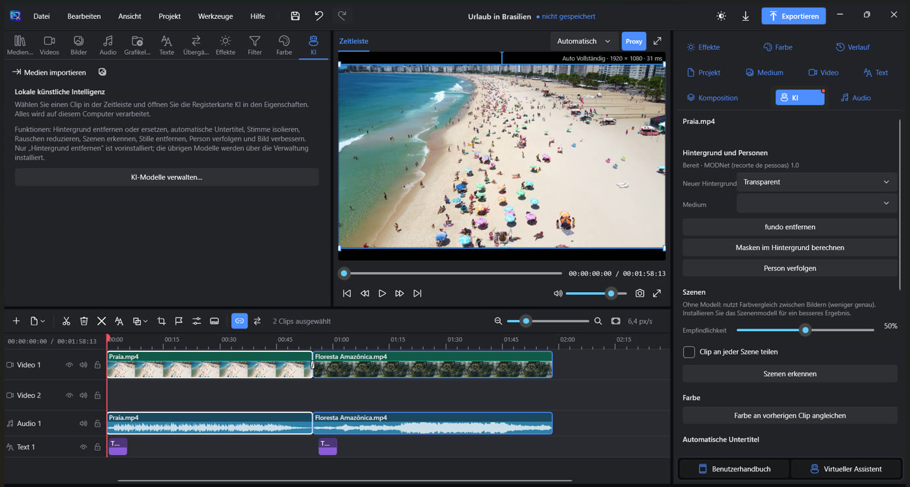

Die Funktionen der künstlichen Intelligenz laufen ausschließlich auf Ihrem Computer. Weder Video noch Audio, Bild oder Text wird ins Internet gesendet.

Die Funktionen befinden sich auf der Registerkarte **KI** der Eigenschaften, wenn Sie einen Clip in der Zeitleiste auswählen. Der Bereich **KI** der Bibliothek fasst die Funktionen zusammen und enthält die Schaltfläche **KI-Modelle verwalten…**, die die Modellverwaltung öffnet.

### Benötigte Modelle

Jede Funktion verwendet ein KI-Modell. Das Modell für **Hintergrund entfernen** wird mit dem Programm geliefert. Die übrigen müssen einmalig mit dem Werkzeug **KI-Modelle herunterladen** installiert werden. Wenn das Modell einer Funktion nicht installiert ist, ist die Schaltfläche deaktiviert und die Meldung „Nicht verfügbar — installieren Sie das Modell unter Werkzeuge › KI-Modelle.“ erscheint.

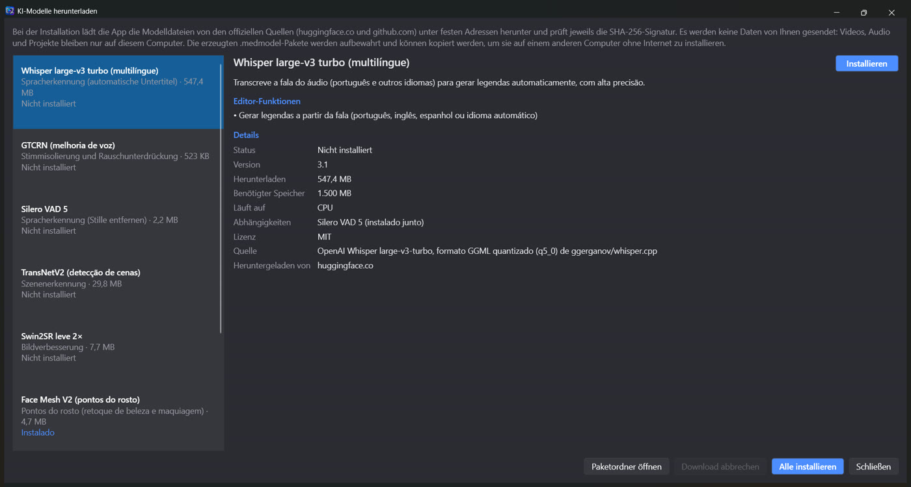

| Funktion | Modell | Installation nötig | Läuft auf |
|---|---|---|---|
| Hintergrund entfernen | MODNet | Nein, im Programm enthalten | CPU oder GPU |
| Masken im Hintergrund berechnen | MODNet | Nein, im Programm enthalten | CPU oder GPU |
| Person verfolgen | MODNet | Nein, im Programm enthalten | CPU oder GPU |
| Untertitel erzeugen | Whisper large-v3 turbo | Ja, etwa 550 MB | Nur CPU |
| Stimme isolieren | GTCRN | Ja, etwa 0,5 MB | Nur CPU |
| Rauschen mit KI reduzieren | GTCRN | Ja, etwa 0,5 MB | Nur CPU |
| Abschnitte ohne Sprache entfernen | Silero VAD 5 | Ja, etwa 2,3 MB | Nur CPU |
| Szenen erkennen | TransNetV2 | Ja, etwa 31 MB | CPU oder GPU |
| Bild verbessern | Swin2SR leicht 2× | Ja, etwa 8 MB | CPU oder GPU |
| Retuschieren (Schönheit und Make-up) und Gesichter unkenntlich machen | Face Mesh V2 | Ja, etwa 5 MB | Nur CPU |
| Virtueller Assistent (Antworten in natürlicher Sprache) | Phi-4-mini-instruct | Ja, etwa 3,2 GB | CPU oder GPU |

Die Szenenerkennung funktioniert auch ohne das Modell TransNetV2, indem die Bilder des Videos verglichen werden. In diesem Fall ist die Genauigkeit geringer.

Die Spracherkennung (Untertitel) verwendet Silero VAD, um die Abschnitte mit Sprache zu finden. Wenn Sie Whisper installieren, wird Silero VAD automatisch mitinstalliert.

> Die Modelle der Tabelle belegen Speicherplatz auf der Festplatte und bei der Nutzung auch Arbeitsspeicher. Whisper zum Beispiel benötigt etwa 1,5 GB freien Arbeitsspeicher.

### Hintergrund entfernen

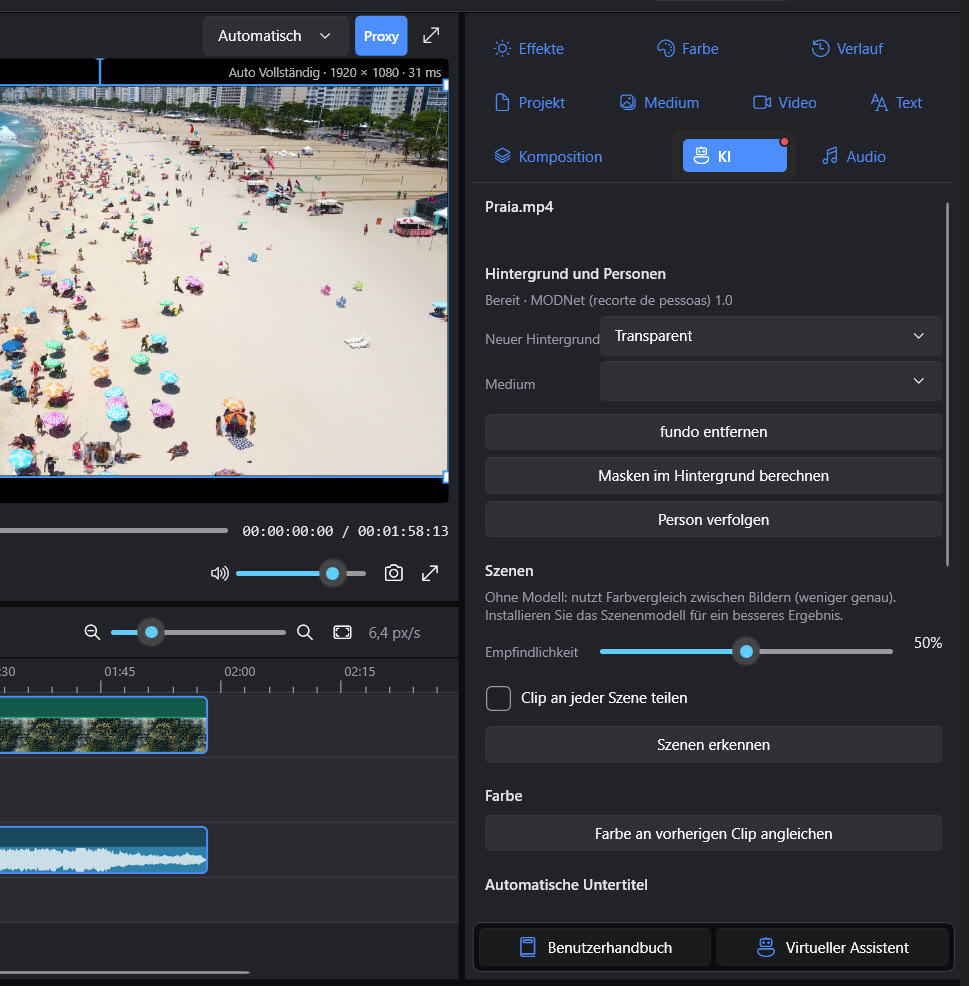

Trennt die Person vom Hintergrund und macht den Hintergrund transparent oder ersetzt ihn durch etwas anderes. Verwenden Sie auf der Registerkarte **KI** die Option **Hintergrund mit KI entfernen**.

- **Neuer Hintergrund**: Wählen Sie **Transparent**, **Volltonfarbe**, **Weichzeichnen** oder **Bild oder Video aus der Bibliothek**. Im letzten Fall wählen Sie die Datei unter **Hintergrundmedium**.
- **Beibehalten**: Behalten Sie die Person (Vordergrund) oder den Hintergrund, um die Person zu entfernen.
- **Einstellungen**: Maskenschwelle, Zusammenziehen oder Ausdehnen des Randes, Randglättung und Glättung zwischen Bildern befinden sich auf der Registerkarte **Effekte** unter **Angewendete Effekte**. Die Glättung zwischen Bildern verringert das Flackern des Randes von Bild zu Bild.

Das Modell wurde hauptsächlich für Porträts trainiert. In Szenen mit personenähnlichen Objekten kann es Teile des Hintergrunds behalten.

Verwenden Sie **Masken im Hintergrund berechnen**, um den ganzen Clip vorab zu verarbeiten. So werden Wiedergabe und Export schneller. Das Ergebnis wird im Cache gespeichert.

Verwenden Sie **Person mit KI verfolgen**, um eine Verfolgung der Person zu erstellen. Anschließend können Sie auf der Registerkarte **Komposition** Texte oder Grafikelemente daran binden.

### Untertitel erzeugen

Erstellt Untertitel automatisch aus der Sprache des Clips.

1. Wählen Sie den Clip aus und gehen Sie zur Registerkarte **KI**.
2. Wählen Sie unter **Sprache der Aufnahme** Portugiesisch, Englisch, Spanisch oder die automatische Sprache.
3. Klicken Sie auf **Untertitel mit KI erzeugen**.
4. Die Untertitel erscheinen auf der Untertitelspur. Überprüfen Sie sie im **Untertitel-Editor**.

Die Erkennung läuft auf dem Prozessor und dauert für ein 10-minütiges Video etwa 4 Minuten. Verfolgen Sie den Fortschritt in der Fortschrittsleiste der Registerkarte.

### Stimme isolieren und Rauschen reduzieren

- **Stimme mit KI isolieren**: trennt die Stimme von der Umgebung. Das Programm erstellt zwei neue Spuren, eine mit der Stimme und eine mit der Umgebung.
- **Rauschen mit KI reduzieren**: verringert das Hintergrundrauschen mit der gewählten **Stärke der Rauschunterdrückung**. Nützlich für Aufnahmen mit Rauschen oder Brummen.

Diese Vorgänge verwenden den Ton des Clips so, wie er in der Zeitleiste klingt. Die Option **Originalton stummschalten** verhindert, dass der alte Ton zusammen mit dem neuen zu hören ist.

### Abschnitte ohne Sprache entfernen

Findet die Abschnitte ohne Sprache und entfernt sie aus dem Clip. Legen Sie mit **Mindestpause** die Mindestdauer einer Pause fest, die geschnitten wird, und klicken Sie dann auf **Abschnitte ohne Sprache mit KI entfernen**. Diese Funktion benötigt das installierte Modell Silero VAD; ohne es ist die Schaltfläche nicht verfügbar. Um Stille ohne KI zu schneiden, verwenden Sie die Registerkarte **Audio** (**Stille entfernen**).

### Szenen erkennen

Sucht nach Szenenwechseln im Video und erstellt an jedem einen Marker.

1. Wählen Sie den Clip aus und gehen Sie zur Registerkarte **KI**.
2. Stellen Sie die **Empfindlichkeit** der Szenen ein. Je höher, desto mehr Szenen werden gefunden.
3. Aktivieren Sie **Clip an jeder Szene teilen**, wenn der Clip an jeder Szene geschnitten werden soll.
4. Klicken Sie auf **Szenen erkennen**.

### Bild verbessern

Vergrößert ein Foto um 2× und rekonstruiert dabei Details. Wählen Sie das Bild aus, gehen Sie zur Registerkarte **KI** und klicken Sie auf **Bild mit KI verbessern**. Der Clip verwendet nun das neue Bild. Um zum Original zurückzukehren, verwenden Sie **Rückgängig**.

### Virtueller Assistent

Beantwortet Fragen zum Programm und zur Videobearbeitung anhand dieses Handbuchs, in der Sprache des Programms und ohne Internet. Öffnen Sie ihn über **Hilfe › Virtueller Assistent** (Umschalt+F1): Der Bereich erscheint rechts im Editor. Geben Sie die Frage ein und drücken Sie die Eingabetaste (Umschalt+Eingabe fügt eine Zeile ein); ohne Unterhaltung schlägt der Bereich einige Fragen vor.

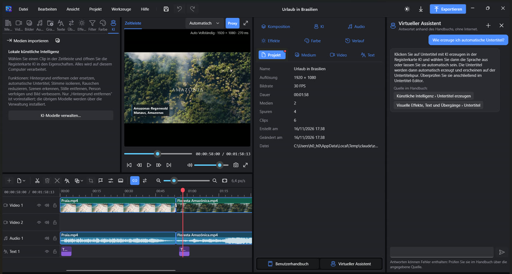

- Mit installiertem Sprachmodell **Phi-4-mini** schreibt der Assistent eine kurze Antwort, die nur die gefundenen Handbuchauszüge verwendet, und zeigt die **Quelle im Handbuch**: Ein Klick darauf öffnet das Handbuch an dieser Stelle. Die Stopp-Schaltfläche bricht die Antwort ab.
- Ohne das Modell zeigt der Assistent die Abschnitte des Handbuchs zum Thema, jeweils mit einem Auszug und der Schaltfläche **Im Handbuch öffnen**. Der Hinweis oben im Bereich installiert das Modell (etwa 3,2 GB, einmalig von den offiziellen Quellen heruntergeladen), ohne den Editor zu verlassen; **Jetzt nicht** blendet den Hinweis aus.
- Das Modell nutzt die Grafikkarte, wenn das **KI-Gerät** auf **GPU (DirectML)** steht (unter **Einstellungen › Leistung**), sonst den Prozessor. Die erste Frage dauert einige Sekunden länger, weil das Modell geladen wird; beim Schließen des Bereichs wird es aus dem Speicher entfernt.
- **Neue Unterhaltung** löscht die Unterhaltung. Antworten können Fehler enthalten: Prüfen Sie sie im angegebenen Abschnitt.

### Eine Verarbeitung abbrechen

Während eine KI-Funktion läuft, erscheint eine Fortschrittsleiste. Klicken Sie auf **KI-Verarbeitung abbrechen**, um sie zu unterbrechen.

## Das Video exportieren

Exportieren heißt, die endgültige Videodatei zu erzeugen. Klicken Sie oben rechts im Fenster auf **Exportieren** oder verwenden Sie **Datei › Exportieren…** (Tastenkombination Strg+E).

### Exportvorlagen

Wählen Sie in der Liste links im Exportfenster eine Vorlage. Jede Vorlage enthält bereits die passenden Einstellungen für eine Plattform:

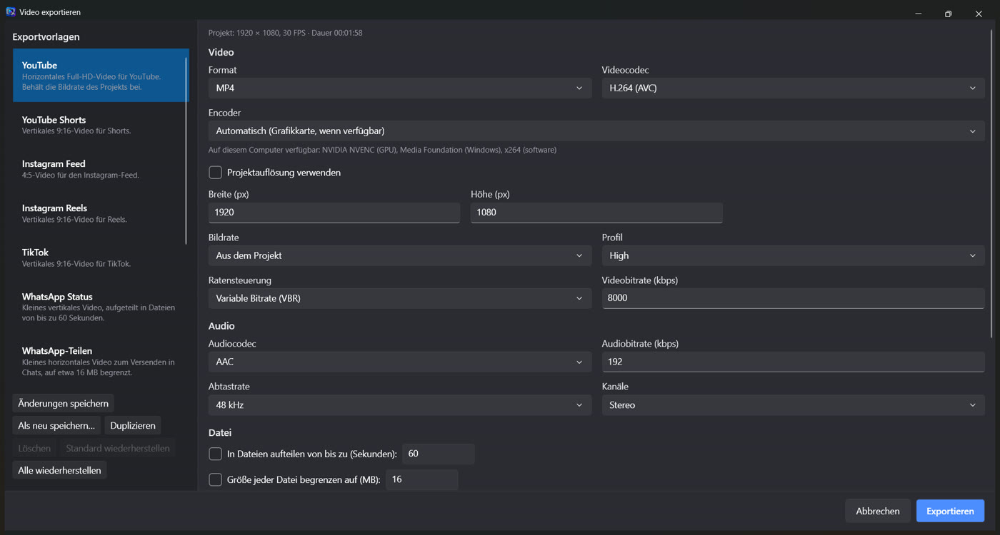

- YouTube
- YouTube Shorts
- Instagram Feed
- Instagram Reels
- TikTok
- WhatsApp Status
- WhatsApp-Teilen
- Facebook Feed
- Facebook Reels
- Präsentationen
- Computer und Notebooks
- Benutzerdefinierter Export

Passen Sie die Parameter an und klicken Sie, wenn Sie möchten, auf **Als neu speichern…**, um Ihre Einstellungen zu behalten. Eigene Vorlagen tragen das Abzeichen „Meine Vorlage“ und können bearbeitet, dupliziert oder gelöscht werden. Standardvorlagen können nicht gelöscht werden, aber Sie können mit **Standard wiederherstellen** die ursprünglichen Einstellungen einer Vorlage zurückholen oder **Alle wiederherstellen** verwenden.

### Parameter

- **Dateiformat**: MP4, MOV (QuickTime), MKV, WebM, AVI, MPEG-2 (.mpg) und animiertes GIF. Nicht jedes Format akzeptiert jeden Codec. Wenn die Kombination nicht möglich ist, weist das Fenster darauf hin.
- **Encoder**: **Automatisch (Grafikkarte, wenn verfügbar)**, **Grafikkarte** oder **Software (am kompatibelsten)**. Der Software-Modus ist am sichersten für Dateien, die auf jedem Gerät abspielbar sein müssen.
- **Videocodec**: H.264 (AVC), H.265 (HEVC), AV1, VP9, Apple ProRes, FFV1, QuickTime Animation, Motion JPEG, MPEG-2 oder GIF. Wählen Sie in den meisten Fällen H.264.
- **Profil**: Standard, High, Main oder Baseline des Codecs. Behalten Sie Standard bei, wenn Sie unsicher sind.
- **Ratensteuerung**: **Variable Bitrate (VBR)**, **Konstante Bitrate (CBR)** oder **Konstante Qualität**. Verwenden Sie bei konstanter Qualität Werte zwischen 18 und 23; kleinere Zahlen bedeuten bessere Qualität.
- **Videobitrate (kbps)**: je höher, desto besser die Qualität und desto größer die Datei. Verwenden Sie für das Internet den von der Vorlage vorgeschlagenen Wert.
- **Auflösung**: Aktivieren Sie **Projektauflösung verwenden** oder geben Sie Breite und Höhe in Pixeln an.
- **Bildrate**: **Vom Projekt** oder eine der Standardraten (23,976, 24, 25, 29,97, 30, 50, 59,94 und 60 FPS).
- **Audiocodec**, **Abtastrate** (44,1 kHz, 48 kHz oder 96 kHz), **Kanäle** (Mono, Stereo oder 5.1) und **Audiobitrate (kbps)**.
- **Transparenz exportieren (Alphakanal)**: behält den transparenten Hintergrund bei. Verwenden Sie dies mit ProRes 4444, QuickTime Animation, FFV1, VP9 oder GIF.

### Bereich und Aufteilung der Datei

- **Bereich**: Wählen Sie **Gesamte Sequenz**, um das ganze Projekt zu exportieren, oder **Benutzerdefinierter Bereich**, um nur einen Abschnitt zu exportieren. Legen Sie **Anfang** und **Ende** fest oder verwenden Sie **Anfang an der Abspielposition**.
- **In Dateien aufteilen**: teilt den Export in Teile bis zu einer bestimmten Dauer in Sekunden oder mit einer Größenbegrenzung in MB. Nützlich für Plattformen mit Größenbeschränkung.

### Untertitel beim Export

Wählen Sie unter **Untertitel** **Keine**, **SubRip (.srt)** oder **WebVTT (.vtt)**, um eine Untertiteldatei neben dem Video zu speichern. Aktivieren Sie **Untertitel ins Video zeichnen (eingebrannte Untertitel)**, damit die Untertitel ins Bild geschrieben werden.

### Ziel und Start

1. Wählen Sie den **Zielordner** und den **Dateinamen**.
2. Aktivieren Sie **Im Hintergrund rendern**, wenn Sie weiterarbeiten möchten, während das Video erzeugt wird.
3. Klicken Sie auf **Exportieren**, um zu starten.

### Render-Warteschlange

Jeder Export kommt in die Render-Warteschlange. Öffnen Sie die Warteschlange mit der Schaltfläche **Render-Warteschlange** oder über **Datei › Render-Warteschlange…**. Für jedes Element zeigt die Warteschlange Status, Fortschritt, Geschwindigkeit und verbleibende Zeit:

- **In Warteschlange**: wartet, bis es an der Reihe ist.
- **Wird gerendert**: läuft.
- **Abgeschlossen**: fertig. Verwenden Sie **Exportierte Datei öffnen** oder **Im Ordner anzeigen**.
- **Unterbrochen**: kann mit **Fortsetzen** weitergeführt werden. Beim Fortsetzen verwendet das Programm die bereits erzeugten Blöcke wieder.
- **Fehlgeschlagen**: Die Meldung erklärt den Grund.
- **Abgebrochen**: vom Benutzer unterbrochen.

Verwenden Sie **Export abbrechen**, um ein Element anzuhalten, **Aus der Warteschlange entfernen**, um es aus der Liste zu nehmen, und **Abgeschlossene löschen**, um fertige Elemente zu entfernen.

## Speichern, automatisches Speichern und Wiederherstellung

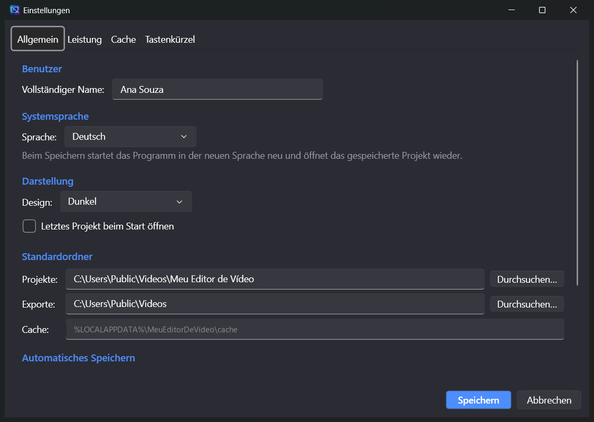

### Das Projekt speichern

- **Datei › Speichern** (Strg+S): schreibt die Änderungen in die Projektdatei.
- **Datei › Speichern unter…** (Strg+Umschalt+S): schreibt eine Kopie des Projekts unter einem anderen Namen oder in einen anderen Ordner. Das Projekt erhält den Namen der Datei, der im Fenstertitel erscheint.
- **Datei › Sicherungskopie erstellen**: erstellt eine Sicherungskopie des Projekts zum aktuellen Zeitpunkt. Das Programm behält bis zu 10 Kopien jedes Projekts im Sicherungsordner der Anwendung.

Die Projektdatei hat die Endung .med. Das Programm verändert die Original-Mediendateien nicht.

### Automatisches Speichern

Standardmäßig speichert das Programm alle 5 Minuten eine Wiederherstellungskopie. Sie können diese Option ausschalten oder das Intervall ändern, unter **Werkzeuge › Einstellungen…**, Registerkarte **Allgemein**.

Die Wiederherstellungskopie ersetzt nicht die Projektdatei. Sie wird nur angeboten, wenn das Programm nach einem unerwarteten Beenden geöffnet wird, etwa nach einem Stromausfall oder Absturz.

### Ein Projekt wiederherstellen

Wenn das Programm ohne Speichern geschlossen wurde, erscheint beim erneuten Öffnen die Frage „Projekt wiederherstellen“:

- **Ja**: öffnet das Projekt mit den letzten Änderungen.
- **Nein**: öffnet ein leeres Projekt; die Kopie bleibt gespeichert und wird beim nächsten Mal erneut angeboten.

> Es wird empfohlen, häufig manuell mit Strg+S zu speichern, auch wenn das automatische Speichern aktiviert ist.

## Einstellungen und Leistung

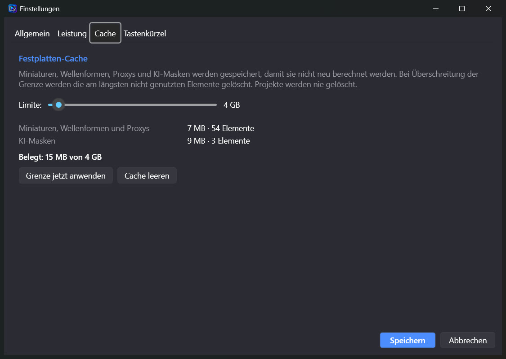

Öffnen Sie die Einstellungen unter **Werkzeuge › Einstellungen…** (Tastenkombination Strg+,). Die Einstellungen sind auf vier Registerkarten verteilt. Nichts wird gespeichert, bevor Sie auf **Speichern** klicken.

### Registerkarte Allgemein

- **Benutzer › Vollständiger Name**: Ihr Name.
- **Systemsprache › Sprache**: Deutsch, Spanisch, Französisch, Englisch, Portugiesisch (Brasilien) oder Portugiesisch (Portugal). Beim ersten Start verwendet das Programm die Windows-Sprache, wenn sie eine dieser ist, sonst Englisch. Beim Speichern wird das Programm in der neuen Sprache neu gestartet: Ungespeicherte Änderungen werden vorher abgefragt, und ein gespeichertes Projekt wird wieder geöffnet. Das Handbuch öffnet sich ebenfalls in der gewählten Sprache.
- **Design**: **Dunkel**, **Hell** oder **Wie Windows**. Sie können auch über die Schaltfläche **Design** in der oberen Leiste umschalten.
- **Nach Updates suchen › Monatlich prüfen**: **Ja** (Standard) oder **Nein**. Das Datum der letzten Prüfung erscheint daneben. Mit **Ja** prüft das Programm beim Öffnen selbst, ob es eine neue Version gibt, wenn seit der letzten Prüfung mehr als 30 Tage vergangen sind. Die Anfrage sendet nur die Sprache der Oberfläche; ohne Internet erscheint nichts.
- **Beim Start das letzte Projekt öffnen**.
- **Standardordner**: der Ordner für Projekte und der Ordner für Exporte.
- **Automatisches Speichern**: die Wiederherstellungskopie ein- oder ausschalten und das Intervall festlegen.

Name, Sprache, Design und Update-Einstellung werden in der Windows-Registrierung unter `HKEY_CURRENT_USER\Software\Meu Editor de Vídeo` gespeichert.

### Registerkarte Leistung

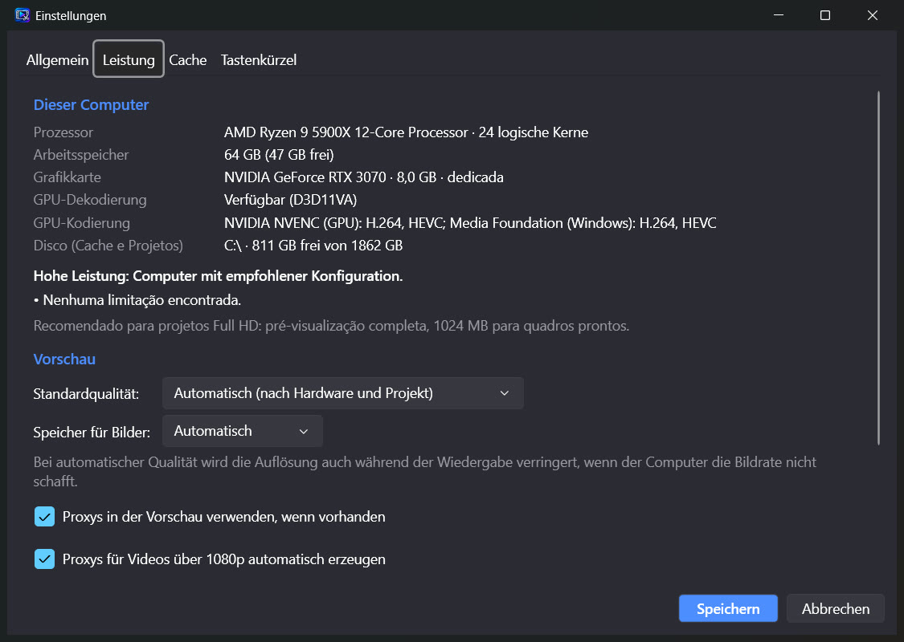

- **Erkannte Hardware**: zeigt Prozessor, Arbeitsspeicher, Grafikkarten, Laufwerke und ob die Grafikkarte Video dekodieren und kodieren kann. Das Programm zeigt außerdem die Grenzen des Computers und eine Nutzungsempfehlung.
- **Vorschau**: Die **Standardqualität der Vorschau** kann **Automatisch**, **Voll**, **1/2 der Auflösung** oder **1/4 der Auflösung** sein. Bei Automatisch wählt das Programm je nach Computer und Projekt und senkt die Auflösung während der Wiedergabe, wenn der Computer nicht mithält. **Speicher für Vorschaubilder** legt fest, wie viel Platz zum Speichern fertiger Bilder verwendet wird.
- **Proxys**: **Proxys in der Vorschau verwenden, wenn vorhanden** und **Proxys für Videos über 1080p automatisch erzeugen**.
- **Beschleunigung**: **Grafikkarte zum Dekodieren und Kodieren von Video verwenden** und **Export-Warteschlange im Hintergrund rendern**.
- **Künstliche Intelligenz**: Das **KI-Gerät** kann **GPU (DirectML), mit Rückfall auf die CPU**, oder **Nur CPU** sein. Bei der GPU-Option wird das Modell automatisch auf dem Prozessor geladen, wenn die Karte oder der Treiber versagt. Die Schaltfläche **Modelle verwalten…** öffnet das Fenster der KI-Modelle.

### Registerkarte Cache

Der Cache speichert Miniaturbilder, Wellenformen, Proxys und KI-Masken, damit sie nicht neu berechnet werden müssen. Auf dieser Registerkarte sehen Sie, wie viel Platz jeder Bereich belegt, legen das **Cache-Limit** in GB fest (Standard 4 GB) und können **Limit jetzt anwenden** oder **Cache leeren** verwenden.

Wenn das Limit überschritten wird, werden die am längsten nicht genutzten Elemente gelöscht. Projekte und Originalmedien werden beim Leeren des Caches nie gelöscht.

### Registerkarte Tastenkombinationen

Diese Registerkarte zeigt alle Aktionen des Programms, nach Kategorien gruppiert. So ändern Sie eine Tastenkombination:

1. Klicken Sie in das Feld der Tastenkombination.
2. Drücken Sie die neue Tastenkombination.
3. Klicken Sie auf **Speichern**.

Wenn die Kombination bereits von einer anderen Aktion verwendet wird, weist das Programm darauf hin und lässt das Speichern nicht zu. Verwenden Sie **Standard** bei einer Aktion, um zur ursprünglichen Tastenkombination zurückzukehren, oder **Alle Standards wiederherstellen**, um alle Änderungen rückgängig zu machen. Die Menüs zeigen immer die verwendete Tastenkombination.

## Tastenkombinationen

Dies sind die Standard-Tastenkombinationen. Sie können jede davon unter **Werkzeuge › Einstellungen… › Tastenkombinationen** ändern.

| Aktion | Tastenkombination |
|---|---|
| Neues Projekt | Strg+N |
| Projekt öffnen | Strg+O |
| Speichern | Strg+S |
| Speichern unter | Strg+Umschalt+S |
| Medien importieren | Strg+I |
| Exportieren | Strg+E |
| Rückgängig | Strg+Z |
| Wiederholen | Strg+Y oder Strg+Umschalt+Z |
| Einstellungen | Strg+, |
| Benutzerhandbuch | F1 |
| Virtueller Assistent | Umschalt+F1 |
| Wiedergabe / Pause | Leertaste |
| Vollbild | F11 (Esc oder F11 zum Beenden) |
| Vorheriges Bild | ← |
| Nächstes Bild | → |
| 1 Sekunde zurück | Umschalt+← |
| 1 Sekunde vor | Umschalt+→ |
| Zum Anfang | Pos1 |
| Zum Ende | Ende |
| Vorheriger Schnitt | ↑ |
| Nächster Schnitt | ↓ |
| Clip an der Abspielposition teilen | S oder Strg+K |
| Löschen | Entf oder Rücktaste |
| Löschen und Lücke schließen | Umschalt+Entf |
| Kopieren | Strg+C |
| Ausschneiden | Strg+X |
| Einfügen | Strg+V |
| Duplizieren | Strg+D |
| Alles auswählen | Strg+A |
| Gruppieren | Strg+G |
| Gruppierung aufheben | Strg+Umschalt+G |
| Marker hinzufügen | M |
| Magnet ein/aus | N |
| Zeitleiste vergrößern | Strg++ (Plustaste) |
| Zeitleiste verkleinern | Strg+- (Minustaste) |
| An Fenster anpassen | Umschalt+Z |
| Multikamera: Kamera 1 bis 4 | Alt+1 bis Alt+4 |

## Datenschutz

Meu Editor de Vídeo wurde dafür gemacht, auf Ihrem Computer zu arbeiten:

- Ihre Videos, Fotos, Audiodateien, Texte und Projekte werden ausschließlich auf Ihrem Computer verarbeitet.
- Auch die Funktionen der künstlichen Intelligenz laufen auf Ihrem Computer. Es werden keine Inhalte ins Internet gesendet.
- Das Programm sammelt keine Nutzungsdaten und sendet keine Telemetrie.
- Das Programm aktualisiert sich nicht selbst über das Internet.

Es gibt eine einzige Ausnahme. Wenn Sie im Werkzeug **KI-Modelle herunterladen** auf **Installieren** klicken, lädt das Programm die Dateien der KI-Modelle von den offiziellen Seiten ihrer Autoren herunter, nämlich huggingface.co und github.com. Nur die gewählten Modelle werden heruntergeladen, und es werden keine Daten Ihres Projekts gesendet. Nach der Installation funktionieren die Modelle ohne Internet. Sie können auch bereits heruntergeladene Modellpakete mit **Paket installieren…** ohne Internet installieren.

Um die Lizenzen und die verwendeten Komponenten von Drittanbietern zu sehen, öffnen Sie **Hilfe › Über Meu Editor de Vídeo**. Der vollständige Text der Lizenzen befindet sich unter **Hilfe › Lizenzen von Drittanbietern**.

## Fehlerbehebung

### Die KI-Funktion ist „Nicht verfügbar“

Das Modell der Funktion wurde noch nicht installiert. Gehen Sie zu **Werkzeuge › KI-Modelle…**, klicken Sie auf **Modelle herunterladen…**, wählen Sie die Modelle aus und klicken Sie auf **Installieren**. Das Werkzeug installiert zuerst die Abhängigkeiten, falls vorhanden. Für die Funktion Hintergrund entfernen ist keine Installation nötig.

### Die Installation eines Modells wurde unterbrochen

Öffnen Sie erneut **Modelle herunterladen…** und klicken Sie auf **Installieren**. Der Download wird dort fortgesetzt, wo er aufgehört hat. Ist die heruntergeladene Datei unvollständig oder verändert, wird sie verworfen und erneut heruntergeladen.

### Die Vorschau ruckelt oder ist langsam

- Wählen Sie oben im Monitor unter **Vorschauauflösung** **1/2** oder **1/4**.
- Verwenden Sie Proxys, indem Sie für große Videos mit **Bearbeitungsproxy erzeugen (540p)** Proxys erstellen.
- Schließen Sie andere ressourcenintensive Programme während der Bearbeitung.
- Prüfen Sie unter **Einstellungen › Leistung**, ob die Grafikkartenbeschleunigung aktiviert ist.

Der Export verwendet immer die Originalauflösung, daher kann ein Video in der Vorschau ruckeln und trotzdem korrekt exportiert werden.

### Ein Medium wird als fehlend angezeigt

Die Datei wurde verschoben, umbenannt oder gelöscht. Verwenden Sie **Projekt › Fehlende Medien suchen…**, um den neuen Pfad anzugeben. Um das zu vermeiden, verwenden Sie **Medien ins Projekt einpacken**, bevor Sie das Projekt verschieben.

### „Nicht unterstütztes Dateiformat“

Das Programm kann dieses Format nicht lesen. Konvertieren Sie die Datei mit einem anderen Konvertierungsprogramm in ein gängiges Format wie MP4 (Video) oder MP3 und WAV (Audio) und importieren Sie sie erneut.

### Der Export ist fehlgeschlagen

- Lesen Sie die Meldung in der Render-Warteschlange. Sie nennt den Grund.
- Wenn die Meldung einen mit dem Format inkompatiblen Codec nennt, wählen Sie einen anderen Codec oder ein anderes Format.
- Wenn der Fehler die Grafikkarte betrifft, wählen Sie den Encoder **Software (am kompatibelsten)** und exportieren Sie erneut.
- Wenn sich die Datei auf anderen Geräten nicht öffnen lässt, verwenden Sie die Vorlage **Computer und Notebooks** oder das Format MP4 mit H.264.

### Ich habe nach einem Absturz Änderungen verloren

Beantworten Sie beim Öffnen des Programms die Frage „Projekt wiederherstellen“ mit **Ja**. Wenn sie nicht erscheint, suchen Sie die Sicherungskopie des Projekts im Sicherungsordner der Anwendung unter `%LOCALAPPDATA%\MeuEditorDeVideo\backups`.

### Das Programm öffnet sich nicht oder zeigt Fehler

Die Betriebsprotokolle (Logs) befinden sich im Ordner `%LOCALAPPDATA%\MeuEditorDeVideo\logs`. Um ihn zu öffnen, verwenden Sie **Hilfe › Protokollordner öffnen** (oder drücken Sie Windows + R, fügen Sie diesen Pfad ein und drücken Sie die Eingabetaste). Wenn Sie um Hilfe bitten, senden Sie die neueste Protokolldatei zusammen mit dem Text aus **Hilfe › Systeminformationen…**. Die Protokolle enthalten nicht den Inhalt Ihrer Videos.

### Fragen zur installierten Version

Öffnen Sie **Hilfe › Über Meu Editor de Vídeo**, um die Programmversion, die Lizenz, die Datenschutzinformationen und die Liste der verwendeten Komponenten und KI-Modelle zu sehen. Im selben Fenster öffnet **Besuchen Sie unsere Website** die Website von Meu Editor de Vídeo in Ihrer Sprache und **GitHub** den Quellcode. Um den Support zu kontaktieren, verwenden Sie **Hilfe › Technischer Support**.
