# Manual do utilizador — Meu Editor de Vídeo

Este manual explica como instalar, usar e configurar o Meu Editor de Vídeo. Ele foi escrito para quem nunca editou vídeo antes. Os nomes de menus e botões são os mesmos que aparecem no ecrã.

Os textos em **negrito** são nomes de menus, botões e opções. O símbolo › separa os níveis de um menu: **Ficheiro › Exportar…** significa abrir o menu Ficheiro e escolher Exportar.

## Primeiros passos

O Meu Editor de Vídeo é executado no Windows 11 de 64 bits, no Linux de 64 bits (Debian 12 ou mais recente, Ubuntu 22.04 ou mais recente) e no macOS. No Windows, use um dos dois ficheiros de instalação:

- **MeuEditorDeVideo-…-Setup.exe**: instalador completo. Recomendado para a maioria das pessoas.
- **MeuEditorDeVideo-…-x64.msi**: pacote do Windows Installer, para quem prefere instalar pelo padrão do Windows.

Execute o ficheiro, siga as ecrãs e, ao final, abra o programa pelo menu Iniciar. Não é preciso instalar mais nada separadamente.

> Se o Windows mostrar o aviso "O Windows protegeu o computador", clique em "Mais informações" e depois em "Executar assim mesmo". Esse aviso aparece em programas sem certificado de assinatura digital.

No **Linux**, instale o pacote **meu-editor-de-video_…_amd64.deb** com o comando `sudo apt install ./meu-editor-de-video_…_amd64.deb`; o apt instala também as bibliotecas necessárias. Depois, abra o programa pelo menu de aplicações ou com o comando `meu-editor-de-video`. Para a narração de textos, instale também o pacote `espeak-ng`.

No **macOS**, abra o ficheiro **MeuEditorDeVideo-….dmg** e arraste o **Meu Editor de Vídeo** para a pasta **Aplicações**. Na primeira vez em que gravar o ecrã, usar a câmara ou o microfone, ou usar o F10 com o programa em segundo plano, o macOS pede a permissão correspondente em **Definições do Sistema › Privacidade e Segurança**.

### Requisitos do computador

Estes são os requisitos previstos na especificação do produto:

- **Mínimo:** Windows 11 de 64 bits, processador Intel Core i5 ou AMD Ryzen 5, 16 GB de memória RAM, placa gráfica compatível com Direct3D e SSD com pelo menos 512 GB.
- **Recomendado:** Windows 11 de 64 bits, processador Intel Core i7 ou AMD Ryzen 7, 32 GB ou mais de memória RAM, placa gráfica NVIDIA RTX ou AMD Radeon com 8 GB ou mais de memória de vídeo e SSD NVMe de 1 TB ou mais.

Uma placa gráfica dedicada não é obrigatória para o programa funcionar, mas deixa a pré-visualização, a exportação e os recursos de inteligência artificial bem mais rápidos.

No Linux e no macOS valem a mesma memória e o mesmo armazenamento. No Linux, os recursos de inteligência artificial são executados no processador. No macOS, o programa é executado em Macs com Apple Silicon (M1 ou mais recente) e com Intel; nos Macs com Intel, os recursos de IA que dependem do ONNX Runtime (como Remover fundo e o assistente virtual) ficam indisponíveis.

### Ao abrir o programa

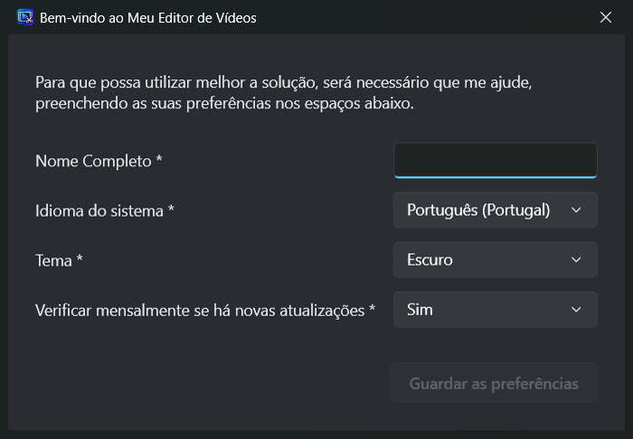

Na primeira vez (ou se alguma preferência estiver em falta ou vazia nas preferências do programa), aparece a janela **Bem-vindo ao Meu Editor de Vídeos**. Preencha **Nome Completo**, **Idioma do sistema**, **Tema** (Claro, Escuro ou Acompanhar o sistema operativo) e **Verificar mensalmente se há novas atualizações** (Sim ou Não) e clique em **Guardar as preferências**. Todos os campos são obrigatórios e a janela só fecha depois de guardar. Se escolher outro idioma, o programa reinicia nele. Depois, as preferências podem ser mudadas em **Ferramentas › Configurações… › Geral**.

O programa abre direto na ecrã de edição, com um projeto novo e vazio chamado "Sem título". Se existir uma cópia de um projeto que não foi fechado corretamente, o programa pergunta se o utilizador quer recuperá-la (veja a seção Guardar, gravação automático e recuperação).

Os últimos cinco projetos abertos aparecem no menu **Ficheiro**, entre separadores. Clique num deles para abrir. Se o ficheiro tiver sido movido ou apagado, o programa avisa e o tira da lista.

### Criar um projeto

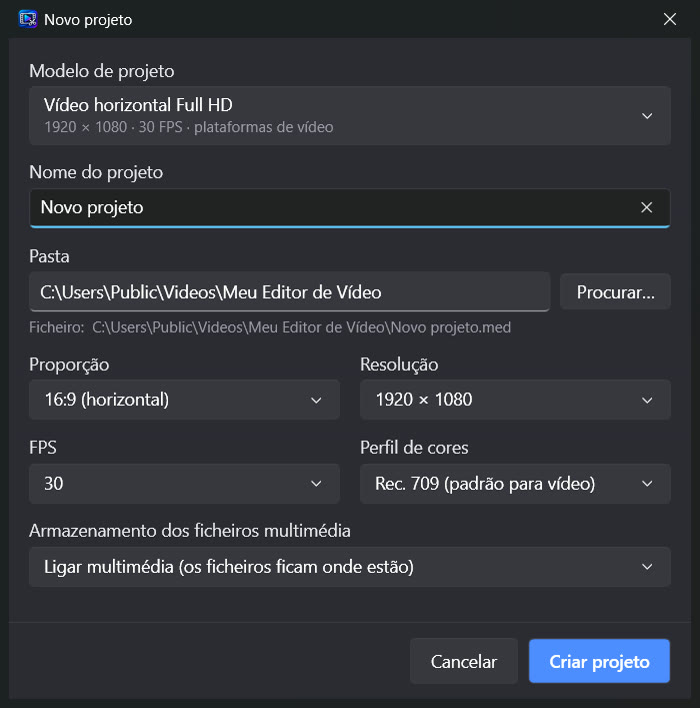

1. Escolha **Ficheiro › Novo projeto…**.
2. Escreva um nome em "Nome do projeto".
3. Escolha a pasta onde o projeto será guardado em "Pasta do projeto" (use **Procurar…** se quiser).
4. Escolha um "Modelo de projeto". Os modelos já trazem a resolução, a proporção e a taxa de fotogramas indicadas. Há modelos para vídeo horizontal (Full HD, 4K e cinema), vertical e quadrado, e modelos para plataformas como YouTube, Instagram, TikTok, WhatsApp e Facebook.
5. Se preferir, ajuste a resolução, a proporção, a taxa de fotogramas (FPS) e o perfil de cores manualmente.
6. Em "Armazenamento das ficheiros multimédia", escolha uma opção:
   - **Vincular ficheiros multimédia (ficheiros ficam onde estão)**: o projeto guarda apenas o caminho dos ficheiros. É o mais leve, mas os ficheiros precisam continuar no mesmo lugar.
   - **Empacotar ficheiros multimédia no projeto (.med independente)**: as ficheiros multimédia são copiadas para dentro do projeto. Use se quiser levar o projeto para outro computador.
7. Clique em **Criar projeto**.

### Abrir um projeto existente

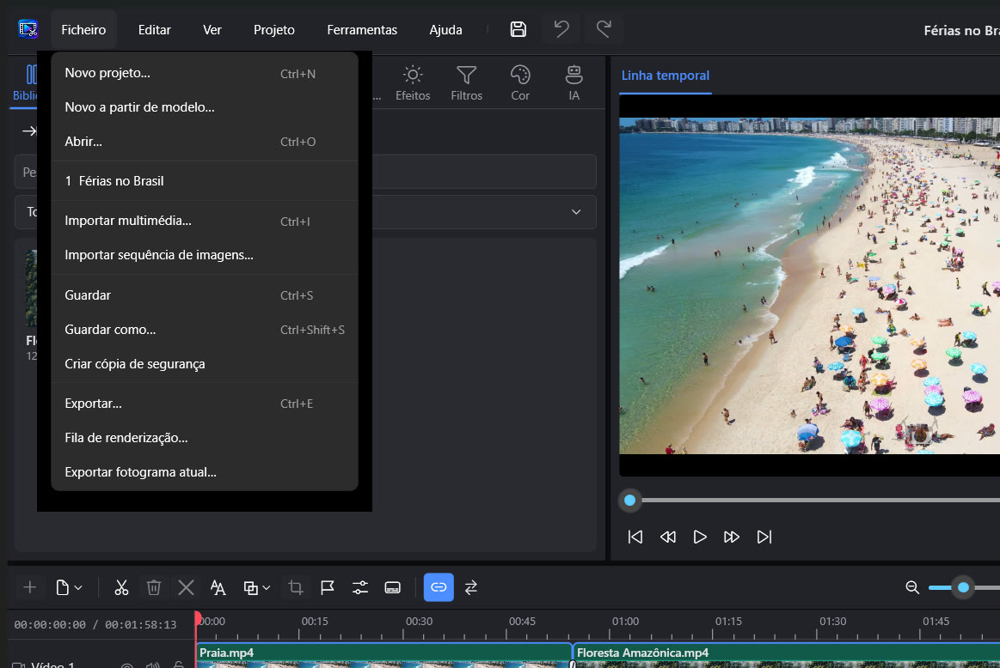

Há três maneiras:

- Escolha **Ficheiro › Abrir…** e selecione o ficheiro .med.
- Clique num dos projetos recentes no menu **Ficheiro**.
- Dê um duplo clique no ficheiro .med no Explorador de Ficheiros. O programa abre o projeto automaticamente.

## A ecrã de edição

Depois de criar ou abrir um projeto, a ecrã de edição aparece. Ela é dividida em áreas:

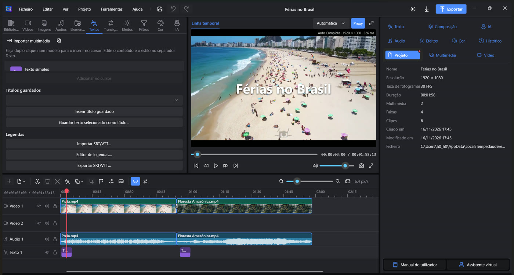

- **Barra superior** (no topo da janela): à esquerda, os menus **Ficheiro**, **Editar**, **Visualizar**, **Projeto**, **Ferramentas** e **Ajuda** e os botões **Guardar**, **Desfazer** e **Refazer**; no centro, o nome do projeto; à direita, **Tema**, **Fila de renderização**, **Exportar** e os botões de minimizar, maximizar e fechar a janela. Arraste a barra para mover a janela e dê um duplo clique nela para maximizar ou restaurar.
- **Biblioteca de ficheiros multimédia** (à esquerda): no alto ficam as abas Biblioteca de Multimédia, Vídeos, Imagens, Áudios, Elementos Gráficos, Textos, Transições, Efeitos, Cor e IA. Passe o rato sobre uma aba para ver o nome completo. As ficheiros multimédia importadas aparecem em grade, com miniatura e duração.
- **Pré-visualização** (no centro, em cima): mostra o resultado do vídeo. Em cima ficam a resolução da pré-visualização, o botão Proxy e o botão **Maximizar o monitor**, que faz a pré-visualização cobrir a biblioteca e a linha temporal (o painel Propriedades continua visível; clique de novo para restaurar); embaixo, a barra de posição (arraste para ir a qualquer ponto), os botões de reproduzir, pausar e avançar fotograma a fotograma, o volume, a captura de fotograma (guarda o fotograma atual em PNG ou JPEG, na resolução do projeto; também em **Ficheiro › Exportar fotograma atual…**) e a ecrã inteiro.
- **Propriedades** (à direita): mostra as informações e as definições do item selecionado. Está dividida em abas: **Projeto** (resolução, taxa de fotogramas, duração, quantidade de ficheiros multimédia e clipes, ficheiro), **Multimédia**, **Vídeo**, **Texto**, **Composição**, **IA**, **Áudio**, **Efeitos**, **Cor** e **Histórico**. No canto inferior direito, os atalhos **Manual do utilizador** e **Assistente virtual** abrem a ajuda com um clique.
- **Linha temporal** (embaixo): onde o utilizador monta o vídeo. Cada linha horizontal é uma faixa. Há uma barra de ferramentas logo acima dela.

> Quando o nome do projeto aparece com a marca "● não guardado", existem alterações que ainda não foram gravadas. Use **Ficheiro › Guardar** ou Ctrl+S.

### Menus

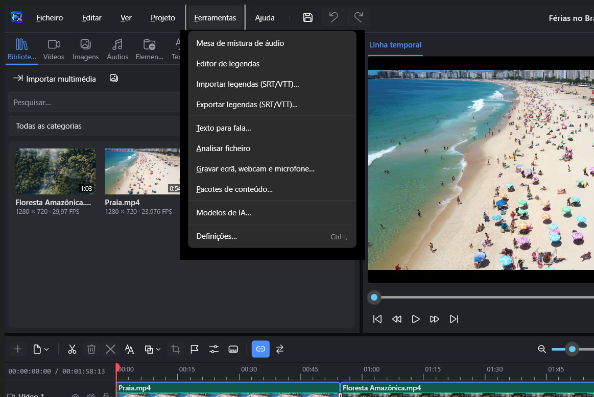

- **Ficheiro**: novo projeto, **novo a partir de modelo**, abrir, importar multimédia, importar sequência de imagens, guardar, guardar como, criar cópia de segurança, exportar, fila de renderização, exportar fotograma atual (PNG ou JPEG) e os cinco projetos recentes.
- **Editar**: desfazer e refazer; selecionar tudo; dividir; **juntar os cortes** (desfaz uma divisão: clique na régua sobre o ponto do corte; só fica disponível quando os dois lados são a continuação da mesma multimédia, sem ajustes diferentes); recortar, copiar, colar no cursor e duplicar; eliminar, eliminar e fechar o espaço (só na faixa do clipe) e **eliminar e juntar** (fecha o espaço em todas as faixas, mantendo a sincronia; faixas bloqueadas não se movem e a operação é recusada se um clipe de outra faixa ocupar parte do trecho removido).
- **Visualizar**:
  - **Modo do layout**: **Padrão**; **Linha temporal** (a linha temporal ocupa toda a largura); **Vídeo** (o monitor ocupa a metade direita, na altura toda).
  - **Qualidade de reprodução**: Automática, Completa, 1/2 ou 1/4.
  - **Nível de zoom no vídeo**: Ajuste (cabe no monitor) ou 10% a 400%; acima do tamanho do monitor aparecem barras de rolagem.
  - **Reproduzir/Pausar**, **Parar** (volta ao ponto onde a reprodução começou) e **Intervalo de reprodução em loop** (repete a seleção da linha temporal ou, sem seleção, o projeto inteiro).
  - **Régua**: réguas em pixels do vídeo no alto e à esquerda da imagem.
- **Projeto**: empacotar ficheiros multimédia no projeto, **reenquadrar automaticamente**, **guardar como modelo**, **camada de ajuste**, **clipe composto**, **ecrã dividido**, **multicâmara** e localizar ficheiros multimédia ausentes (veja [Camadas de ajuste, clipes compostos, ecrã dividido e multicâmara](#camadas-de-ajuste-clipes-compostos-ecrã-dividida-e-multicâmara)).
  - **Guardar como modelo…** guarda uma cópia do projeto guardado nos seus modelos. **Ficheiro › Novo a partir de modelo…** escolhe um modelo (seu ou de um pacote), pergunta onde guardar o projeto novo e abre a cópia; o modelo continua intacto.
  - **Reenquadrar automaticamente…** muda o formato do projeto (9:16 para Reels, TikTok e Shorts; 1:1; 4:5; 16:9) e reposiciona cada clipe de vídeo e imagem para cobrir o novo fotograma. Em **Acompanhar**, escolha **Rosto**, **Corpo inteiro** ou **Centro do fotograma**. Para acompanhar a pessoa, o programa usa o modelo de remoção de fundo e cria keyframes de posição, que o utilizador pode ajustar depois na aba Vídeo. Os textos ficam como estão. O andamento aparece na aba **IA**, e tudo se desfaz com um único Ctrl+Z.
- **Ferramentas**: mixer de áudio, editor de legendas, importar e exportar legendas, **texto para fala**, **analisar multimédia**, **gravar ecrã, webcam e microfone**, **pacotes de conteúdo**, modelos de IA e definições.
  - **Gravar ecrã, webcam e microfone…** grava a área de trabalho, uma webcam num canto do ecrã e o som de um microfone, tudo ao mesmo tempo, num ficheiro MP4. Com mais de um monitor, escolha em **Ecrã a gravar** qual ecrã gravar (ou todas). Depois, em **O que gravar**, escolha **Ecrã inteiro** ou **Apenas uma janela**; neste caso, escolha em **Janela a gravar** uma das janelas abertas no ecrã escolhido (janelas minimizadas não aparecem; mantenha-a aberta e visível durante a gravação). A webcam ocupa um décimo da largura do ecrã gravada. Ao clicar em **Gravar**, o programa é minimizado e uma contagem 5, 4, 3, 2, 1 aparece no centro do ecrã antes de a gravação começar. Para parar, pressione **F10** (funciona com qualquer programa em primeiro plano); o programa volta a aparecer. A gravação vai para a pasta **Gravações** (ao lado do projeto ou em Vídeos › Meu Editor de Vídeo), entra na biblioteca (categoria Gravações) e, se a opção estiver marcada, na linha temporal no cursor. Sem o ecrã, grava só a webcam. No macOS, o F10 fora do programa exige a permissão de Acessibilidade (Definições do Sistema › Privacidade e Segurança › Acessibilidade). No Linux com Wayland, o ecrã não pode ser gravado e o F10 só funciona com o programa em primeiro plano.
  - **Pacotes de conteúdo…** instala, exporta e remove pacotes de autocolantes, títulos e modelos de projeto (ficheiros .medpack). Um pacote é um ZIP com as pastas `figurinhas` (PNG, GIF, WebP, JPEG ou SVG), `titulos` (.medtitle) e `modelos` (.med) e, opcionalmente, um `pacote.json` com o nome (por exemplo `{"nome": "Festa de Verão"}`). Os itens que o utilizador mesmo guarda ficam no pacote **Meus itens**; use **Exportar…** para compartilhá-lo.
  - **Texto para fala…** transforma um texto em narração com as vozes instaladas no computador, sem internet. Digite o texto, escolha a **Voz** e a **Velocidade** e clique em **Gerar e inserir**: o áudio vai para a biblioteca (categoria Narração) e entra na posição do cursor, na primeira faixa de áudio livre ou numa faixa nova chamada Narração. Para ter mais vozes, como as em português, instale-as em **Definições do Windows › Hora e idioma › Fala**. No macOS, instale vozes em **Definições do Sistema › Acessibilidade › Conteúdo falado**; no Linux, a narração usa o espeak-ng (instale o pacote `espeak-ng`).
  - **Analisar multimédia** dá etiquetas a todas as ficheiros multimédia da biblioteca: tipo, orientação (horizontal, vertical, quadrado), resolução (HD, Full HD, 4K), duração (curto, longo) e som. Com os modelos instalados, também **fala** ou **sem fala**, o número de **cenas** e **pessoa** ou **sem pessoas**. As etiquetas aparecem ao passar o rato sobre a multimédia e a caixa **Pesquisar…** da biblioteca também procura nelas.
- **Ajuda**: **Manual do utilizador** (F1), **Assistente virtual** (Shift+F1), **Atalhos de teclado…**, **Informações do sistema…**, **Abrir pasta de logs**, **Licenças de terceiros**, **Sobre o Meu Editor de Vídeo**, **Suporte Técnico** (abre a página de atendimento no navegador, no idioma do programa), **Verificar atualizações** (consulta pela internet se há uma versão nova: mostra "Tem a versão mais recente!" ou a janela **Nova versão disponível**, com a versão, os idiomas, os sistemas suportados, o autor e as ligações para transferir na Microsoft Store e no site AplicativosIA.Online; ao clicar em **Fechar esta janela**, a data da verificação é guardada). Em **Sobre o Meu Editor de Vídeo**, o ícone do LinkedIn abre o perfil do autor no navegador. Aí ficam também as ligações **Visite o nosso website** (o site do programa, no idioma da interface) e **Visite o GitHub do Meu Editor de Vídeo** (o código-fonte).

O **Manual do utilizador** abre este manual dentro do programa, sem internet. A lista à esquerda leva a cada assunto e Ctrl+F procura uma palavra. A janela pode ficar aberta enquanto o utilizador edita.

**Atalhos de teclado…** mostra os atalhos em uso, inclusive os que o utilizador mudou. **Informações do sistema…** mostra a versão, o Windows, o processador, a memória, a placa gráfica, os modelos de IA e as pastas do programa; o botão **Copiar** leva tudo para a área de transferência, útil ao pedir ajuda.

## Importar multimédia

Importar é trazer para o projeto os ficheiros que o utilizador vai usar, como vídeos, fotos, músicas e gravações. Os ficheiros originais não são alterados.

### Formatos aceitos

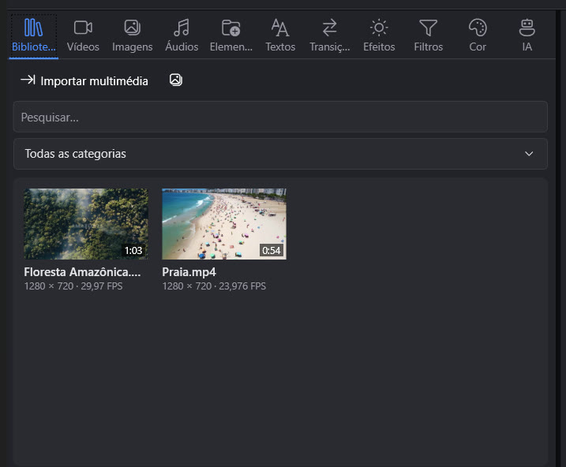

- **Vídeo**: MP4, M4V, MOV, MKV, WebM, AVI, WMV, FLV, MPG e MPEG, M2TS, MTS, TS, 3GP, OGV, MXF e VOB.
- **Áudio**: MP3, WAV, AAC, M4A, FLAC, OGG, OGA, Opus, WMA, AIFF, AIF, AC3 e AMR.
- **Imagem**: JPG e JPEG, PNG, BMP, TIF e TIFF, WebP, TGA, JFIF e SVG.
- **GIF animado**: GIF.
- **Sequência de imagens**: uma série de fotos numeradas, como foto_0001.png, foto_0002.png e assim por diante.

Ficheiros de outros formatos são recusados, com a mensagem "Formato de ficheiro não suportado.".

### Como importar

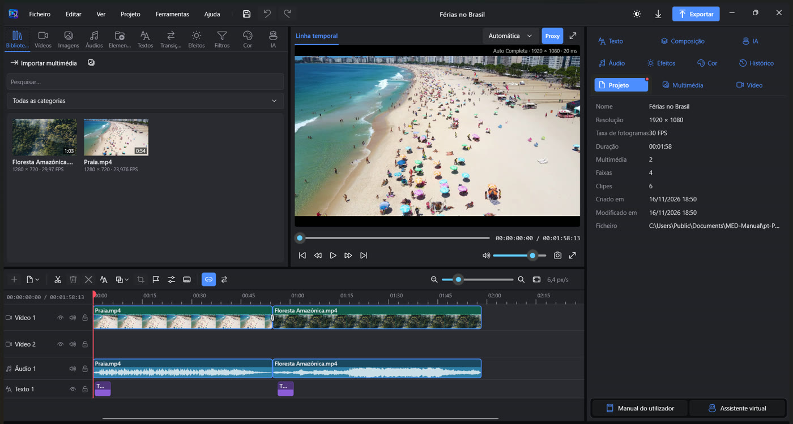

1. Clique em **Importar Multimédia** no painel da biblioteca, ou use **Ficheiro › Importar multimédia…** (atalho Ctrl+I).
2. Escolha um ou vários ficheiros e confirme.
3. Acompanhe o progresso. A mensagem "Importando 3 de 10" mostra quantos ficheiros já foram lidos.

O utilizador também pode arrastar ficheiros ou pastas do Explorador de Ficheiros e soltá-los sobre a biblioteca de ficheiros multimédia. Quando o ficheiro está sobre a área certa, aparece a indicação "Solte para importar".

Para uma sequência de imagens, use **Ficheiro › Importar sequência de imagens…**. O programa reconhece a numeração automaticamente.

Cada multimédia importada ganha uma miniatura. Ao selecionar uma multimédia, a aba **Multimédia** das propriedades mostra duração, resolução, taxa de fotogramas e outros dados do ficheiro.

### Organizar a biblioteca

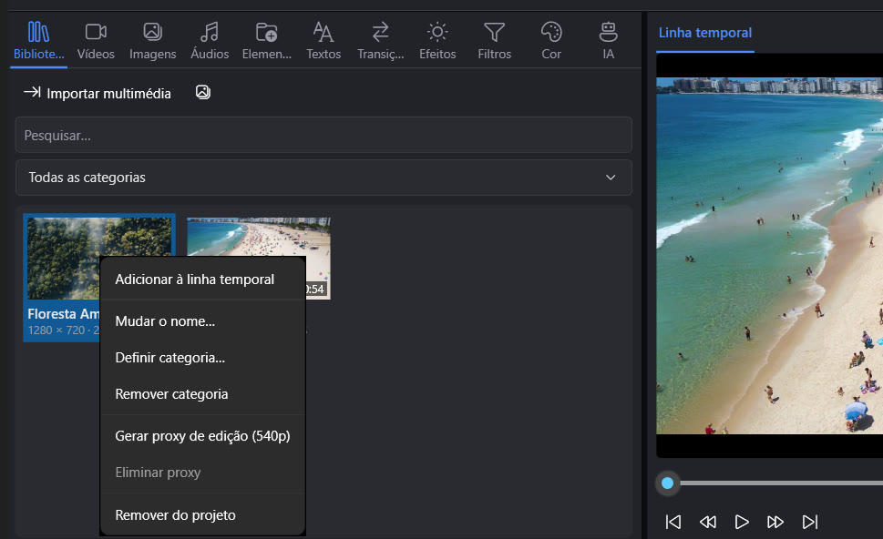

- Use a caixa **Pesquisar…** para encontrar uma multimédia pelo nome, pela categoria ou pelas etiquetas criadas em **Ferramentas › Analisar multimédia** (por exemplo "fala", "pessoa" ou "vertical").
- Clique com o botão direito numa multimédia para **Renomear…**, **Definir categoria…**, **Remover categoria**, **Adicionar à linha temporal** ou **Remover do projeto**.
- Remover uma multimédia do projeto não apaga o ficheiro do computador.

### Multimédia ausente

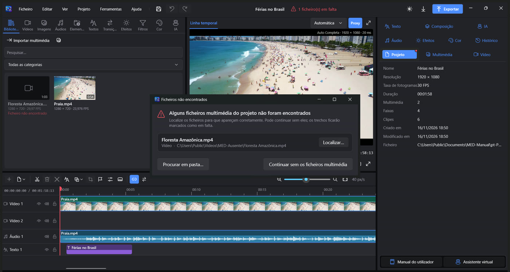

Se um ficheiro foi movido, renomeado ou apagado, o projeto mostra o aviso "Algumas ficheiros multimédia do projeto não foram encontradas" ao ser aberto. O aviso também aparece na barra de status como "Multimédia ausentes", com a quantidade de ficheiros multimédia afetadas. Para resolver:

1. Clique em **Localizar…** para indicar o ficheiro, ou em **Procurar em pasta…** para o programa procurar nas pastas e subpastas que o utilizador escolher.
2. Se não quiser localizar agora, clique em **Continuar sem as ficheiros multimédia**. Os trechos ficam marcados como ausentes e podem ser localizados depois.

O utilizador pode abrir essa janela a qualquer momento em **Projeto › Localizar ficheiros multimédia ausentes…**. Num projeto transferido da internet, o programa não procura ficheiros multimédia nem LUT que estejam noutro computador da rede, porque só consultar esse computador já lhe enviaria os dados de acesso do Windows: esses ficheiros aparecem como ausentes e essas LUT ficam desativadas. Se confiar na origem do projeto, localize os ficheiros nesta janela e ative as LUT no painel **Propriedades**.

Para evitar esse problema ao levar o projeto para outro computador, use **Projeto › Empacotar ficheiros multimédia no projeto…**. Ele copia as ficheiros multimédia para dentro do ficheiro do projeto.

### Proxies (versões leves para edição)

Um proxy é uma cópia leve de um vídeo grande, em 540p, usada só para a pré-visualização ficar mais fluida. A exportação sempre usa o ficheiro original.

- Para criar um proxy, clique com o botão direito no vídeo na biblioteca e escolha **Gerar proxy de edição (540p)**.
- Para apagar um proxy, escolha **Eliminar proxy**.
- No monitor, a opção **Usar proxies na pré-visualização** liga ou desliga o uso dos proxies.
- Em **Ferramentas › Definições…**, o utilizador pode pedir que os proxies sejam gerados automaticamente para vídeos acima de 1080p.

## Editar na linha temporal

A linha temporal é onde o vídeo é montado da esquerda para a direita. O **cursor** (uma linha vertical) mostra o instante que está a ser visto na pré-visualização. Os pedaços de multimédia colocados nas faixas são chamados de clipes.

### Colocar ficheiros multimédia na linha temporal

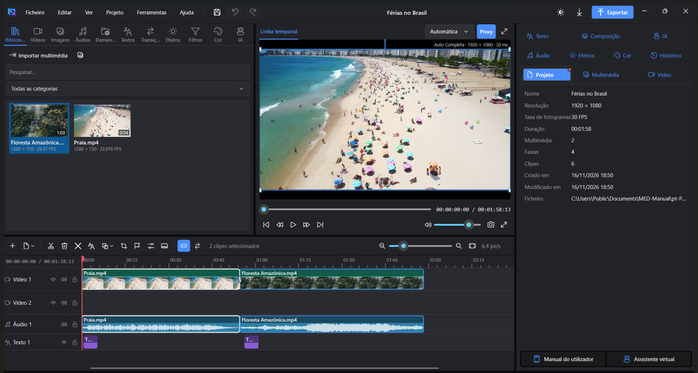

- Arraste uma multimédia da biblioteca para uma faixa.
- Ou selecione a multimédia na biblioteca e clique em **Adicionar à linha temporal**, na barra de ferramentas. Imagens e áudios entram na posição do cursor: a imagem vai para uma faixa de Imagem livre, senão para uma faixa de vídeo vazia; o áudio vai para uma faixa de áudio livre nesse trecho. Se nenhuma servir, o programa cria uma faixa nova.

### Mover, cortar e dividir

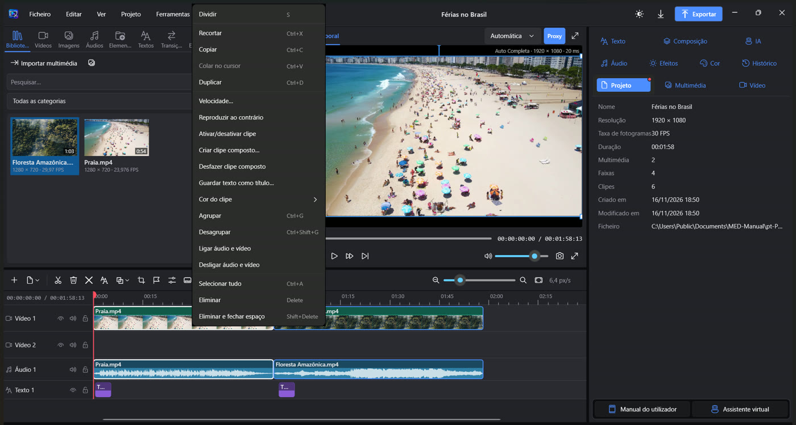

- **Mover**: arraste o clipe para outro lugar da faixa ou para outra faixa do mesmo tipo.
- **Aparar o início ou o fim**: arraste a borda do clipe para encurtar ou alongar o trecho usado.
- **Dividir**: posicione o cursor no ponto desejado e clique em **Dividir** na barra de ferramentas, ou pressione S. O clipe é cortado em duas partes nesse ponto.
- **Juntar os cortes** (menu Editar): volta a juntar as duas partes de um clip dividido. Posicione o cursor sobre o ponto do corte; só funciona quando as duas partes são a continuação da mesma multimédia, sem ajustes diferentes.
- **Eliminar**: selecione o clipe e pressione Delete. Também é possível usar o botão **Eliminar seleção**.
- **Eliminar e fechar espaço**: apaga o clipe e puxa os clipes seguintes para preencher o vazio. Use Shift+Delete.
- **Cortar e ampliar**: selecione um clipe de vídeo ou imagem e clique no botão de corte na barra de botões da linha do tempo. Na janela que abre, arraste sobre o fotograma para marcar a área que deve ficar no vídeo: arraste dentro da área para a mover, use as pegas dos cantos e das margens para mudar o tamanho, ou arraste fora dela para desenhar outra. A barra de tempo percorre o clipe para escolher um fotograma de referência. Em **Proporção**, escolha **Livre**, a proporção do projeto, a original ou uma fixa (16:9, 9:16, 1:1, 4:3, 3:4, 4:5); com proporção fixa, só os cantos mudam o tamanho. **Tamanho** mostra a área em píxeis do vídeo. Ao clicar em **Aplicar**, a área marcada é ampliada para ocupar o fotograma, centrada; se a proporção dela for diferente da do projeto, sobram faixas. A rotação e os keyframes de posição e escala do clipe são removidos, e o tamanho do projeto não muda. **Redefinir** volta ao fotograma inteiro. Ctrl+Z desfaz.
- **Adicionar texto simples**: o botão **T** da barra de botões da linha do tempo cria um texto simples na posição do cursor e abre logo o separador **Texto** das propriedades para escrever e formatar.
- **Ferramentas de desenho**: o botão de formas abre um menu com **Retângulo**, **Seta**, **Elipse**, **Triângulo**, **Linha** e **Polígono**. A forma escolhida entra na posição do cursor, com 5 segundos, numa faixa de gráficos livre, e o separador **Vídeo** das propriedades abre para ajustar tamanho, cor e contorno.
- **Copiar, recortar, colar e duplicar**: use Ctrl+C, Ctrl+X, Ctrl+V e Ctrl+D. Ao colar, o clipe vai para a posição do cursor.

### Ímã e edição em cascata

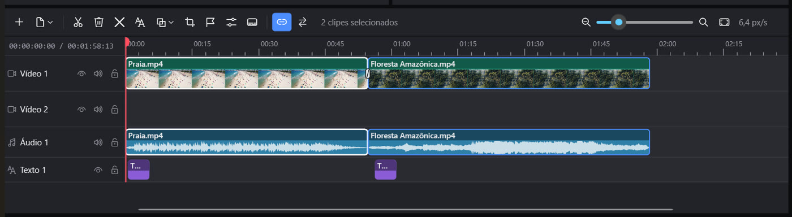

- **Ímã de alinhamento** (tecla N): quando ligado, o clipe "gruda" nas bordas de outros clipes e no cursor, o que facilita encaixar as partes sem deixar espaços. O botão fica na barra de ferramentas.
- **Edição em cascata (ripple)**: quando ligada, mover ou aparar um clipe empurra os clipes seguintes, sem deixar buracos.

### Faixas

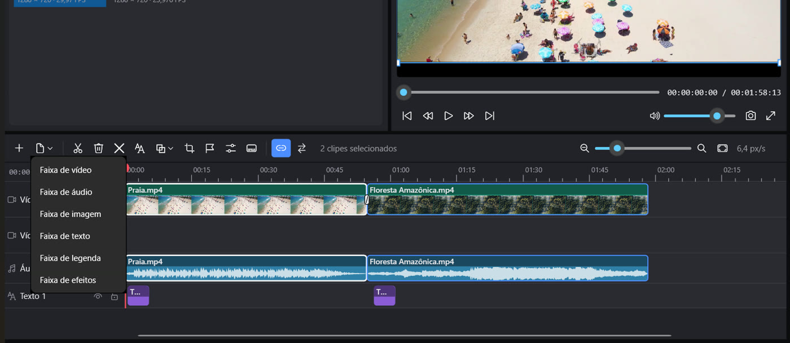

As faixas são as linhas horizontais da linha temporal. Para adicionar uma faixa, clique no botão **Adicionar faixa** e escolha o tipo (todas as faixas novas, criadas pelo utilizador ou pelo programa, entram no topo, acima de todas as outras):

- **Faixa de vídeo**
- **Faixa de áudio**
- **Faixa de imagem**
- **Faixa de texto**
- **Faixa de legenda**
- **Faixa de efeitos**

Em cada faixa, no cabeçalho à esquerda, há três botões:

- **Ocultar**: esconde a faixa na pré-visualização.
- **Mudo**: silencia a faixa de áudio.
- **Bloquear**: impede alterações na faixa, para evitar mexer no que já está pronto.

Clique com o botão direito no nome da faixa para **Renomear faixa…** ou **Remover faixa**. Para mudar a ordem das faixas, arraste o nome de uma faixa para cima ou para baixo (ou use **Mover faixa para cima** e **Mover faixa para baixo** no mesmo menu). A faixa de cima aparece à frente.

### Agrupar e vincular

- **Agrupar** (Ctrl+G): une vários clipes para que se movam juntos. Use **Desagrupar** (Ctrl+Shift+G) para separar.
- **Vincular áudio e vídeo**: faz o áudio de um vídeo seguir o vídeo. Use **Desvincular áudio e vídeo** para separar.

### Velocidade do clipe

Clique com o botão direito no clipe e escolha **Velocidade…** para deixá-lo mais rápido ou mais lento. Na aba **Vídeo** das propriedades, a lista de velocidades vai de 0,25× (câmara lenta) a 8× (acelerado).

### Ativar e desativar clipes

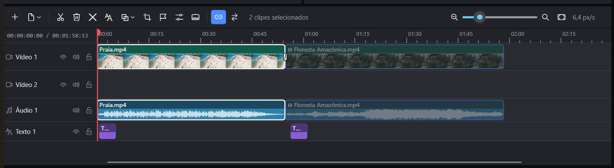

Clique com o botão direito no clipe e escolha **Ativar/desativar clipe**. Um clipe desativado continua na linha temporal (esmaecido e com o símbolo ⊘), mas não aparece nem soa na reprodução e na exportação.

### Camadas de ajuste, clipes compostos, ecrã dividido e multicâmara

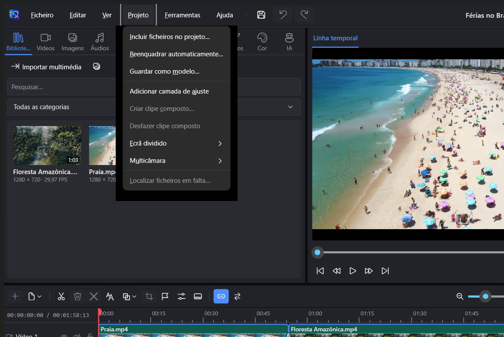

- **Camada de ajuste** (**Projeto › Adicionar camada de ajuste**): cria, no cursor, um clipe de 5 segundos numa faixa de efeitos. Os efeitos e a correção de cor colocados nele valem para **todas as faixas abaixo**, durante o tempo do clipe. Selecione a camada e adicione efeitos nas abas **Efeitos** e **Cor**. A opacidade da camada dosa o efeito e as máscaras limitam a área. Estique ou mova a camada como qualquer clipe.
- **Clipe composto** (**Projeto › Criar clipe composto…** ou menu de contexto): junta os clipes selecionados (com os áudios vinculados) num único clipe, que se move, corta e recebe efeitos como um só. As faixas e as posições originais ficam guardadas dentro dele. **Desfazer clipe composto** devolve os clipes à linha temporal, em faixas novas, só com o trecho que o clipe composto mostrava. O som do clipe composto só toca em velocidade normal.
- **Ecrã dividido** (**Projeto › Ecrã dividido**): selecione de 2 a 4 clipes de vídeo ou imagem, cada um numa faixa diferente, e escolha um modelo: **2 lado a lado**, **2 empilhados**, **3 colunas**, **3 faixas**, **1 grande e 2 pequenos** ou **4 em grade**. Cada clipe (na ordem das faixas, de cima para baixo) é ampliado para cobrir a sua parte do fotograma e recortado no excesso. Ajuste depois a posição e o recorte na aba Vídeo.
- **Multicâmara** (**Projeto › Multicâmara**): coloque cada câmara numa faixa de vídeo, sincronizadas (por exemplo, com **Sincronizar pelo áudio**). Durante a reprodução ou parado, escolha **Câmara 1** a **Câmara 4** (Alt+1 a Alt+4, com o foco na linha temporal) para mostrar aquela câmara **a partir do cursor**: o programa corta todas as câmaras no cursor e desativa as outras. A câmara 1 é a faixa de vídeo mais alta com clipe no cursor. O áudio não muda.

### Cor do clipe

Para identificar clipes de um jeito visual, selecione um ou mais clipes, clique com o botão direito e escolha **Cor do clipe**. A cor fica guarda no projeto e pode ser desfeita com Ctrl+Z. Escolha **Automática (pelo tipo)** para voltar à cor padrão (vídeo, imagem, áudio ou texto).

Projetos com cores de clipe usam o formato 1.3. Versões anteriores do programa abrem esses projetos com um aviso e ignoram as cores.

### Marcadores

Marcadores são lembretes na régua de tempo, úteis para anotar pontos importantes, como o início de uma fala.

- Posicione o cursor e clique em **Adicionar marcador** ou pressione M.
- Clique com o botão direito no marcador para **Renomear marcador…** ou **Remover marcador**.

### Zoom da linha temporal

Use os botões de zoom na barra de ferramentas, ou os atalhos:

- Aproximar: Ctrl + tecla mais (ou + do teclado numérico)
- Afastar: Ctrl + tecla de menos (ou - do teclado numérico)
- Ajustar à janela: Shift+Z

### Desfazer e refazer

- **Desfazer** (Ctrl+Z) e **Refazer** (Ctrl+Y ou Ctrl+Shift+Z) voltam e avançam as últimas ações.
- A aba **Histórico**, nas propriedades, mostra a lista de ações feitas. Clique numa delas para voltar o projeto àquele ponto.

### Navegar pelo vídeo

- Espaço: reproduz ou pausa.
- Setas para a esquerda e para a direita: voltam ou avançam um fotograma.
- Shift com as setas: voltam ou avançam um segundo.
- Cima e baixo: vão para o corte anterior e para o próximo corte.
- Home e End: vão para o início e para o fim.

## Efeitos visuais, texto e transições

Para aplicar um efeito, selecione o clipe na linha temporal e use as abas das propriedades. O utilizador também pode usar as seções da biblioteca, como **Efeitos**, **Cor** e **Transições**: clique duas vezes num item para aplicá-lo no cursor ou ao clipe selecionado, ou use o botão **Aplicar ao clipe selecionado**. Efeitos e transições também se aplicam a imagens, figurinhas e textos, e a aba **Cor** ajusta as cores de imagens e figurinhas. Ao inserir um clip, o painel de propriedades abre-se sozinho na aba certa: **Texto** para textos, **Vídeo** para vídeos, imagens e figurinhas, e **Áudio** para áudios.

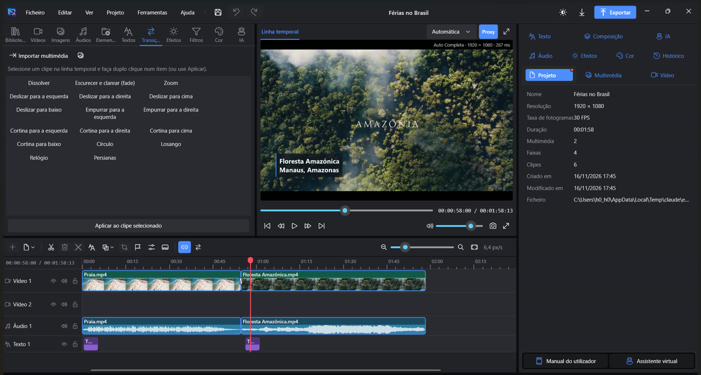

A secção **Efeitos** da biblioteca mostra os efeitos de vídeo prontos em miniaturas, separados por categoria (escolha a categoria na lista acima das miniaturas): **Tendências**, **Aberturas**, **Encerramentos**, **Amor**, **Festa**, **Moldura**, **Destaque**, **Distorção**, **Falha digital**, **Cintilação**, **Grunge**, **Lupa**, **Luz**, **Retro**, **Tremido**, **Diapositivos**, **Ecrã dividido**, **Temporizador**, **Visor** e **Utilitários** (desfocagem, nitidez, vinheta, chroma key e os outros efeitos básicos). Cada miniatura mostra o efeito numa cena de praia com uma pessoa; nos efeitos de movimento, como o **Tremido**, a miniatura sobrepõe instantes vizinhos para indicar o movimento. Os efeitos são animados pelo tempo do clip: as **Aberturas** revelam o vídeo no início do clip, os **Encerramentos** escondem-no no fim e o **Temporizador** acompanha a duração do clip. Depois de aplicado, o efeito aparece no separador **Efeitos** das propriedades, onde o utilizador escolhe o estilo, a intensidade, a velocidade, a cor e outros ajustes.

A secção **Filtros** da biblioteca (ao lado de **Efeitos**) traz looks prontos que mudam de uma vez a cor, o ambiente e o estilo do vídeo ou da imagem, sem ajustar cada parâmetro. Escolha a categoria na lista acima das miniaturas: **Básico**, **Destaques**, **Monocromático**, **Estilo de vida**, **Cinematográfico**, **Retro**, **Primavera**, **Interiores**, **Noturno** e **Criativos**. Cada miniatura mostra o filtro aplicado numa cena colorida de praia com farol, veleiro e palmeira. Selecione o clip e faça duplo clique no filtro (ou use **Aplicar ao clip selecionado**). O filtro é feito de efeitos comuns (ajustes de cor, curvas, rodas de cor, vinheta, grão, brilho suave), que aparecem no separador **Efeitos** das propriedades: aí pode ajustar ou remover cada um.

### Aba Vídeo

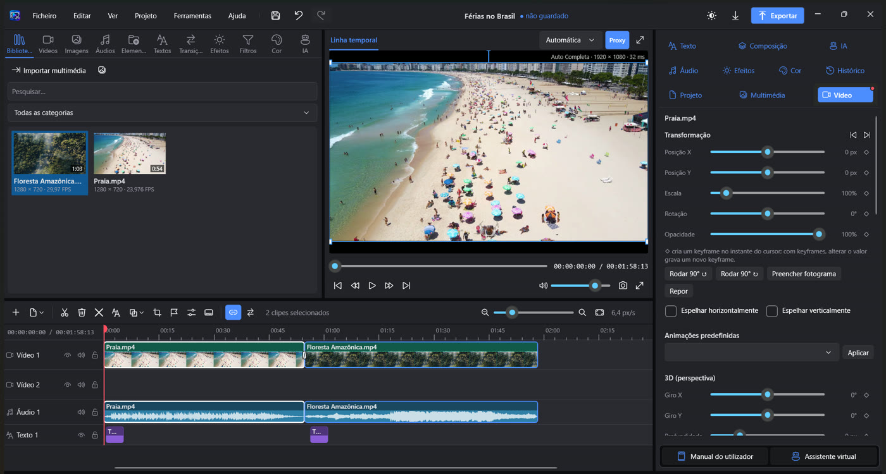

Esta aba reúne as definições de movimento e tempo do clipe:

- **Transformação**: posição X e Y, escala, rotação e opacidade. Ao lado de cada valor há um botão ◇ que cria um keyframe. Também é possível fazê-lo diretamente no monitor: com o clip selecionado na linha temporal, arraste-o dentro do vídeo para o mover, arraste a pega redonda acima da caixa para o rodar (com Shift, de 15° em 15°) e, em imagens, figurinhas, vídeos e formas, arraste um canto para mudar o tamanho. Os textos só se movem e rodam.
- **Keyframes**: um keyframe guarda um valor num instante específico. Quando há keyframes, o programa muda o valor gradualmente entre eles. Use **Keyframe anterior** e **Próximo keyframe** para navegar entre eles, e **Interpolação** para escolher a curva: Suave (entrada e saída), Linear, Acelerando, Desacelerando ou Manter (salto).
- **3D (perspectiva)**: giro X, giro Y e profundidade, para dar sensação de profundidade ao clipe. O botão **Virar cartão 3D** faz o clipe girar como um cartão. Não é um modelo 3D completo.
- **Animações prontas**: efeitos de movimento prontos para aplicar, como entrar pela esquerda, aparecer com zoom, Ken Burns (zoom lento), pulsar, girar, balançar, quicar e surgir e sumir.
- **Recorte**: corta as bordas do vídeo pela esquerda, pelo topo, pela direita e pela base. Os controles só escondem as bordas; o tamanho do projeto continua o mesmo. Para o vídeo realmente ficar com o tamanho recortado, clique em **Aplicar recorte ao vídeo**: o projeto passa a ter o tamanho da área recortada, em pixels do vídeo original (uma gravação 1920×1080 sem 25% da esquerda fica com 1440×1080), a área recortada preenche o fotograma e a exportação sai com essas dimensões. Textos e outros clipes acompanham. O clipe não pode estar girado nem ter keyframes de posição ou escala. Ctrl+Z desfaz.
- **Mistura**: modo de mistura com outras camadas, como Multiplicar, Tela, Sobrepor, Luz suave, Adicionar, Escurecer, Clarear e Diferença.
- **Fades**: **Entrada gradual** e **Saída gradual**, de 0 a 10 segundos, para o clipe surgir e desaparecer suavemente.
- **Velocidade**: velocidades predefinidas ou outra velocidade. Abaixo de 1×, a opção **Câmara lenta suavizada** mistura fotogramas vizinhos para reduzir os saltos. **Reproduzir ao contrário** mostra o clipe do fim para o começo, com o áudio vinculado também invertido (também no menu de contexto do clipe; o clipe ganha o símbolo ◀ na linha temporal). Não vale para fotogramas congelados. Em vídeos longos, use proxies para a reprodução ao contrário ficar fluida.
  - **Câmara lenta por interpolação (fluxo óptico)**: abaixo de 1×, cria os fotogramas intermediários acompanhando o movimento, o que fica mais fluido que a simples mistura. Não precisa de modelo, mas deixa a reprodução e a exportação mais lentas.
  - **Curva**: curva de velocidade (speed ramping). Escolha **Montagem**, **Herói**, **Bala**, **Pulo**, **Acelerar** ou **Desacelerar** para o clipe acelerar e desacelerar dentro dele, sem mudar a duração nem o trecho usado do vídeo. **Constante (sem curva)** volta ao normal. Com curva, o áudio do clipe fica mudo. Aparar ou dividir o clipe também volta à velocidade constante.
  - **Desfoque de movimento**: rastro de movimento quando a posição, a escala ou a rotação estão animadas por keyframes. Em 100%, o rastro cobre o intervalo de um fotograma inteiro.
- **Congelar fotograma**, **Repetir trecho**, **Preencher fotograma**, **Girar 90°** e **Espelhar** na horizontal e na vertical.
- **Transição de entrada**: aplica uma transição entre este clipe e o clipe que vem antes dele na mesma faixa. Para usar, os dois clipes precisam estar encostados. O utilizador escolhe a transição e a **Duração da transição**. Se não houver um clip encostado antes (uma imagem, figurinha ou texto isolado), a transição é de entrada: começa no início do clip e revela-o sobre as faixas de baixo.

- **Rastreamento de câmara**: escolha **Cabeça** ou **Corpo**, e uma câmara virtual acompanha essa parte da pessoa. Ajuste:
  - **Corte automático (zoom)**: aproxima a imagem do alvo.
  - **Seguir o movimento**: quanto a câmara segue o alvo (em 0%, ela fica no centro).
  - **Agitar**: tremor de câmara em torno do alvo.
  - **Fundo desfocado**: desfoca tudo o que não é a pessoa.

  O rastreamento usa o mesmo modelo de recorte de pessoa da aba **IA** (instale-o em **Modelos de IA**, se ainda não tiver). Sem o modelo ou sem pessoa no fotograma, a câmara fica no centro e o fundo não é desfocado. O efeito também aparece na lista de efeitos aplicados da aba **Efeitos**.
- **Retocar**: retoque do rosto da pessoa, fotograma a fotograma. Clique em **Beleza**, **Maquiagem** ou **Desfocar rostos** para adicionar o efeito ao clipe; os ajustes aparecem logo abaixo.
  - **Desfocar rostos**: encontra o rosto em cada fotograma e o esconde com **Desfoque**, **Pixelizar** ou **Tarja preta**. Ajuste a **Intensidade** e o **Tamanho da área**. Funciona com um rosto por fotograma.
  - **Beleza**: **Pele · suavizar** e **Pele · clarear**, **Linhas de expressão** e **Bolsas abaixo dos olhos** (suavizam essas áreas), e ajustes de forma: **Rosto · afinar**, **Olhos · aumentar**, **Nariz · afinar**, **Boca · tamanho** e **Sobrancelhas · erguer** (valores negativos fazem o contrário).
  - **Maquiagem**: escolha um **Look** pronto (Natural, Glamour, Noite ou Rosado) ou **Nenhum**, e ajuste cada item: **Cílios**, **Sombra de olhos**, **Delineador**, **Sobrancelhas**, **Batom**, **Blush**, **Contorno**, **Realces**, **Cor dos olhos** e **Sardas**. Sombra, sobrancelhas, batom, blush e íris têm cor própria. Um item com valor acima de 0% usa o seu valor e a sua cor; com 0%, vale o que o look define.

  O retoque usa o modelo **Face Mesh V2**, que localiza 478 pontos do rosto. Instale-o em **Ferramentas › Modelos de IA › Transferir modelos…** (cerca de 5 MB). Se o modelo de recorte de pessoa estiver instalado, ele ajuda a encontrar a cabeça no fotograma. Sem o modelo Face Mesh ou sem rosto visível, o fotograma fica como está. O retoque funciona melhor com o rosto de frente e ocupando uma boa parte da imagem.

As transições disponíveis são: Corte seco, Dissolver, Escurecer e clarear (fade), Zoom, Deslizar (para a esquerda, a direita, cima e baixo), Empurrar (para a esquerda e para a direita), Cortina (para a esquerda, a direita, cima e baixo), Círculo, Losango, Relógio e Persianas.

### Efeitos

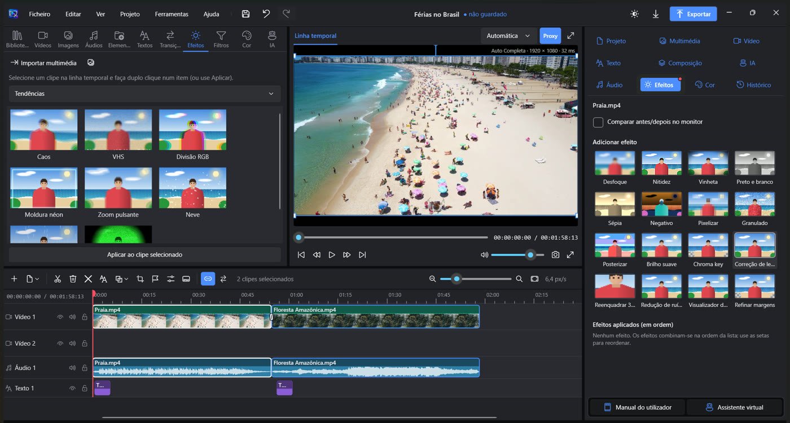

A aba **Efeitos** tem duas partes. Em cima, uma grade com uma miniatura de cada efeito, que mostra o resultado numa cena de exemplo: clique numa delas para adicionar o efeito ao clipe. Embaixo, a lista **Efeitos aplicados**, na ordem em que os efeitos são processados. Cada efeito da lista tem controles deslizantes para os ajustes, e os botões **Mover para cima**, **Mover para baixo** e **Remover efeito**. A seta à esquerda do nome mostra ou oculta os ajustes. Dê um duplo clique num controle deslizante para voltar ao valor padrão. Nos ajustes de cor, uma faixa colorida sob o controle mostra o efeito do valor (por exemplo, azul a laranja na temperatura).

Efeitos visuais disponíveis:

- **Desfoque**, **Nitidez**, **Vinheta**, **Preto e branco**, **Sépia**, **Negativo**, **Pixelizar**, **Granulado**, **Posterizar** e **Brilho suave**.
- **Chroma key**: remove um fundo verde, azul ou de outra cor escolhida. Tem tolerância, suavidade da transição, suavização das bordas, remoção do reflexo da cor e a opção de deixar o fundo transparente ou com cor sólida.
- **Refinar bordas**: contrai ou expande a borda da transparência, suaviza e limpa a cor das bordas. Use depois do chroma key ou de uma máscara.
- **Reenquadrar 360°**: transforma um vídeo 360° (equirretangular, com largura igual ao dobro da altura) numa vista comum. Ajuste a **Direção**, a **Inclinação**, o **Giro** e o **Campo de visão** e escolha a **Proporção da vista** (16:9, 9:16, 1:1, 4:3 ou 4:5). Crie keyframes nesses valores para a câmara virtual se mover pelo vídeo.
- **Correção de lente**: corrige a curvatura das linhas retas causada por lentes grande-angulares e câmaras de ação (valores negativos) ou por teleobjetivas (positivos). **Zoom para esconder as bordas** amplia a imagem para tirar os cantos vazios.
- **Redução de ruído de vídeo**: suaviza o granulado de gravações com pouca luz. **Preservar detalhes** mantém mais textura.
- **Visualizador de áudio**: barras (normais ou espelhadas) ou uma onda que dançam com o som de uma música. Ao adicionar, escolha a música da biblioteca; ela precisa estar na linha temporal. Ajuste o número de barras, a altura, a cor e a opacidade. Use num clipe de vídeo ou imagem (por exemplo, um fundo).

Nas abas **Efeitos** e **Cor**, a opção **Comparar antes/depois no monitor** mostra, à esquerda de uma linha no monitor, o vídeo sem efeitos e sem correção de cor, para o utilizador comparar. Arraste a alça da linha para a direita ou para a esquerda para mudar a divisão.

Os cartões das opções já aplicadas ao clipe ficam com a borda em destaque. Um duplo clique num cartão aplicado desaplica a opção: remove o efeito ou, numa predefinição de cor, os ajustes que ela criou (desde que o utilizador não os tenha alterado).

### Cor

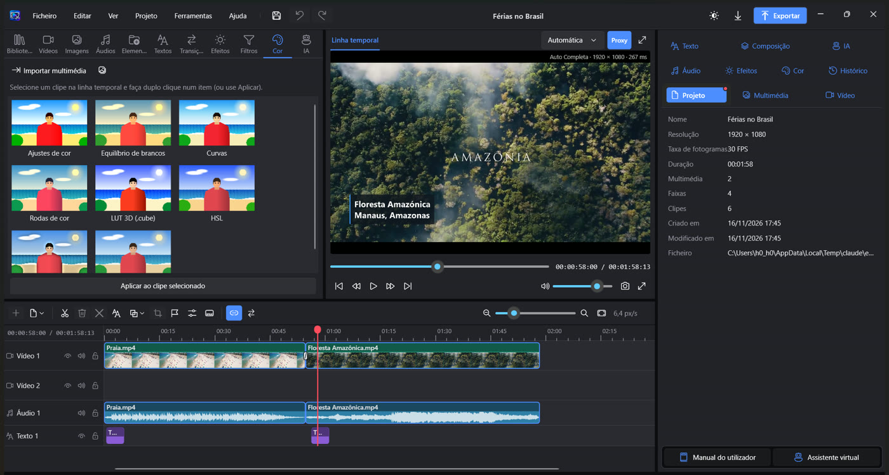

A aba **Cor** começa pelas **Predefinições**: Preto e branco, Noir, Cinema, Vívido, Quente, Frio, Desbotado, Retrô e Claro e arejado. Clique numa miniatura para aplicar o estilo ao clipe. A predefinição entra na lista de correções aplicadas como ajustes comuns, que o utilizador pode alterar ou remover; **Desfazer** (Ctrl+Z) volta tudo de uma vez.

Abaixo, em **Ferramentas de cor** (e na seção **Cor** da biblioteca), ficam as ferramentas de correção de cor:

- **Ajustes de cor**: exposição, brilho, contraste, saturação, temperatura, tonalidade (verde ou magenta), matiz, sombras e realces.
- **Balanço de branco**: indique a cor que deveria ser cinza neutro, e o programa corrige a dominante.
- **Curvas**: curvas de tons do vídeo inteiro e por canal (vermelho, verde e azul).
- **Rodas de cor**: ajuste separado das sombras, dos tons médios e dos realces.
- **LUT 3D (.cube)**: aplica uma tabela de cores no formato .cube, muito usada para dar um estilo ao vídeo. Escolha a intensidade com o controle deslizante.
- **HSL**: ajusta matiz, saturação e luminância de cada faixa de cor (vermelho, laranja, amarelo, verde, ciano, azul, roxo e magenta) sem mexer nas outras, por exemplo só o azul do céu. Cinzas, preto e branco não mudam.
- **HDR**: aspecto HDR, que recupera sombras e realces e reforça os detalhes. Tem intensidade, sombras, realces, detalhes e vivacidade.
- **Combinar cor**: iguala a cor e o contraste de um clipe aos de outro. Selecione o clipe e use **Combinar cor com o clipe anterior** na aba **IA**: o programa compara três fotogramas de cada clipe e cria o efeito, com ganho e deslocamento por canal. Ajuste a **Intensidade** para um meio-termo.

### Máscaras, rastreamento e estabilização

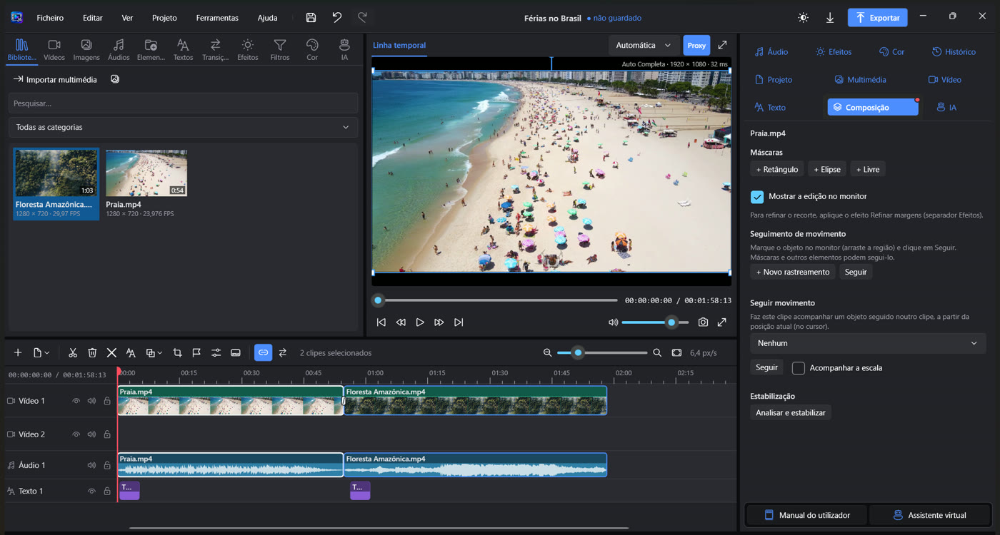

Esses recursos ficam na aba **Composição**. Eles funcionam para vídeos, imagens, textos e elementos gráficos.

- **Máscaras**: crie uma forma com **+ Retângulo**, **+ Elipse** ou **+ Livre** (pontos, com Ctrl+clique no monitor). A máscara recorta o que aparece do clipe. O utilizador pode somar, subtrair ou fazer a interseção de máscaras, inverter a máscara e suavizar o contorno.
- **Máscara de cor (só efeitos)**: marcada, a máscara não recorta o clipe; ela limita a correção de cor e os efeitos à área dela (por exemplo, clarear só o rosto ou desfocar só uma placa). A borda suavizada da máscara faz a transição.
- **Forma-chave**: com o botão **◇ Forma-chave**, a máscara muda de forma ao longo do tempo.
- **Rastreamento de movimento**: marque um objeto no monitor, clique em **Rastrear** e o programa acompanha esse objeto. Outro clipe pode então **Seguir** o movimento, com a opção **Seguir**. Use **Soltar** para desligar.
- **Estabilização**: **Analisar e estabilizar** mede o movimento da câmara e compensa os tremores. Ajuste a **Suavidade** e a **Ampliação** da imagem. Use **Remover estabilização** para desfazer.

### Elementos gráficos e formas

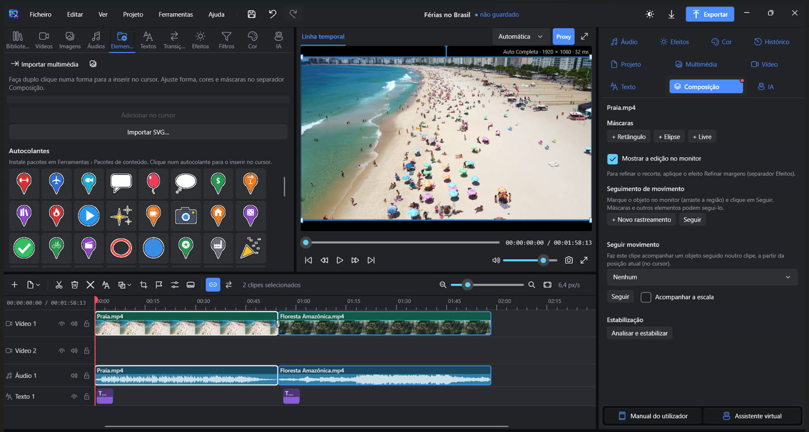

Na seção **Elementos Gráficos** da biblioteca, clique duas vezes numa forma para inseri-la no cursor. As formas disponíveis são: Retângulo, Retângulo arredondado, Círculo, Linha, Seta, Estrela, Hexágono, Balão de fala e Coração. O utilizador pode ajustar o preenchimento e a cor do contorno na aba **Composição**.

Também é possível importar um gráfico vetorial pelo botão **Importar SVG…**.

Em **Autocolantes** aparecem as autocolantes dos pacotes instalados. O programa já vem com o pacote **Básico**, com 96 autocolantes: de uso comum (setas, círculo de destaque, certo e errado, balões de fala, coração, estrela, emojis, botões Inscreva-se e Curtir, selos como Novo e Oferta, entre outras), formas geométricas (círculo, quadrado, retângulo, triângulo, losango, pentágono e hexágono), pinos de mapa com o topo quadrado, redondo, hexagonal, em losango, estrela, coração ou triângulo, e pinos de pontos de interesse da cidade (aeroporto, estações de autocarro, comboio e metro, hospital, polícia, bombeiros, escola, museu, parque, restaurante, hotel, entre outros). Ele não pode ser removido, mas pode ser exportado. Clique numa delas para inseri-la no cursor por 3 segundos, com 40% do tamanho (ajuste na aba Vídeo), numa faixa de imagem livre (ou numa faixa nova chamada Autocolantes). A imagem entra também na biblioteca, na categoria Autocolantes.

### Textos e legendas

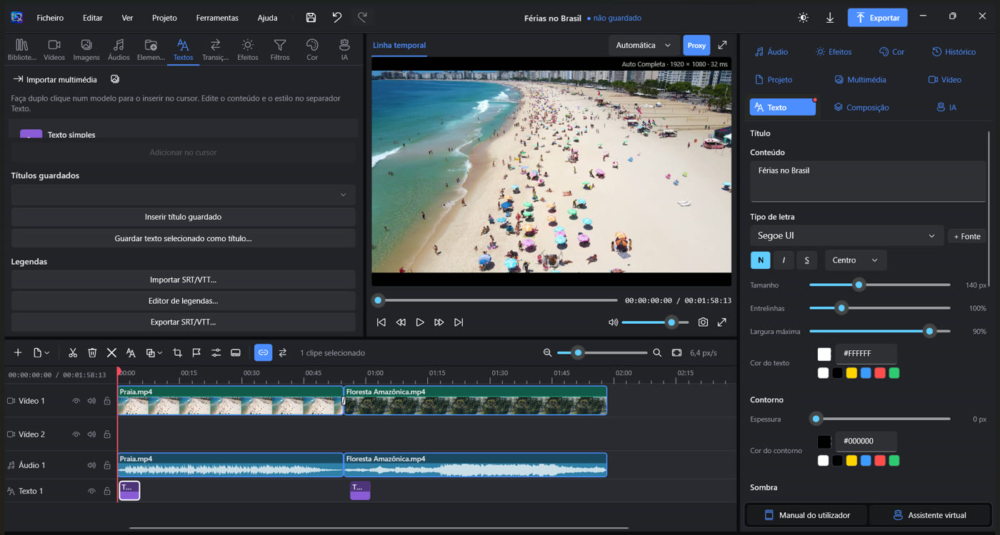

### Inserir textos

Na seção **Textos** da biblioteca, clique duas vezes num modelo para inseri-lo no cursor:

- **Texto simples**: texto em negrito com sombra suave.
- **Título**: título grande no centro, com entrada em zoom.
- **Tarja (lower third)**: nome e cargo no canto inferior esquerdo, com caixa e barra de destaque.
- **Créditos rolantes**: lista de créditos que sobe pelo ecrã durante o clipe.
- **Legenda**: legenda na faixa de legendas, com caixa escura na base do fotograma.

Selecione o texto na linha temporal para editar. A aba **Texto** das propriedades tem:

- **Conteúdo**: o texto. Pressione Enter para quebrar a linha.
- **Fonte**: fontes do Windows ou fontes adicionadas ao programa com **+ Fonte** (ficheiros .ttf ou .otf).
- **Negrito**, **Itálico** e **Sublinhado**.
- **Cores** do texto, do contorno, da caixa de fundo e da sombra. Use o formato #RRGGBB ou #AARRGGBB para definir a cor.
- **Alinhamento** e **Ponto de apoio**.
- **Animação de entrada** e **Animação de saída**: por exemplo, esmaecer, deslizar ou zoom.

A posição, a escala, a rotação e a opacidade do texto ficam na aba **Vídeo**.

Para reaproveitar um texto pronto (estilo, animações e duração), selecione-o e use **Guardar texto selecionado como título…** na seção Textos (ou no menu de contexto do clipe). Ele aparece em **Títulos guardados**; escolha-o e clique em **Inserir título guardado** para colocá-lo no cursor. Títulos de pacotes instalados aparecem na mesma lista.

### Legendas

Legendas são textos com horário, organizados na faixa de legenda. Para trabalhar com elas:

- **Ferramentas › Importar legendas (SRT/VTT)…**: traz um ficheiro de legendas pronto.
- **Ferramentas › Exportar legendas (SRT/VTT)…**: guarda as legendas do projeto como ficheiro SRT ou VTT.
- **Ferramentas › Editor de legendas**: abre uma janela para ver e editar todas as legendas. É possível adicionar, remover e editar o texto e os horários, ir para uma legenda específica e deslocar todas de uma vez, em segundos.
- **Gerar legendas**: cria legendas automaticamente a partir da fala. Veja a seção Inteligência artificial.

Ao exportar o vídeo, é possível escolher entre guardar um ficheiro de legendas ao lado do vídeo ou desenhar as legendas no próprio vídeo (legendas gravadas na imagem).

## Áudio

### Mixer de áudio

Abra o mixer em **Ferramentas › Mixer de áudio** ou pelo botão da barra de ferramentas. Ele mostra uma coluna para cada faixa de áudio, com:

- **Volume** (fader) e **panorâmica** (esquerda e direita). Clique duas vezes no fader ou na panorâmica para voltar ao padrão.
- **M** (mudo): silencia a faixa.
- **S** (solo): deixa só as faixas com solo tocando.
- Medidores de nível, que se movem durante a reprodução.

### Aba Áudio do clipe

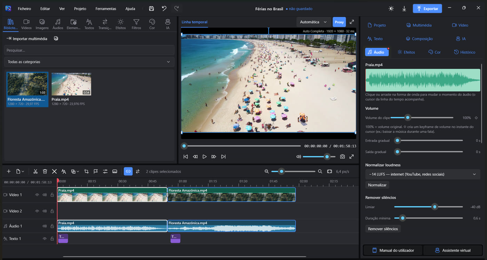

Selecione um clipe de áudio, ou um vídeo com som, e use a aba **Áudio**:

- **Forma de onda**: no topo do separador aparece o áudio do clipe, com o cursor da linha do tempo a vermelho. Clique ou arraste sobre ela para ir a outro momento do áudio; o cursor da linha do tempo e o monitor acompanham.
- **Volume**: 100% é o volume original. Com o botão ◇, o utilizador cria um keyframe de volume. Assim é possível atransferir a música durante uma fala, por exemplo.
- **Entrada gradual** e **Saída gradual**: fades de 0 a 10 segundos, para o som começar e terminar suavemente.
- **Normalizar loudness**: ajusta o volume para um alvo de loudness (padrão EBU R128), sem passar de um pico seguro. Escolha o **Alvo de loudness** antes de aplicar.
- **Remover silêncios**: corta os trechos silenciosos do clipe. Ajuste o **Limiar**, abaixo do qual o som é considerado silêncio, e a **Duração mínima** do silêncio.
- **Batidas**: com a música selecionada, **Marcar batidas** cria um marcador em cada batida e **Cortar vídeos nas batidas** divide os clipes de vídeo e imagem que tocam junto com ela em cada batida (para montagens no ritmo). Ajuste a **Sensibilidade**: mais alta encontra mais batidas.
- **Atenuar sob a fala**: com a música selecionada, clique em **Atenuar sob a fala** e o programa atransfere o volume dela nos trechos em que há fala nas outras faixas (narração, entrevista). Escolha a **Redução** (padrão −12 dB) e a **Transição** (duração da descida e da subida). O resultado são keyframes de volume, que o utilizador pode ajustar; **Remover atenuação** apaga essa animação. Com o modelo de deteção de fala instalado, a deteção é mais precisa; sem ele, o programa usa o nível do som.
- **Sincronizar pelo áudio**: se o utilizador gravou o mesmo momento com duas câmaras ou com um gravador de som, selecione os dois clipes e clique em **Sincronizar**. O programa alinha os dois sons. O clipe da faixa mais acima fica parado, e o outro é movido.
- **Manter o tom na velocidade**: quando o clipe é acelerado ou desacelerado, a voz continua com tom natural.

### Efeitos de áudio

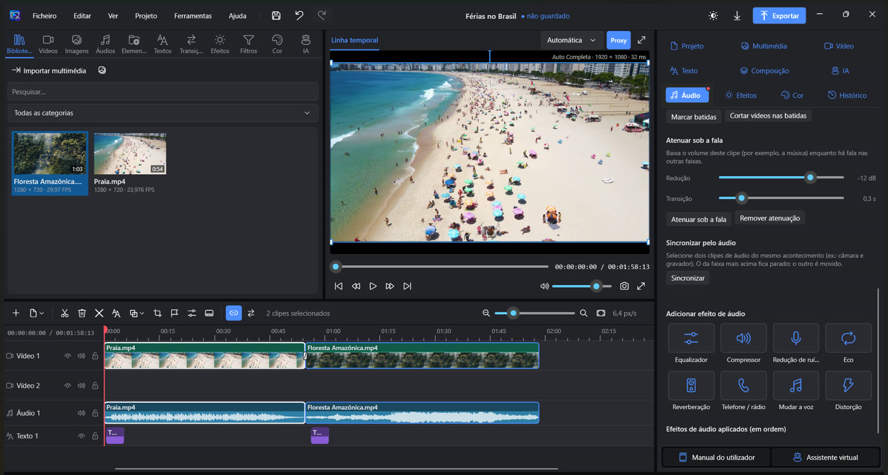

Na mesma aba, em **Adicionar efeito de áudio**, estão os efeitos:

- **Equalizador**: graves, médios e agudos, com corte de graves.
- **Compressor**: aproxima os trechos fortes dos fracos, com limiar, razão, ataque, liberação e ganho de compensação.
- **Redução de ruído**: diminui chiados e ruídos constantes, como ventilador ou ar-condicionado. Tem intensidade e sensibilidade.
- **Eco**: repetições do som com atraso.
- **Reverberação**: simula o som de uma sala.
- **Telefone / rádio**: som de telefone ou rádio antigo.
- **Distorção**: saturação do som.
- **Mudar a voz**: vozes prontas (**Grave**, **Agudo**, **Esquilo**, **Monstro** e **Robô**) ou, em **Personalizado**, o **Tom** em semitons e a intensidade do **Robô**. A velocidade não muda.

Os efeitos são aplicados na ordem em que aparecem na lista **Efeitos de áudio aplicados**.

## Inteligência artificial

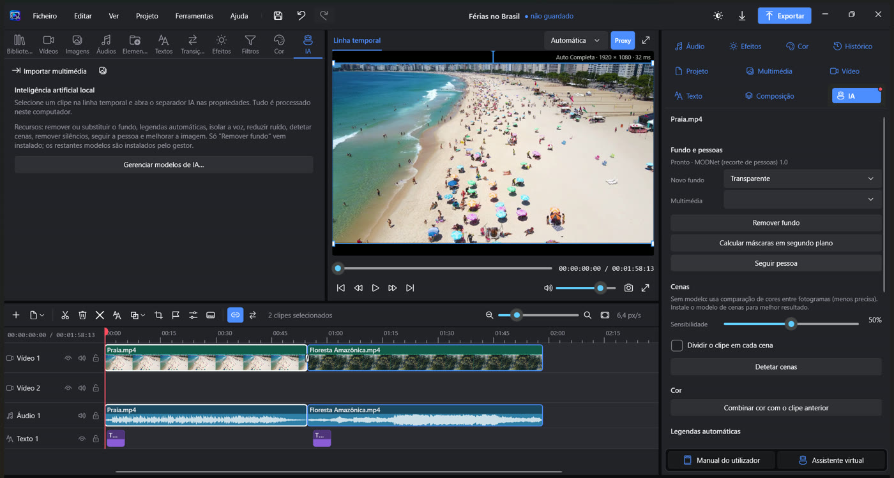

Os recursos de inteligência artificial do programa são executados somente no seu computador. Nenhum vídeo, áudio, imagem ou texto é enviado para a internet.

Os recursos ficam na aba **IA** das propriedades, quando o utilizador seleciona um clipe na linha temporal. A seção **IA** da biblioteca resume os recursos e tem o botão **Gerenciar modelos de IA…**, que abre o gerenciador de modelos.

### Modelos necessários

Cada recurso usa um modelo de IA. O modelo do **Remover fundo** já vem com o programa. Os demais precisam ser instalados, uma única vez, pela ferramenta **Transferir modelos de IA**. Quando o modelo de um recurso não está instalado, o botão fica desativado e aparece a mensagem "Indisponível — instale o modelo em Ferramentas › Modelos de IA.".

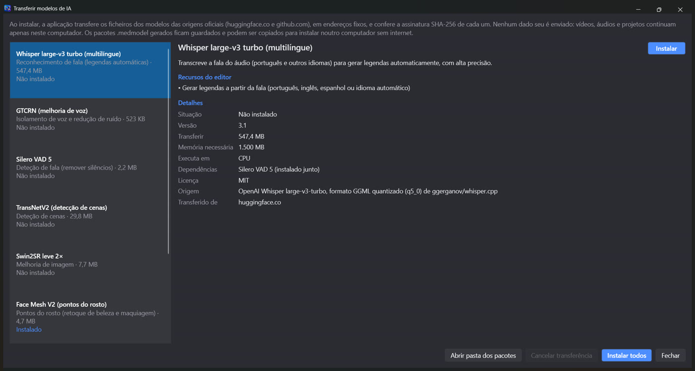

| Recurso | Modelo | Precisa instalar | Processa em |
|---|---|---|---|
| Remover fundo | MODNet | Não, já vem com o programa | CPU ou GPU |
| Calcular máscaras em segundo plano | MODNet | Não, já vem com o programa | CPU ou GPU |
| Rastrear pessoa | MODNet | Não, já vem com o programa | CPU ou GPU |
| Gerar legendas | Whisper large-v3 turbo | Sim, cerca de 550 MB | Somente CPU |
| Isolar voz | GTCRN | Sim, cerca de 0,5 MB | Somente CPU |
| Reduzir ruído com IA | GTCRN | Sim, cerca de 0,5 MB | Somente CPU |
| Remover trechos sem fala | Silero VAD 5 | Sim, cerca de 2,3 MB | Somente CPU |
| Detetar cenas | TransNetV2 | Sim, cerca de 31 MB | CPU ou GPU |
| Melhorar imagem | Swin2SR leve 2× | Sim, cerca de 8 MB | CPU ou GPU |
| Retocar (beleza e maquiagem) e desfocar rostos | Face Mesh V2 | Sim, cerca de 5 MB | Somente CPU |
| Assistente virtual (respostas em linguagem natural) | Phi-4-mini-instruct | Sim, cerca de 3,2 GB | CPU ou GPU |

A deteção de cenas funciona mesmo sem o modelo TransNetV2, comparando as imagens do vídeo. Nesse caso, a precisão é menor.

O reconhecimento de fala (legendas) usa o Silero VAD para encontrar os trechos com fala. Ao instalar o Whisper, o Silero VAD é instalado junto, automaticamente.

> Os modelos da tabela ocupam espaço no disco e também memória ao serem usados. O Whisper, por exemplo, precisa de cerca de 1,5 GB de memória livre.

### Remover fundo

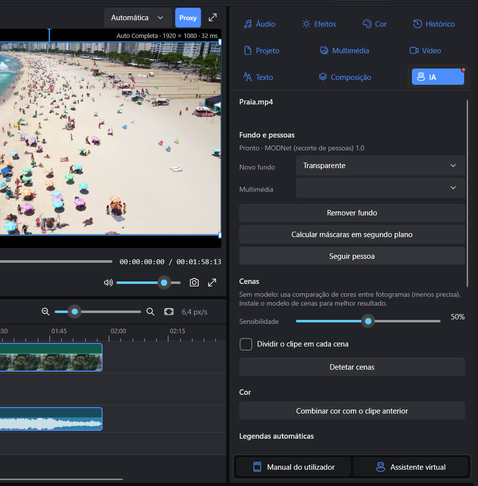

Separa a pessoa do fundo e deixa o fundo transparente, ou o substitui por outra coisa. Use na aba **IA**, com **Remover fundo com IA**.

- **Novo fundo**: escolha **Transparente**, **Cor sólida**, **Desfoque** ou **Imagem ou vídeo da biblioteca**. Neste último caso, escolha o ficheiro em **Multimédia do fundo**.
- **Manter**: deixe a pessoa (primeiro plano) ou o fundo, para remover a pessoa.
- **Ajustes**: o limiar da máscara, a contração ou expansão da borda, a suavização da borda e a suavização entre fotogramas ficam na aba **Efeitos**, em **Efeitos aplicados**. A suavização entre fotogramas reduz o tremor da borda de um fotograma para o outro.

O modelo foi treinado principalmente para retratos. Em cenas com objetos parecidos com pessoas, ele pode manter partes do fundo.

Use **Calcular máscaras em segundo plano** para processar o clipe inteiro antes. Assim a reprodução e a exportação ficam mais rápidas. O resultado fica guardado no cache.

Use **Rastrear pessoa com IA** para criar um rastreamento da pessoa. Depois, na aba **Composição**, o utilizador pode vincular textos ou elementos gráficos a ela.

### Gerar legendas

Cria legendas automaticamente a partir da fala do clipe.

1. Selecione o clipe e vá à aba **IA**.
2. Em **Idioma da fala**, escolha Português, Inglês, Espanhol ou o idioma automático.
3. Clique em **Gerar legendas com IA**.
4. As legendas aparecem na faixa de legenda. Revise-as no **Editor de legendas**.

O reconhecimento é executado no processador, e leva cerca de 4 minutos para um vídeo de 10 minutos. Acompanhe o andamento na barra de progresso da aba.

### Isolar voz e reduzir ruído

- **Isolar voz com IA**: separa a voz do ambiente. O programa cria duas faixas novas, uma com a voz e outra com o ambiente.
- **Reduzir ruído com IA**: diminui o ruído de fundo, com a **Intensidade da redução de ruído** escolhida. Útil para gravações com chiado ou zumbido.

Essas operações são feitas com o áudio do clipe, do jeito que ele soa na linha temporal. A marcação **Silenciar o áudio original** evita ouvir o som antigo junto com o novo.

### Remover trechos sem fala

Encontra os trechos sem fala e os remove do clipe. Use **Pausa mínima** para definir a duração mínima de pausa que será cortada, e depois clique em **Remover trechos sem fala com IA**. Este recurso precisa do modelo Silero VAD instalado; sem ele, o botão fica indisponível. Para cortar silêncios sem IA, use a aba **Áudio** (**Remover silêncios**).

### Detetar cenas

Procura as mudanças de cena do vídeo e cria um marcador em cada uma.

1. Selecione o clipe e vá à aba **IA**.
2. Ajuste a **Sensibilidade** das cenas. Quanto maior, mais cenas são encontradas.
3. Marque **Dividir o clipe em cada cena**, se quiser que o clipe seja cortado em cada cena.
4. Clique em **Detetar cenas**.

### Melhorar imagem

Amplia uma foto em 2× reconstruindo os detalhes. Selecione a imagem, vá à aba **IA** e clique em **Melhorar imagem com IA**. O clipe passa a usar a nova imagem. Para voltar à original, use **Desfazer**.

### Assistente virtual

Esclarece dúvidas sobre o programa e sobre edição de vídeo com base neste manual, no idioma do programa e sem internet. Abra em **Ajuda › Assistente virtual** (Shift+F1): o painel aparece à direita do editor. Escreva a pergunta e prima Enter (Shift+Enter muda de linha); sem conversa, o painel sugere algumas perguntas.

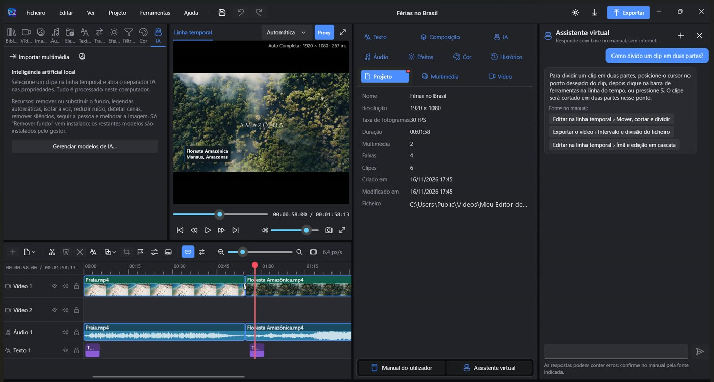

- Com o modelo de linguagem **Phi-4-mini** instalado, o assistente escreve uma resposta curta usando apenas os excertos do manual que encontrou e mostra a **Fonte no manual**: clique nela para abrir o manual nessa secção. O botão de parar interrompe a resposta.
- Sem o modelo, o assistente mostra as secções do manual que tratam do assunto, com um excerto de cada uma e o botão **Abrir no manual**. O aviso no topo do painel instala o modelo (cerca de 3,2 GB, transferidos uma única vez das origens oficiais) sem sair do editor; **Agora não** esconde o aviso.
- O modelo usa a placa gráfica quando o **Dispositivo da IA** é **GPU (DirectML)** (em **Definições › Desempenho**) ou, caso contrário, o processador. A primeira pergunta demora alguns segundos mais, porque o modelo é carregado; ao fechar o painel, ele sai da memória.
- **Nova conversa** apaga a conversa. As respostas podem conter erros: confirme na secção indicada.

### Cancelar um processamento

Enquanto um recurso de IA está a rodar, aparece uma barra de progresso. Clique em **Cancelar processamento de IA** para interromper.

## Exportar o vídeo

Exportar é gerar o ficheiro final do vídeo. Clique em **Exportar** no canto superior direito da janela, ou use **Ficheiro › Exportar…** (atalho Ctrl+E).

### Modelos de exportação

Na lista à esquerda da janela de exportação, escolha um modelo. Cada modelo já traz a configuração adequada para uma plataforma:

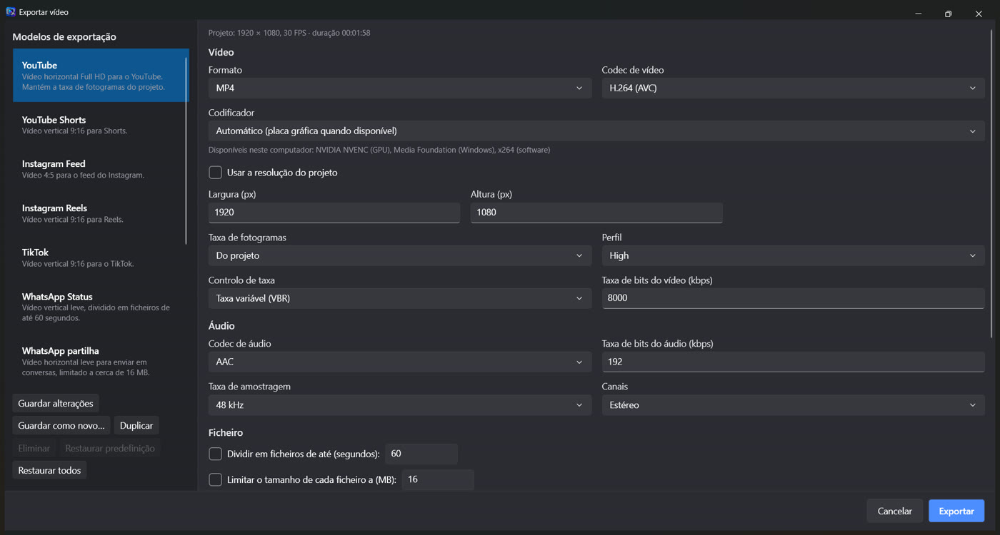

- YouTube
- YouTube Shorts
- Instagram Feed
- Instagram Reels
- TikTok
- WhatsApp Status
- WhatsApp compartilhamento
- Facebook Feed
- Facebook Reels
- Apresentações
- Computadores e notebooks
- Exportação personalizada

Ajuste os parâmetros e, se quiser, clique em **Guardar como novo…** para guardar sua configuração. Os modelos próprios aparecem com o selo "Meu modelo" e podem ser editados, duplicados ou eliminados. Os modelos padrão não podem ser apagados, mas o utilizador pode usar **Restaurar padrão** para voltar a configuração original de um modelo, ou **Restaurar todos**.

### Parâmetros

- **Formato do ficheiro**: MP4, MOV (QuickTime), MKV, WebM, AVI, MPEG-2 (.mpg) e GIF animado. Nem todo formato aceita todos os codecs. Se a combinação não for possível, a janela avisa.
- **Codificador**: **Automático (placa gráfica quando disponível)**, **Placa de vídeo** ou **Software (mais compatível)**. O modo Software é o mais seguro para ficheiros que precisam abrir em qualquer dispositivo.
- **Codec de vídeo**: H.264 (AVC), H.265 (HEVC), AV1, VP9, Apple ProRes, FFV1, QuickTime Animation, Motion JPEG, MPEG-2 ou GIF. Para a maioria dos casos, escolha H.264.
- **Perfil**: Padrão, High, Main ou Baseline do codec. Mantenha Padrão se não souber.
- **Controle de taxa**: **Taxa variável (VBR)**, **Taxa constante (CBR)** ou **Qualidade constante**. Com a qualidade constante, use valores entre 18 e 23, onde números menores significam melhor qualidade.
- **Taxa de bits do vídeo (kbps)**: quanto maior, maior a qualidade e o tamanho do ficheiro. Para a internet, use o valor sugerido pelo modelo.
- **Resolução**: marque **Usar a resolução do projeto** ou informe a largura e a altura em pixels.
- **Taxa de fotogramas**: **Do projeto**, ou uma das taxas padrão (23,976, 24, 25, 29,97, 30, 50, 59,94 e 60 FPS).
- **Codec de áudio**, **Taxa de amostragem** (44,1 kHz, 48 kHz ou 96 kHz), **Canais** (Mono, Estéreo ou 5.1) e **Taxa de bits do áudio (kbps)**.
- **Exportar transparência (canal alfa)**: mantém o fundo transparente. Use com ProRes 4444, QuickTime Animation, FFV1, VP9 ou GIF.

### Intervalo e divisão do ficheiro

- **Intervalo**: escolha **Sequência inteira** para exportar o projeto todo, ou **Intervalo personalizado** para exportar só um trecho. Defina o **Início** e o **Fim**, ou use **Início no cursor**.
- **Dividir em ficheiros**: divide a exportação em partes de até determinada duração em segundos, ou com um limite de tamanho em MB. Útil para plataformas com limite de tamanho.

### Legendas na exportação

Em **Legendas**, escolha **Nenhum**, **SubRip (.srt)** ou **WebVTT (.vtt)** para guardar um ficheiro de legendas ao lado do vídeo. Marque **Desenhar as legendas no vídeo (legendas gravadas na imagem)** para que as legendas fiquem gravadas na imagem.

### Destino e início

1. Escolha a **Pasta de destino** e o **Nome do ficheiro**.
2. Marque **Renderizar em segundo plano**, se quiser continuar editando enquanto o vídeo é gerado.
3. Clique em **Exportar** para iniciar.

### Fila de renderização

Cada exportação entra na fila de renderização. Abra a fila com o botão **Fila de renderização** ou em **Ficheiro › Fila de renderização…**. Para cada item, a fila mostra o estado, o progresso, a velocidade e o tempo restante:

- **Na fila**: a aguardar a vez.
- **Renderizando**: em andamento.
- **Concluída**: pronto. Use **Abrir ficheiro exportado** ou **Mostrar na pasta**.
- **Interrompida**: pode ser continuada com **Retomar**. Ao retomar, o programa aproveita os blocos já gerados.
- **Falhou**: a mensagem explica o motivo.
- **Cancelada**: interrompida pelo utilizador.

Use **Cancelar exportação** para parar um item, **Remover da fila** para tirá-lo da lista e **Limpar concluídas** para esvaziar os itens já prontos.

## Guardar, gravação automático e recuperação

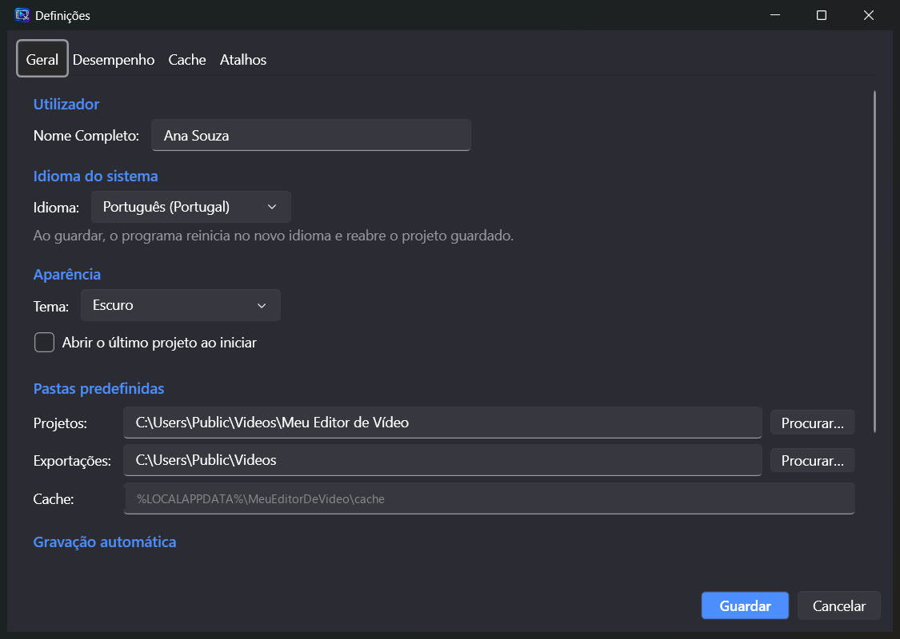

### Guardar o projeto

- **Ficheiro › Guardar** (Ctrl+S): grava as alterações no ficheiro do projeto.
- **Ficheiro › Guardar como…** (Ctrl+Shift+S): grava uma cópia do projeto com outro nome ou em outra pasta. O projeto passa a ter o nome do ficheiro, que aparece no título da janela.
- **Ficheiro › Criar cópia de segurança**: cria uma cópia de segurança do projeto no momento atual. O programa guarda até 10 cópias de cada projeto, na pasta de cópias de segurança do aplicativo.

O ficheiro do projeto tem a extensão .med. Os ficheiros das ficheiros multimédia originais não são alterados pelo programa.

### Gravação automático

Por padrão, o programa guarda uma cópia de recuperação a cada 5 minutos. O utilizador pode desligar essa opção, ou mudar o intervalo, em **Ferramentas › Definições…**, na aba **Geral**.

A cópia de recuperação não substitui o ficheiro do projeto. Ela só é oferecida quando o programa é aberto depois de um fechamento inesperado, como queda de energia ou travamento.

### Recuperar um projeto

Se o programa foi fechado sem guardar, ao abri-lo de novo aparece a pergunta "Recuperar projeto":

- **Sim**: abre o projeto com as últimas alterações.
- **Não**: abre um projeto vazio; a cópia continua guardada e é oferecida de novo na próxima vez.

> Recomenda-se guardar manualmente com Ctrl+S com frequência, mesmo com o gravação automático ligado.

## Definições e desempenho

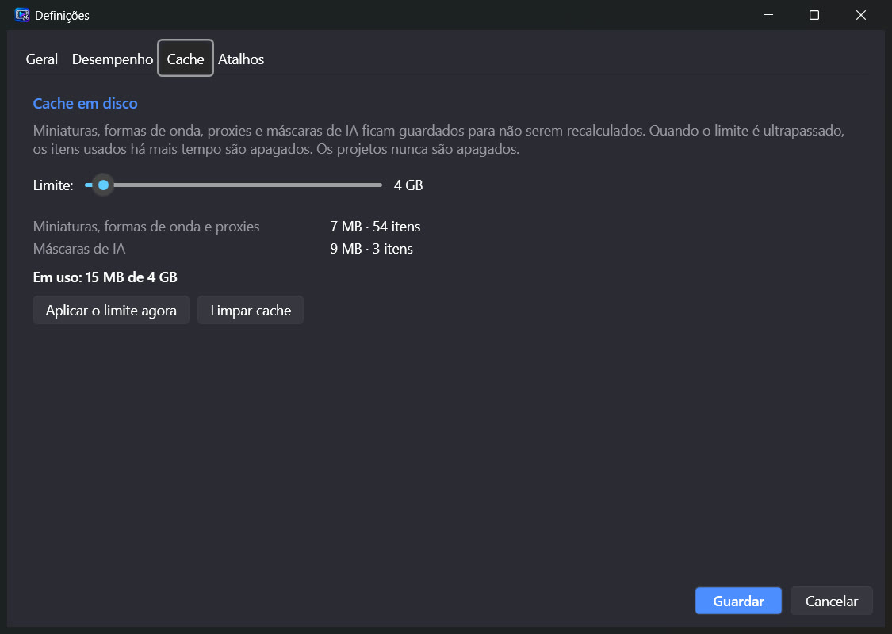

Abra as definições em **Ferramentas › Definições…** (atalho Ctrl+,). As definições são divididas em quatro abas. Nada é gravado até o utilizador clicar em **Guardar**.

### Aba Geral

- **Utilizador › Nome completo**: o seu nome.
- **Idioma do sistema › Idioma**: Alemão, Espanhol, Francês, Inglês, Português (Brasil) ou Português (Portugal). Na primeira execução, o programa usa o idioma do Windows, se for um desses, ou o inglês. Ao guardar, o programa reinicia no novo idioma: antes pergunta sobre alterações não guardadas e depois reabre o projeto, se estiver guardado. O manual também abre no idioma escolhido.
- **Tema**: **Escuro**, **Claro** ou **Igual ao Windows**. O utilizador também pode alternar pelo botão **Tema** na barra superior.
- **Verificar por atualizações › Verificar mensalmente**: **Sim** (padrão) ou **Não**. A data da última verificação aparece ao lado. Com **Sim**, ao abrir o programa ele verifica sozinho se há versão nova quando já passaram mais de 30 dias da última verificação. A consulta envia só o idioma da interface e o sistema operativo; sem internet, nada aparece.
- **Abrir o último projeto ao iniciar**.
- **Pastas padrão**: a pasta dos projetos e a pasta das exportações.
- **Gravação automático**: ligar ou desligar a cópia de recuperação e definir o intervalo.

O nome, o idioma, o tema e a preferência de atualizações ficam no Registo do Windows, em `HKEY_CURRENT_USER\Software\Meu Editor de Vídeo`.

### Aba Desempenho

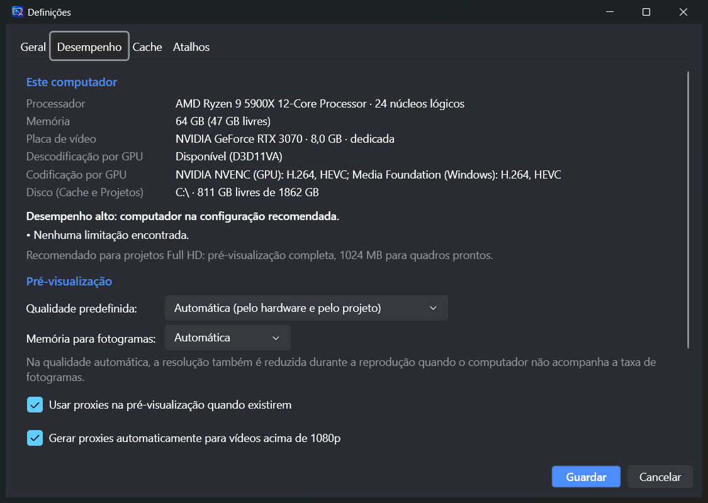

- **Hardware detetado**: mostra o processador, a memória, as placas gráficas, os discos e se a placa gráfica pode decodificar e codificar vídeo. O programa também indica as limitações do computador e uma recomendação de uso.
- **Pré-visualização**: a **Qualidade padrão da pré-visualização** pode ser **Automática**, **Completa**, **1/2 da resolução** ou **1/4 da resolução**. Na opção Automática, o programa escolhe conforme o computador e o projeto, e reduz a resolução durante a reprodução se o computador não acompanhar. A **Memória para fotogramas da pré-visualização** define quanto espaço usar para guardar fotogramas prontos.
- **Proxies**: **Usar proxies na pré-visualização quando existirem** e **Gerar proxies automaticamente para vídeos acima de 1080p**.
- **Aceleração**: **Usar a placa gráfica para decodificar e codificar vídeo** e **Renderizar a fila de exportação em segundo plano**.
- **Inteligência artificial**: o **Dispositivo da IA** pode ser **GPU (DirectML), com recuo para a CPU**, ou **Somente CPU**. Com a opção de GPU, se a placa ou o driver falhar, o modelo é carregado no processador automaticamente. O botão **Gerenciar modelos…** abre a janela de modelos de IA.

### Aba Cache

O cache guarda miniaturas, formas de onda, proxies e máscaras de IA, para que não precisem ser recalculados. Nesta aba o utilizador vê quanto espaço cada área usa, define o **Limite do cache** em GB (padrão de 4 GB), e pode usar **Aplicar o limite agora** ou **Limpar cache**.

Quando o limite é ultrapassado, os itens usados há mais tempo são apagados. Os projetos e as ficheiros multimédia originais nunca são apagados pela limpeza do cache.

### Aba Atalhos

Esta aba mostra todas as ações do programa, agrupadas por categoria. Para trocar um atalho:

1. Clique no campo do atalho.
2. Pressione a nova combinação de teclas.
3. Clique em **Guardar**.

Se a combinação já estiver em uso por outra ação, o programa avisa e não deixa guardar. Use **Padrão** numa ação para voltar ao atalho original, ou **Restaurar todos os padrões** para desfazer todas as mudanças. Os menus sempre mostram o atalho em uso.

## Atalhos de teclado

Estes são os atalhos padrão. O utilizador pode mudar qualquer um deles em **Ferramentas › Definições… › Atalhos**.

No macOS, use a tecla **Cmd (⌘)** em vez de **Ctrl** em todos os atalhos (por exemplo, Cmd+S para guardar) e a tecla **Option (⌥)** em vez de **Alt**. Em teclados de Mac, as teclas F1, F10 e F11 podem exigir a tecla **fn**.

| Ação | Atalho |
|---|---|
| Novo projeto | Ctrl+N |
| Abrir projeto | Ctrl+O |
| Guardar | Ctrl+S |
| Guardar como | Ctrl+Shift+S |
| Importar multimédia | Ctrl+I |
| Exportar | Ctrl+E |
| Desfazer | Ctrl+Z |
| Refazer | Ctrl+Y ou Ctrl+Shift+Z |
| Definições | Ctrl+, |
| Manual do utilizador | F1 |
| Assistente virtual | Shift+F1 |
| Reproduzir / pausar | Espaço |
| Ecrã inteiro | F11 (Esc ou F11 para sair) |
| Fotograma anterior | ← |
| Próximo fotograma | → |
| Voltar 1 segundo | Shift+← |
| Avançar 1 segundo | Shift+→ |
| Ir para o início | Home |
| Ir para o fim | End |
| Corte anterior | ↑ |
| Próximo corte | ↓ |
| Dividir clipe no cursor | S ou Ctrl+K |
| Eliminar | Delete ou Backspace |
| Eliminar e fechar o espaço | Shift+Delete |
| Copiar | Ctrl+C |
| Recortar | Ctrl+X |
| Colar | Ctrl+V |
| Duplicar | Ctrl+D |
| Selecionar tudo | Ctrl+A |
| Agrupar | Ctrl+G |
| Desagrupar | Ctrl+Shift+G |
| Adicionar marcador | M |
| Ligar/desligar ímã | N |
| Aproximar a linha temporal | Ctrl++ (tecla mais) |
| Afastar a linha temporal | Ctrl+- (tecla de menos) |
| Ajustar à janela | Shift+Z |
| Multicâmara: câmara 1 a 4 | Alt+1 a Alt+4 |

## Privacidade

O Meu Editor de Vídeo foi feito para funcionar no seu computador:

- Seus vídeos, fotos, áudios, textos e projetos são processados somente no seu computador.
- Os recursos de inteligência artificial também são executados no seu computador. Nenhum conteúdo é enviado para a internet.
- O programa não coleta dados de uso e não envia telemetria.
- O programa não se atualiza sozinho: apenas verifica se há uma versão nova, e o utilizador decide se a instala.

Existem duas exceções. Em **Ajuda › Verificar atualizações** (e a cada 30 dias, se a opção estiver ligada), o programa consulta o seu site enviando apenas o idioma da interface e o sistema operativo. Quando o utilizador clica em **Instalar** na ferramenta **Transferir modelos de IA**, o programa transfere os ficheiros dos modelos de IA dos sites oficiais dos seus autores, que são os endereços huggingface.co e github.com. Só os modelos escolhidos são transferidos, e nenhum dado do seu projeto é enviado. Depois de instalados, os modelos funcionam sem internet. O utilizador também pode instalar pacotes de modelo já transferidos, com **Instalar pacote…**, sem usar a internet.

Para ver as licenças e os componentes de terceiros usados, abra **Ajuda › Sobre o Meu Editor de Vídeo**. O texto completo das licenças fica em **Ajuda › Licenças de terceiros**.

## Solução de problemas

### O recurso de IA está "Indisponível"

O modelo do recurso ainda não foi instalado. Vá em **Ferramentas › Modelos de IA…**, clique em **Transferir modelos…**, escolha os modelos e clique em **Instalar**. A ferramenta instala primeiro as dependências, se houver. Para o recurso Remover fundo, nenhuma instalação é necessária.

### A instalação de um modelo foi interrompida

Abra **Transferir modelos…** de novo e clique em **Instalar**. O transferência continua de onde parou. Se o ficheiro transferido estiver incompleto ou alterado, ele é descartado e transferido outra vez.

### A pré-visualização está a travar ou lenta

- No alto do monitor, em **Resolução da pré-visualização**, escolha **1/2** ou **1/4**.
- Ative o uso de proxies, criando proxies dos vídeos grandes com **Gerar proxy de edição (540p)**.
- Feche outros programas pesados enquanto edita.
- Em **Definições › Desempenho**, confira se a aceleração por placa gráfica está ligada.

A exportação sempre usa a resolução original, por isso um vídeo pode travar na pré-visualização e ainda assim ser exportado corretamente.

### Uma multimédia aparece como ausente

O ficheiro foi movido, renomeado ou apagado. Use **Projeto › Localizar ficheiros multimédia ausentes…** para indicar o novo caminho. Para evitar isso, use **Empacotar ficheiros multimédia no projeto** antes de mover o projeto.

### "Formato de ficheiro não suportado"

O programa não lê esse formato. Converta o ficheiro para um formato comum, como MP4 (vídeo) ou MP3 e WAV (áudio), com outro programa de conversão, e importe de novo.

### A exportação falhou

- Leia a mensagem na fila de renderização. Ela indica o motivo.
- Se aparecer a mensagem de codec incompatível com o formato, escolha outro codec ou outro formato.
- Se o erro envolver a placa gráfica, escolha o codificador **Software (mais compatível)** e exporte de novo.
- Se o ficheiro não abrir em outros dispositivos, use o modelo **Computadores e notebooks** ou o formato MP4 com H.264.

### Perdi alterações depois de um travamento

Ao abrir o programa, responda **Sim** à pergunta "Recuperar projeto". Se ela não aparecer, procure a cópia de segurança do projeto, que fica na pasta de cópias de segurança do aplicativo, dentro de `%LOCALAPPDATA%\MeuEditorDeVideo\backups`.

### O programa não abre ou apresenta erros

Os registos de funcionamento (logs) ficam na pasta `%LOCALAPPDATA%\MeuEditorDeVideo\logs`. Para abri-la, use **Ajuda › Abrir pasta de logs** (ou pressione Windows + R, cole esse caminho e pressione Enter). Ao pedir ajuda, envie o ficheiro de registo mais recente junto com o texto de **Ajuda › Informações do sistema…**. Os registos não contêm o conteúdo dos seus vídeos. No Linux, a pasta é `~/.local/share/MeuEditorDeVideo/logs`; no macOS, `~/Library/Application Support/MeuEditorDeVideo/logs`.

### No Linux, a gravação do ecrã não funciona

No Linux com Wayland (o padrão no Ubuntu e no Debian com GNOME), o sistema não permite que outros programas capturem o ecrã: a gravação do ecrã fica indisponível (com um aviso) e o F10 só funciona com o programa em primeiro plano. A câmara e o microfone continuam a funcionar. Para gravar o ecrã, termine a sessão e, no ecrã de entrada, escolha a sessão **Xorg** (por exemplo, "Ubuntu em Xorg"). No macOS, se a gravação ficar preta ou o F10 não responder, verifique as permissões de **Gravação de ecrã** e **Acessibilidade** em **Definições do Sistema › Privacidade e Segurança**.

### Dúvidas sobre a versão instalada

Abra **Ajuda › Sobre o Meu Editor de Vídeo** para ver a versão do programa, a licença, as informações de privacidade e a lista de componentes e modelos de IA usados. Na mesma janela, **Visite o nosso website** abre o site do Meu Editor de Vídeo no seu idioma e **GitHub** abre o código-fonte. Para falar com o suporte, use **Ajuda › Suporte Técnico**.
